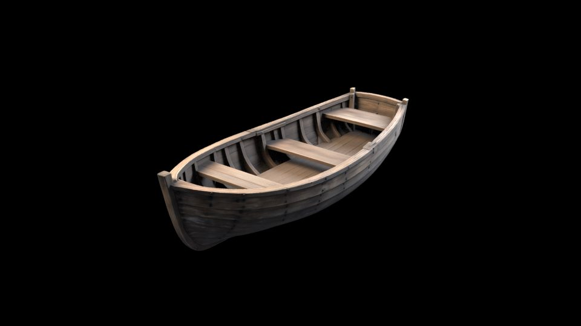
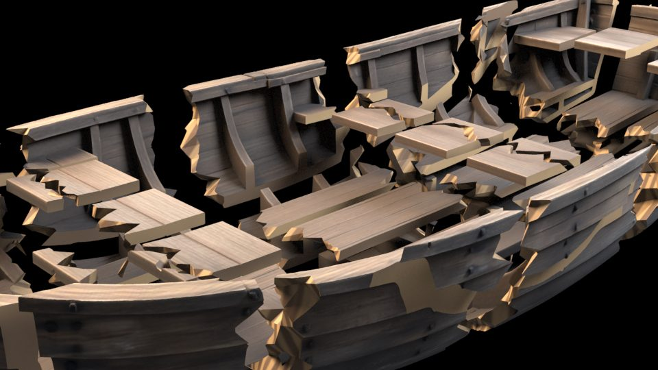
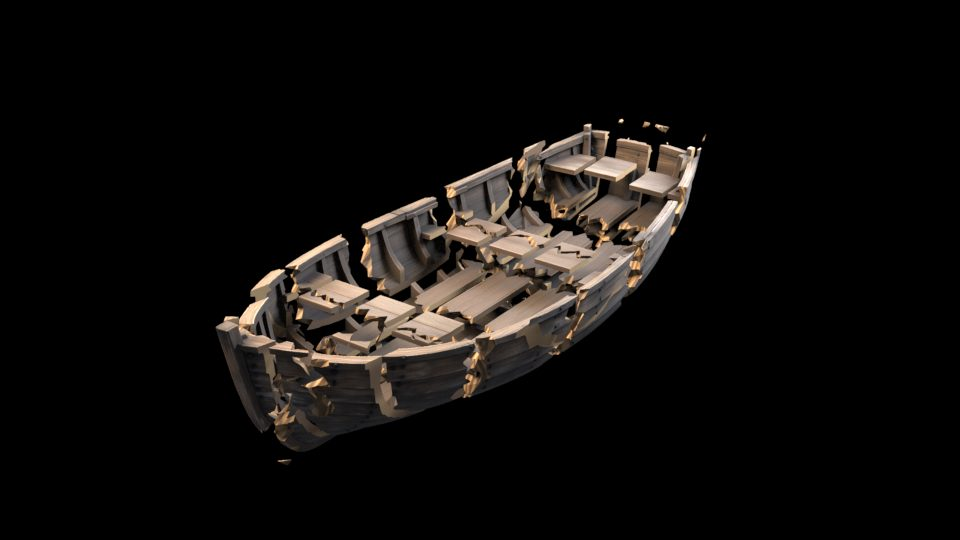

# Native wood geometry and detail stills passed; localized FLIP blast remains in validation

The active candidate starts from the actual intact Rodin model with 500000 source triangles. Houdini native wood fracture produced 71 closed positive-volume pieces, 171 adjacency bonds and 655084 render triangles; a portable cold rebuild and native cache-reader save/reopen passed. Three actual Mantra stills inspect the intact source, native cuts and art-directed exploded geometry. Full-boat calm-water stability, the localized upward/outward FLIP blast, free flotation and the final film remain unaccepted. Dynamics currently validates 43 compound actors; 71 static pieces do not imply 71 independent fluid actors. The case remains outside the selected collection.

[Native geometry package](fractured-rest.zip) · [Native geometry acceptance](native-geometry-summary.json) · [Static geometry replay](replay/natural-geometry/USAGE.md) · [Native media parameters and hashes](native-media-summary.json) · [Intact native still](intact-native.jpg) · [Native cut detail](wood-cut-detail.jpg) · [71-piece art-directed inspection](wood-fracture-exploded.jpg) · [Reference](boat-reference.jpg) · [Intact source and textures](source-intact.zip) · [Intact source inventory](source-intact-manifest.json) · [Intact source and terms](SOURCE-INTACT.md) · [New native-fracture plan](natural-fracture-brief.json) · [Reference metadata and review scope](production-references.json) · [Assembled native still](split-assembled.jpg) · [Source-parts inspection](parts-exploded.jpg) · [Inspection parameters](parts-preview.json) · [Color pipeline](color-pipeline-summary.json) · [Initial water state](initial-water-state.jpg) · [Split model and textures](source-model.zip) · [Source and terms](SOURCE.md) · [Model inventory](model-manifest.json) · [Generation prompt](imagegen-prompt.json) · [Reproduction and acceptance](reproduction-brief.md) · [Acceptance requirements](acceptance-requirements.json) · [Sanitized probes](probe-summary.json) · [Portable geometry acceptance](portable-acceptance-summary.json) · [Material repair acceptance](material-repair-summary.json) · [Short rebuild acceptance](rebuild-summary.json) · [Reopened frame-1 render comparison](render-rebuild-summary.json) · [Feedback-disabled control](feedback-control-summary.json) · [Browser QA status](browser-qa-summary.json) · [Unselected case draft](collection-case.draft.json) · [English presentation draft](localization-en.draft.json) · [Validation](validation.json) · [Manifest](manifest.json)

## Active native wood-fracture direction

The [intact source archive](source-intact.zip) preserves the original Rodin OBJ payload and five texture maps. Its relative diffuse MTL and explicit PBR sidecar provide portable links; the additional packed map and normal convention remain unverified. Parsed source measurements are 249960 position records, 262894 UV coordinates, 390147 normals and 500000 triangle faces; all face-corner indices are valid and numeric coordinates finite. [The intact source inventory](source-intact-manifest.json) binds those counts and archive checks to the actual bytes. The [static geometry acceptance](native-geometry-summary.json) now records the cold native source-to-fracture rebuild, exact restored P/topology/UV/N/names, all 71 closed positive-volume pieces and cache-reader save/reopen. Its 768 exterior-vertex source-correspondence samples are a sampled check, not a claim about every exterior corner. The [portable native rest package](fractured-rest.zip) contains three sanitized Bgeo caches, not a public HIP or a coupled simulation.

The native workflow uses Houdini RBD Material Fracture wood mode, adjacency constraints, Bullet and real FLIP coupling. Static cuts, grain direction, closed volumes, density 400 kg/m³ and per-piece mass/centre-of-mass checks are measured in the geometry record; those values do not qualify coupled dynamics. Constraint and force views with units, collision-guide imagery, an actual impact front and post-impact free-flotation evidence remain required. A weak calm-water pilot failed, and corrective grid/coupling controls are under test for 43 compound actors. An elevated camera should contain both the upward/outward plume and actual hull break front without hiding the critical failure region behind a liquid curtain. [The detailed brief](natural-fracture-brief.json) separates completed static checks from pending dynamics. Existing Bang global-load-release diagnostics and earlier render batches are stopped, unaccepted comparison material. They are not the new natural water-blast result.

## Actual native wood inspection

The intact view uses the original 500000-triangle source. The cut close-up and full exploded view use the accepted 71-piece, 655084-triangle native rest geometry. Houdini `explodedview::2.0`, piece attribute `name`, scale 0.35 separates pieces for inspection. It is art-directed spacing, not a simulated blast, constraint-break frame or flotation result.

Exterior Principled materials use the actual diffuse map as sRGB and separate roughness/metallic maps as raw data. The fresh-cut group has 91465 triangles and a separate native per-shading-sample procedural material using untransformed rest coordinates and normals. Its directional fibers and ring bands are art direction, not species/pore/end-grain certification. No geometry displacement is applied; all P/UV/N/names match exactly from accepted rest cache to material staging before separation, and original physical cache bytes are unchanged. The normal-map convention and packed PBR channels remain unverified and unused.

All three views completed in native Mantra at 960 × 540 with 4 × 4 pixel samples, ray samples 1–9 and zero warnings. [native-media-summary.json](native-media-summary.json) records actual cameras, render times, source PNG/EXR hashes and material limits. Their EXRs were already converted from verified `lin_rec709` to sRGB by FFmpeg 8.1.1. This integration only encodes those existing RGB PNG pixels as full-frame q82 JPEG with embedded sRGB ICC: no second color transfer, crop, resize, retouch or denoising. The separate tutorial-reader VX test used a different FFmpeg version and is not the boat media source.

## Water-blast reference and review scope

The target is a localized liquid blast beneath the hull, followed by actual wood failure, falling debris and measured post-impact flotation. [DanCortesVfx’s water-explosion tutorial](https://www.youtube.com/watch?v=w3yHqQQ1ODQ) is the user’s main reference; only its author/title and indexed description of primary FLIP plus whitewater were checked. The related [Diyz3n H20 reference](https://www.youtube.com/watch?v=o2E8LtnitvY) has reported velocity-import and explosion-look chapter metadata; direct fetch was unavailable. Neither video was played or listened to for this record, and no private user screenshot is published.

The user’s [Bilibili P12 Bullet setup reference](https://www.bilibili.com/video/BV1Vr4y1i7Qr/?p=12) was checked through actual metadata and five private frame samples at 180, 600, 1200, 1800 and 2250 seconds. The sampled interface shows Houdini 18.0.287; selected burned-in caption lines were read visually. Caption tracks were unavailable, and there was no full-video or audio review. The recorded Bilibili uploader is not an assertion of original authorship. No third-party footage is published, and metal-ship parameters are not transferred directly to this wooden boat.

The public [SideFX Large Scale Fluids overview](https://www.sidefx.com/tutorials/houdini-essentials-large-scale-fluids/) informs the separation of collision, caching, secondary detail and meshing; its full paid course was not acquired or watched. Current official [native fracture](https://www.sidefx.com/docs/houdini/nodes/sop/rbdmaterialfracture.html), [whitewater source](https://www.sidefx.com/docs/houdini/nodes/sop/whitewatersource.html) and [whitewater solver](https://www.sidefx.com/docs/houdini/nodes/sop/whitewatersolver.html) documentation supports the proposed workflow. Foam, spray and bubbles are a deferred secondary pass from actual cached liquid fields after the primary native result passes; they do not establish boat breakage or flotation. [The reference record](production-references.json) keeps access and review limits explicit.

## Historical generated-source comparison

The reference is 1254 × 1254 pixels. Rodin generated the intact model using seed 4172, Gen-2.5-Medium, Raw triangle mesh, OBJ and PBR materials. Native import measured 500000 triangles. Bang then split that output using strength 7 and a target of 150000 faces. Native inspection measured 17 parts, 150000 triangles and vertex UVs. Generation settings and archive-member hashes are in the [model inventory](model-manifest.json). The split model is an assembled source for a destruction solve; its separate parts are not evidence that water broke the boat.

The [portable archive](source-model.zip) retains the split OBJ, five provider texture maps, relative material bindings and source notes. Its physical source units are unspecified. The native assembled preview used an explicit scale and placement, with measured metre bounds in [validation.json](validation.json). No watertightness or engineering hull certification is claimed.

## Source-parts inspection

This separate native Mantra view inspects the 17 named source parts and their 150000 triangles, with UVs preserved. Houdini's `explodedview::2.0` uses piece attribute `name` and separation scale 1.0. Its controlled camera, render settings and measured expanded bounds are in [parts-preview.json](parts-preview.json). The spacing is art-directed source inspection; it is not a water-impact frame or evidence that the fragments float. The large central hull body and the peripheral source pieces remain distinguishable.

The three historical comparison JPEGs are full-frame quality-82 derivatives of the retained EXRs. Each source header was checked for `oiio:ColorSpace=lin_rec709`; FFmpeg 8.1.1 converts linear Rec.709 RGB to sRGB using the recorded zscale filter before RGB24 JPEG encoding. No crop, resize or retouch is applied. The imagegen reference JPEG is unchanged. [The color record](color-pipeline-summary.json) also separates the tested BT.709 video pipeline from final film acceptance.

## Passed native checks and retained failures

| Stage | Observed result |
| --- | --- |
| Native static wood geometry | 71 closed positive-volume pieces, 171 bonds, 655084 render triangles and 327616 points; portable cold typed rebuild and cache-reader save/reopen passed. P/topology/UV/N/names match the original accepted native rest caches. This is geometry acceptance, not fluid-actor or blast acceptance. |
| Native static media | Three actual Mantra views completed with zero warnings. Intact source, cut close-up and scale 0.35 exploded inspection have exact source PNG/EXR hashes and full-frame sRGB JPEG derivatives. No dynamics claim. |
| Portable geometry | Independent headless import measured 17 parts, 75003 points, 150000 triangles and 450000 primitive corners. HIP save/reopen retained ordered position, UV and normal fingerprints. Bgeo export/reimport retained topology, part paths and values at every corresponding primitive corner, with zero measured position, UV and normal difference. These checks cover the split source, not a completed simulation. |
| Original material failure | The earlier importer created a material and assignment but left the diffuse texture disabled and empty, including after HIP reopening. The failure is preserved in the portable acceptance summary; it is not replaced by a later pass. |
| Material repair | [PR #361](https://github.com/dcc-mcp/dcc-mcp-houdini/pull/361), source `73e9db1e4dc85da16d33ab385cfa2f52e08b49f3`, passed 224 targeted tests and native typed import/readback, HIP save/reopen and required-missing-texture checks. Native diffuse binding is enabled and resolves to an existing file; observed scalar roughness is 0.408248290463863, metallic 0 and opacity 1. A missing required texture reports `partial`. This does not accept all PBR maps or rendered equivalence. The native summary was recorded before the candidate was committed. |
| Constraint repair | [PR #360](https://github.com/dcc-mcp/dcc-mcp-houdini/pull/360), source `c89e52559f9e26867cc12d7676f7c482d63c100b`, passed native glue, Bullet soft and cone relationship checks, including reuse and rejection of a SOP parent. Exact-head CI passed; licensed Docker E2E was skipped. The tool still reports a graph skeleton. |
| Cube feedback calibration | With feedback enabled, the independent cube centre was about 0.34263 m at frame 24 and 0.33263 m at frame 48. The corrected feedback-disabled control reached about -4.54902 m at frame 24. This calibration does not establish released-boat-fragment flotation. |
| Independent short rebuild | A blank native scene on source `73e9db1e4dc85da16d33ab385cfa2f52e08b49f3` passed 12 dry-run/applied recipe stages containing 51 explicitly authored nodes, excluding native HDA internals and automatically created defaults. The 17-part source, 4000-triangle simulation proxy and 150000-triangle visual restoration passed, with zero measured rest-position error. At frames 1 and 2, piece positions and their names/paths/UVs/normals matched production exactly; water particle counts were 104506 and 205344, with zero position difference. Native HIP reopening passed. The full 96-frame independent solve was not run. |
| Reopened first-frame render | The independent replay's reopened scene rendered frame 1 at 960 × 540 through Mantra. Fully decoded RGB float pixels match production exactly; their SHA-256 is in the comparison summary. EXR metadata/container hashes differ and are not used as a pixel verdict. This accepts the controlled first frame only. |
| First boat diagnostic | Across 26 cached frames, all 17 parts remained attached and zero parts were released. That run failed its fracture target and remains a separate historical result. |
| Feedback-disabled short control | The later candidate's same proxy, walls and high-resolution restoration setup was run for 4 frames with feedback scale 0. All 17 parts remained attached, with zero native feedback records, nonzero hydrodynamic loads or releases. Zero-load diagnostic records are retained. This is a short causal control, not a full-duration control or flotation test. |
| Earlier Bang production diagnostic | The 17-part global-load-release diagnostic and native render batches remain comparison material. They are not the new intact-source native wood-fracture workflow or an accepted final film. The new static native geometry is accepted separately; spatial blast loads, coupled break events and flotation remain pending. |
| Browser QA | The official `dcc-cua` 1.12.2 owned-browser launch returned `browser_refused` from an elevated runtime before any browser PID/HWND was obtained. No UI observation or input occurred. Bilingual page and playback acceptance remain blocked. |

## Reproduction

Extract [source-model.zip](source-model.zip), preserve its relative directory structure, and import `boat.obj` without merging named objects or dropping vertex UVs. [SOURCE.md](SOURCE.md) records the material-boundary fix, scalar conversion and maps that still need explicit destination shader setup. The independent geometry checks apply to this archive and its recorded hash. The historical acceptance HIP and Bgeo stay private. The separate sanitized [native rest package](fractured-rest.zip) is cleared as static geometry with its own [cold-rebuild instructions](replay/natural-geometry/USAGE.md); it contains no HIP or coupled simulation cache.

The `replay/` directory contains the historical Bang comparison reconstruction used for the passing blank-scene, two-frame acceptance and reopened first-frame pixel comparison. Follow the [reproduction brief](reproduction-brief.md) and [acceptance requirements](acceptance-requirements.json); the complete recorded solve and its terminal metrics still need comparison. Reopening source geometry and matching initial physics frames do not accept a final boat simulation, and Bgeo conservation does not establish cross-application material parity.

The new film targets consecutive native frames on a24fps solver timeline; actual cache fps, frame count and duration remain unverified. Native linear Rec.709 EXRs use the recorded sRGB still and BT.709 limited-range YUV420 video pipeline. No denoising, filmic transform or ACES grade is adopted. Earlier gamma-2.2 debugging previews, the 12 fps pilot and the old Bang film plan are not the new final media.

## Boundaries

The intact source, 71-piece native static wood geometry, portable cold rebuild/cache-reader reopening, three new native inspection stills, and earlier independently scoped source round trips/importer fix/cube calibration/two-frame rebuild are the accepted scopes in this snapshot. Final boat fracture, later fragment flotation, a complete simulation cache, a reopened final simulation, full-sequence independent rebuild, continuous final film, motion/audio review, bilingual browser playback and public deployment are unaccepted. Provider terms continue to govern generated artwork and assets; the repository software license supplies no additional artwork, training or evaluation-data permission. Image-generator model identity remains unknown.
