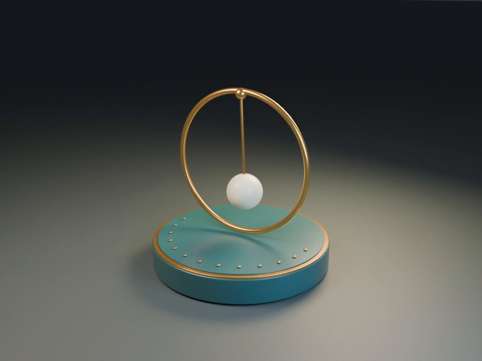

# Brass Pendulum: refined native animation and guided spatial denoising

An original, editable Blender scene is the source of this **960 × 720, 96-sample** animation. The film contains **144 frames at 24000/1001 fps**, lasting **6.006 seconds**, with no audio track. Genuine DCC-MCP edits refine the geometry and framing; a separate, installed native denoising process uses the render's real Albedo and Normal guides. This is a higher-resolution production candidate. The user approved this current film for publication via voice; current-head web playback remains a separate pending gate.

[New spatial-OIDN film](pendulum-oidn.mp4) · [Editable native project](scene-public.blend) · [Native inspection](native-inspection.json) · [Processing evidence](processing-validation.json) · [Frame/timebase evidence](temporal-integrity-summary.json) · [Visual review and its limits](visual-review.json) · [Validation](validation.json) · [Actual software versions and exercised capabilities](software-capability-coverage.json) · [Playback reference contract](playback-reference.json) · [File manifest](manifest.json) · [Rights](LICENSES.md)

## Native form and composition

A brass hoop surrounds an authored porcelain pendulum above a deep-teal plinth. The swing amplitudes diminish through keyframes; this is authored motion, not a physical simulation. The refined camera moves from **42 mm to 44 mm**, keeping the complete plinth and hoop within frame. The recorded all-144-frame projected-boundary audit finds a minimum **4.73% image-edge margin**. The hoop's native control points increase from **96 to 384**, and its bevel resolution from **3 to 6**; the rod's bevel resolution is also 6. These are native geometry changes, not an image-based imitation of geometry.

The scene contains **26 objects**, with no linked libraries, external image dependencies or embedded text scripts in the inspected public copy. It was saved and reopened before production rendering. The new path-cleaned public copy was independently saved and reopened. Its recorded equivalence scope is the inspected render settings and projected bounds across all 144 frames; this does not establish byte identity, complete semantic equivalence or pixel-identical rerendering.

The production environment is **Blender 4.5.13 LTS**, **Cycles CPU** and **DCC-MCP Core 0.20.44**. The actual local adapter source was frozen for the recorded run. This entry does not imply that every local adapter change is available in a newly released package. The [recorded recipe](scene-recipe.json) and native evidence describe the operations and their verification scope.

## Scene-linear processing, with actual guides

The renderer uses **96 samples**, fixed seed **42**, no adaptive sampling, no animated seed and no in-render denoising. Native flat multilayer PIZ EXR retains scene-linear **Combined and Denoising Albedo as HALF16**, and **Denoising Normal as FLOAT32**, with an additional FLOAT32 Depth pass. This is a **mixed-precision multilayer EXR**, not an all-float32 source. The unchanged source files remain private because their metadata contains local paths.

The production scene host exits before denoising begins. The installed unified **dcc-media-enhance 0.2.0**, at [source revision bd4aca7](https://github.com/dcc-mcp/dcc-media-enhance/tree/bd4aca72488ca6165816ebdf95c99df5800a192a), invokes **Blender 4.5.13 compositor OIDN** in a separate empty process. The real Albedo and Normal channels are explicitly mapped into the denoiser. The standalone oidnDenoise binary is not installed, and Blender's embedded OIDN version was not independently reported. No model download, image generation or learned upscaling was performed.

The denoised beauty output is float32 scene-linear RGBA EXR. Native Blender applies **AgX / Look None / exposure 0 / gamma 1** to a 16-bit PNG display sequence. FFmpeg's zscale then explicitly converts the display **sRGB transfer to limited-range BT.709** for H.264/yuv420p delivery. PNG metadata may carry Frame=001 from the denoise-only scene and is not chronology evidence. Actual sequence association comes from native raw-EXR frame fields, chain hashes, conversion receipts and delivery PTS. The exact video timebase is **1/24000**, with PTS increments of **1001**. No retiming, interpolation or upscaling is used.

**This OIDN path is spatial and runs independently per frame.** It performs neither temporal denoising nor motion compensation. A successful still-frame denoise cannot establish motion stability. Consecutive frames, rapid travel, reversals and actual natural-speed playback require their own review.

## What the evidence can establish

The complete 144-frame raw/denoised/display/delivery chain has been hash-checked, fully decoded and checked for exact delivery timing. Six static contact sheets cover all 144 frames; source frames 1, 13, 73 and 144 were also inspected at native size. No blocking static defect was observed at those inspection scales: the plinth stays complete and the bob and pedestal silhouettes are smooth. Fine bright speckling and edge aliasing remain on gold ring/rod highlights and a few bob-edge pixels. These observations are not a noise-free claim or natural-speed motion acceptance.

- The downloadable MP4 is a lossy display derivative, not the original scene-linear render or a lossless master.
- Technical decode, all-frame timing checks, pixel comparison and the recorded visual review have separate scopes. See the current evidence files for completed and uncompleted checks.
- The browser acceptance runs the actual page's explicit watch control at normal speed, without seeking or changing playback rate, until the real ended event. It observes requestVideoFrameCallback and decoded-frame counters, compares motion-region pixels against the corresponding independent decoded reference, and separately checks the last displayed video screenshot. The full 960 × 720 keyframes and the actual video/screenshot are reduced to a 160 × 120 comparison space; this is a motion-region thumbnail check, not a full-resolution pixel-identity test. English and Chinese desktop/touch-viewport runs are required.
- The reference atlas and first/middle/final reference images come from an independent decode of the **same final MP4**. They establish browser display identity against delivery bytes. The JPEG atlas uses an explicit BT.601/full-range/4:4:4 encode after independent video decoding; this avoids an implicit JPEG matrix or subsampling mismatch. They are not high-sample ground truth, a source-render quality score, or proof that spatial denoising is temporally stable.
- Missing references, CORS/canvas errors, decode failures, stalled pictures, wrong final pictures and excessive frame gaps must fail the browser check. Sparse reported presentation drops are bounded and recorded. Existing stop/release, hover and negative player tests remain in place.
- Current-head browser success must be established by the CI run for that exact candidate commit. The historical e2b1690 receipt below does not cover this film or this head.
- An earlier 24-frame pilot decoded successfully, but Kdenlive's last displayed picture did not match its final timecode. That playback was rejected and is not used as evidence of complete natural-speed playback. The current visual-review record preserves the distinction.

The user approved the current film for publication via voice on 2026-10-16. This remains a Draft pending current-head browser gates; subjective acceptance is not objective image-quality certification. Safari, Firefox, physical phones, production hosting and audio-device behavior are outside this Chromium acceptance; the film is intentionally silent.

## Historical atadenoise comparison

The [complete earlier case](historical-atadenoise/README.md), [synchronized comparison](historical-atadenoise/pendulum-synchronized-comparison.mp4), native source and original evidence are preserved in a separate directory. That historical experiment used **640 × 480, 32 samples**, a **48 → 62 mm** lens change, its earlier geometry, and **FFmpeg atadenoise=s=5** temporal averaging. Its matched raw/processed pair remains a valid comparison for that earlier experiment only.

The historical raw video is **not** a raw control for this new 960 × 720 film: geometry, camera, sampling, resolution and processing differ. No cross-version image difference is presented as an isolated measure of denoising quality. The historical CI receipt applies only to its explicitly named old commit and limited playback checks.

## Reuse and attribution boundaries

Open scene-public.blend in Blender with automatic script execution disabled. The editable geometry, materials, lights, camera and authored motion remain native. Re-render into a new destination; the published source copy has not been rerendered to establish pixel identity. The recipe is inspectable production guidance, not a promise of byte-identical reconstruction or a standalone installer.

All model and reasoning-effort stages remain **Unknown** because no independently verified accepted task-configuration record is available. No model identity is inferred from source prose or visual appearance.

Original artwork and case-specific materials remain rights-reserved. The public dcc-media-enhance implementation has its own MIT license; Blender, OIDN, FFmpeg and other upstream components retain their own licensing obligations. See [LICENSES.md](LICENSES.md).

---

# 黄铜摆锤：原生动画细化与引导式空间降噪

这版候选动画来自可编辑 Blender 原生场景：**960 × 720、96 samples、144 帧、24000/1001 fps、6.006 秒，无音轨**。真实 DCC-MCP 编辑改进几何与构图，独立原生后期进程利用实际渲染的 Albedo、Normal 通道降噪。成片的技术证据与用户最终艺术验收分别记录。

## 原生几何与构图

黄铜圆环围住瓷质摆锤，深青色底座完整入镜。摆动由逐渐减小的关键帧幅度驱动，并非物理仿真。镜头从 **42 mm 变化至 44 mm**；全部 144 帧的投影边界检查记录最小边距为 **4.73%**。圆环控制点由 **96 增至 384**，倒角分辨率由 **3 增至 6**；摆杆倒角分辨率也为 6。这些变化直接发生在原生几何中。

场景含 **26 个对象**。已检查的公开副本没有链接库、外部图像依赖或嵌入式文本脚本。制作场景在渲染前保存并重新打开，路径清理后的公开副本也经过保存重开。公开副本的等价检查范围是指定渲染设置及全部 144 帧的投影边界；不据此声称全部语义、字节或重新渲染像素完全一致。

## 真实引导通道与色彩链

渲染使用 **Blender 4.5.13 LTS / Cycles CPU / 96 samples**，固定 seed 42，关闭自适应采样、动画随机种子和渲染内降噪。原生 PIZ 多层 EXR 中，Combined 和 Denoising Albedo 为 **HALF16**，Denoising Normal 为 **FLOAT32**，另含 FLOAT32 Depth。因此输入是**混合精度多层 EXR**。原始文件保留不变，其元数据含本地路径，不直接公开。

制作宿主退出后，已安装的 **dcc-media-enhance 0.2.0（bd4aca7）**通过独立空白 Blender 进程调用 **compositor OIDN**，明确映射真实 Albedo / Normal 引导通道。未安装独立 oidnDenoise 程序，也未独立核验 Blender 内嵌 OIDN 的版本号。没有下载后端、生成位图或学习式放大。

输出为 float32 场景线性 RGBA EXR，再由原生 Blender 通过 **AgX / Look None / exposure 0 / gamma 1** 转成 16-bit PNG。FFmpeg zscale 明确执行 **sRGB 显示传递函数 → 限制范围 BT.709**，编码 H.264/yuv420p。时间基准为 **1/24000**，PTS 步进为 **1001**，没有补帧、变速或放大。

**此 OIDN 流程是逐帧空间降噪，不是时域降噪，也没有运动补偿。** 单张静帧成功不能证明动态稳定；快速运动、换向、连续帧及自然速度完整播放需要分别检查。

## 验收与证据边界

完整144帧的raw、降噪、展示与交付链已核验哈希、完整解码及精确时间基准。6张静态联系表覆盖全部144帧，并以原生尺寸检查了第1、13、73、144帧。在这些检查尺度内未观察到阻断性静态缺陷：完整底座保留，球和底座轮廓平滑。金属环杆高光和少数球边像素仍有细小亮点或锯齿，不能称完全无噪，也不据此认定自然速度动态验收通过。

浏览器验收通过实际页面的观看按钮，以自然速度从头播放到真实 ended；禁止用跳转、变速或替代媒体事件完成检查。门禁同时记录真实呈现回调和解码计数、按 mediaTime 对应源帧核对运动区域像素，并检查最终实际显示截图。960 × 720关键帧、视频和截图统一缩至160 × 120比较空间；此门禁核对缩略图中的运动区域，不宣称全分辨率像素一致。英中桌面和触控视口均须通过。丢帧容忍有明确上限并保留记录，既有停止释放、悬停及负向测试继续生效。

参考 atlas 及首、中、末参考图由**最终同一 MP4 独立解码**取得，用来证明浏览器显示与交付字节相符。JPEG atlas在独立视频解码后使用明确的BT.601/full-range/4:4:4编码，避免隐含JPEG矩阵或色度抽样差异。它们不是高采样真值、原始 EXR 的画质评分或时域稳定证明。缺参考、CORS、画布读取失败、解码错误、冻结画面、错尾帧或过大帧间隔均不得默认为通过。当前提交是否通过，必须查看精确对应该 head 的 CI；旧提交证据不能代用。

早期 24 帧短段通过离线解码，但 Kdenlive 显示的末图与末尾时码不一致，因此原生完整播放验收被判失败，不能拿它证明完整自然速度播放。完整片的实际检查与尚未验证项目见新的 visual-review / validation 记录。

用户已于2026-10-16通过语音批准当前成片发布。PR仍为Draft，等待当前head浏览器门禁；该主观接受不等于客观画质认证。触控覆盖是 Chromium 模拟视口，不是实体手机；Safari、Firefox 和实际部署站点不在本次门禁范围。

## 历史案例单独保留

[历史 atadenoise 案例](historical-atadenoise/README.md)完整保留早期原生工程、原始与处理后展示视频、同步对照和证据。它使用 **640 × 480、32 samples、48 → 62 mm** 镜头、旧几何及 **atadenoise=s=5** 时域平均滤镜。其 raw/processed 对照只适用于那次实验。

**旧 raw 视频不是新成片的同源未处理对照**：几何、镜头、分辨率、采样和后期均已改变。不同版本之间的变化不能作为单独衡量降噪质量的实验。旧 CI 凭证也仅对应其中明确列出的旧提交与检查范围。

所有模型与推理强度继续记录为 **Unknown**。原创场景、画面和案例资料保留权利；开源工具各自的许可不额外授权原创作品。原生副本、配方和公开证据支持检查与复核，但不承诺字节一致重建。
