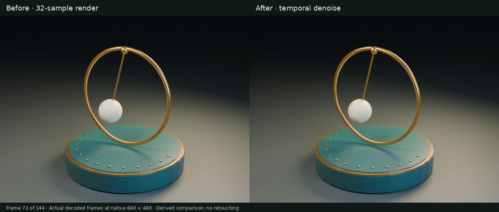

# Brass Pendulum: a low-sample Blender animation survives temporal-denoise delivery with its frame cadence intact

An original, editable Blender animation was rendered as **144 frames at 640 × 480 and 32 samples**, then processed by the actual media-denoise pipeline using **FFmpeg atadenoise=s=5**. Both matched H.264 previews preserve **24000/1001 fps and 6.006 seconds**, with no audio track. The native scene, measured evidence and before/after comparison make the processing inspectable. This is a bounded low-sample demonstration; it does not establish high-sample visual fidelity.

[Synchronized before/after video](pendulum-synchronized-comparison.mp4) · [Processed video](pendulum-denoised.mp4) · [Raw comparison video](pendulum-raw.mp4) · [Hero](hero.jpg) · [Before/after](comparison.jpg) · [Editable native copy](scene-public.blend) · [Typed recipe](scene-recipe.json) · [Native inspection](native-inspection.json) · [Processing measurements](processing-validation.json) · [Visual review](visual-review.json) · [Rights](LICENSES.md) · [Validation](validation.json) · [Manifest](manifest.json)

## Original form, actual native execution

A brass curve hoop surrounds a porcelain pendulum above a deep-teal plinth. The scene was authored through typed Blender DCC-MCP tools, including geometry, materials, parenting, object animation and camera-optics keyframes. The lens changes from **48 mm to 62 mm** while the swing amplitude decreases. This is authored motion, not a physically simulated pendulum.

| Native measurement | Observed |
| --- | ---: |
| Objects | 26 |
| Mesh objects | 19 |
| Native mesh vertices | 7,426 |
| Native mesh polygons | 7,783 |
| Curves / control points | 2 / 98 |
| Materials / lights / cameras | 4 / 3 / 1 |
| External image textures / linked libraries | 0 / 0 |

Mesh counts exclude tessellated curve bevels. Native metric unit scale is **1.0**. Detailed sampled keyframes, material and render settings are in the native inspection. The original scene was saved and reopened in a fresh Blender host. For publication, all inspected scene semantics and evaluated transforms/lens values were compared across **144 frames** after path cleanup.

Creation used **Blender 4.5.13 LTS**, **Cycles CPU**, and **DCC-MCP Core 0.20.44** with the camera-optics/timebase adapter patch at [the pinned source commit](https://github.com/dcc-mcp/dcc-mcp-blender/tree/397d2aaa8049857bb33aedd6efdc9ef4234deb62). The case does not imply that this patch is available in a released adapter. Verification reaches native host execution and actual typed tool returns for creation, plus native CLI execution for post-production; it is not a cross-host conservation claim.

## Actual temporal processing, controlled comparison

The original PNGs and the original native file were left unchanged. Opaque RGB images were explicitly converted to **limited-range BT.709 YUV 4:4:4, 8-bit** before processing. The FFV1 masters use lossless coding, but the RGB-to-YUV conversion is not mathematically lossless. Measured conversion round-trip mean absolute channel error is **0.4004232901114005** on the **0–255** scale; maximum absolute channel error is **2**.

Post-production used **dcc-media-enhance 0.2.0**, source revision **bd4aca72488ca6165816ebdf95c99df5800a192a**, through its direct native CLI. This tool selected **FFmpeg 7.1.5**, running **atadenoise=s=5**. This is a temporal averaging filter, with no motion compensation or neural model. The pipeline's processing receipt and output hash were checked. An earlier full-range trial was superseded by a matching limited-range input/output pair for a cleaner control; that earlier trial is not evidence of proven color corruption.

| Delivered preview | Raw control | Temporally denoised |
| --- | --- | --- |
| Codec / pixel format | H.264 / yuv420p | H.264 / yuv420p |
| Dimensions | 640 × 480 | 640 × 480 |
| Frames | 144 | 144 |
| Frame rate | 24000/1001 fps | 24000/1001 fps |
| Duration | 6.006 seconds | 6.006 seconds |
| Color range / matrix | limited / BT.709 | limited / BT.709 |
| Audio streams | 0 | 0 |
| Complete decode | pass | pass |

Both previews use the same encoding settings. Their time base is **1/24000** and their PTS increment is exactly **1001**. No frame interpolation, upscaling or retiming was used. The masters' Matroska timestamp quantization is separately recorded, rather than confused with the exact MP4 cadence. Pixel-change statistics measure change, not noise reduction, perceptual quality or fidelity.

The independent visual review observes modestly smoother grain in the background, ground and shadows; it does not assign a noise-reduction or quality score. The review records what was actually inspected and the remaining limitations. Residual noise and the original geometry's faceting remain visible. Check the moving bob, rod and ring edges in both videos; a temporal filter can soften movement.

## Synchronized before/after review

The [synchronized comparison](pendulum-synchronized-comparison.mp4) places the matched raw and denoised FFV1 masters side by side: raw on the left, denoised on the right. Each panel remains at its native 640 × 480 resolution. Labels bring the composed frame to 1280 × 544. This is a new matched H.264 display encode, not either original delivery MP4. It contains the same 144 frames, 24000/1001 fps cadence and 6.006-second duration, with no audio, interpolation, retiming or upscaling.

[Comparison validation](comparison-validation.json) records a complete native decode and exact rational timestamps. The [temporal-integrity summary](temporal-integrity-summary.json) records unchanged original source hashes, complete decoding of both masters and delivery videos, no exact consecutive duplicate frames, and same-index nearest-frame matching within a bounded ±3-frame diagnostic. These are technical diagnostics, not visual-quality scores. [GitHub CI evidence](ci-verification.json) for commit `e2b16906456d7fafa2f920e5ab27df86454ede87` now verifies H.264 decoding, explicit playback, seek-state checks and controls for all three videos in English/Chinese desktop and touch viewports. The complete site localization step also passes. Earlier local Chromium lacked H.264 support and broad local navigation checks timed out; those local limits are preserved separately. Continuous playback through the end, natural-speed motion/flicker review and final artistic acceptance remain unverified. This remains a draft for review.

## Public native copy and privacy

The public **scene-public.blend** is a separate derivative, not the original bytes. It changes exactly **2 path fields**: the saved file-browser directory and the render output destination. The latter is now scene-relative. The original hash, public-copy hash, clean binary pattern scan, dependency audit and normalized native semantic comparisons are in [native-inspection.json](native-inspection.json).

No new render was performed from the public copy. Equality of inspected scene data and evaluated animation does not by itself prove pixel-identical rerendering. The original raw frames and FFV1 masters are not bundled in this compact website entry; their hashes, dimensions and processing measurements remain recorded. The downloadable raw MP4 is a lossy display encode, not the original PNG sequence.

## Reproduction

Open **scene-public.blend** in Blender, with automatic script execution disabled. The file contains the editable geometry, materials, lighting, camera and authored motion. Inspect the full timeline, especially the changing focal length and swing amplitude. Rendering uses Cycles CPU at the recorded sample count, with native denoising disabled and a portable scene-relative output location.

For typed-MCP reconstruction, [scene-recipe.json](scene-recipe.json) contains **78 actual successful construction/configuration calls** with the output destination replaced by a portable placeholder. Use a disposable scene and a compatible typed host. This is a readable recipe, not a standalone installer or transport harness; it was extracted and inspected, not replayed in the publication review.

To repeat the public algorithm on a newly rendered image sequence, ingest the PNG frames with the recorded RGB-to-YUV conversion, run `atadenoise=s=5`, then make matching H.264 display encodes. The [dcc-media-enhance source](https://github.com/dcc-mcp/dcc-media-enhance) is independently public under the MIT license; the implementation is not bundled in this case. This source-publication statement does not claim a new package or binary release. FFmpeg and any other backend or model retain their own licenses and distribution obligations, and the original case assets remain rights-reserved. Its bounded run and measurements are documented independently in the processing evidence. Repeat renders and encodes can vary by software build; byte-identical reproduction has not been established.

## Boundaries

- Original procedural animation, not CineRecon video reconstruction, a benchmark entry or a model-quality score.
- No high-sample ground truth, reference PSNR/SSIM or objective perceptual-quality acceptance was run.
- No OIDN, neural denoising, EXR input or auxiliary render passes were used.
- The scene's original primitive faceting and residual low-sample noise remain; denoising does not repair geometry or increase render resolution.
- Technical full decode, metadata checks and image review are separate from final user artistic acceptance, which remains not run.
- Public evidence is a sanitized measurement summary and reusable recipe, not a complete raw trace or the media-pipeline source.
- Every model/effort attribution stage remains **Unknown** because no independently verified accepted task-configuration record is available. A source report's self-description is not sufficient attribution evidence.
- Rights are reserved as described in [LICENSES.md](LICENSES.md); public inspection grants no additional artwork license.
