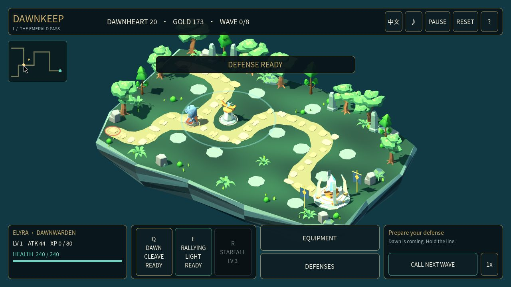
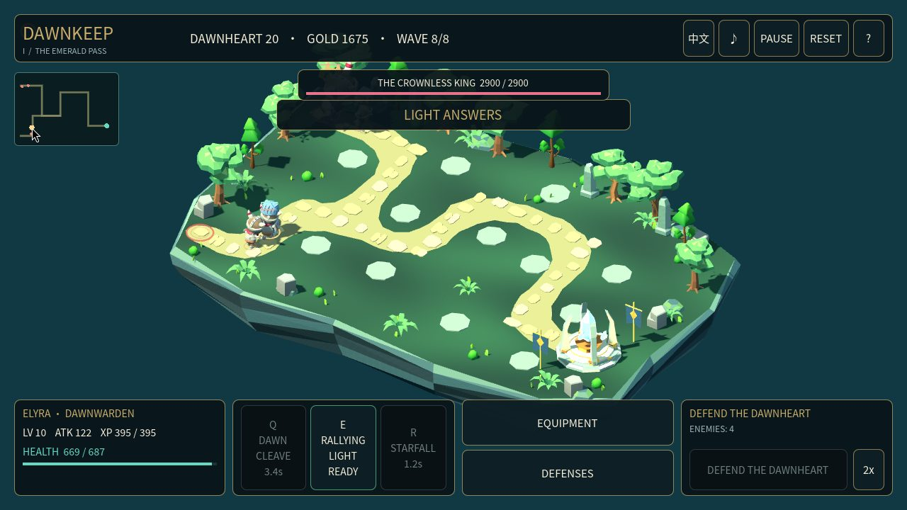
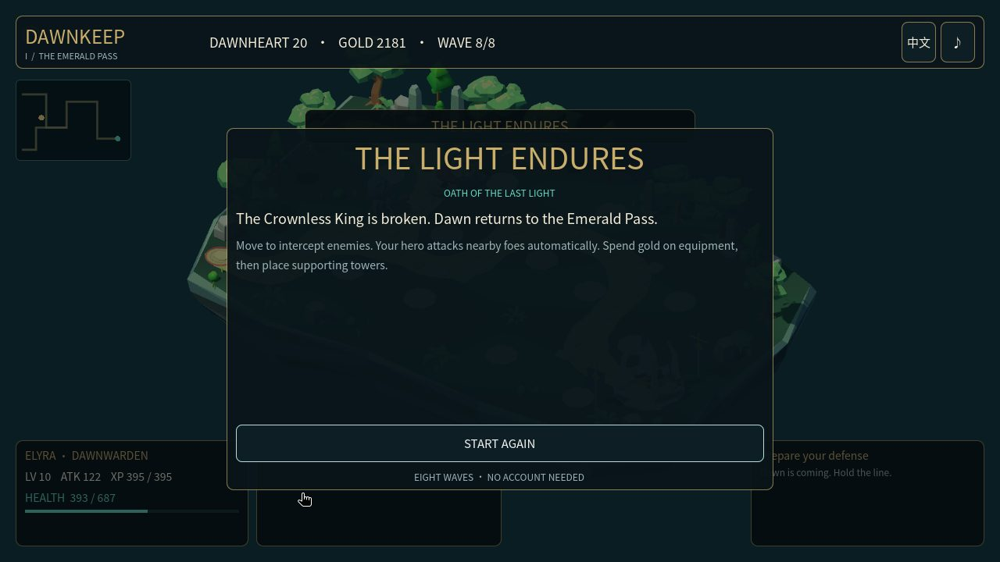
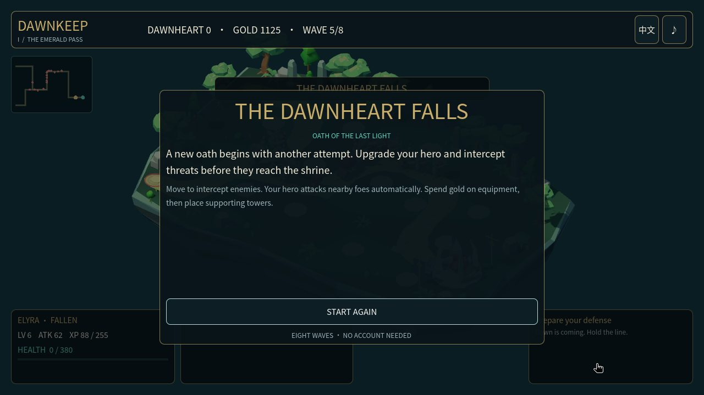
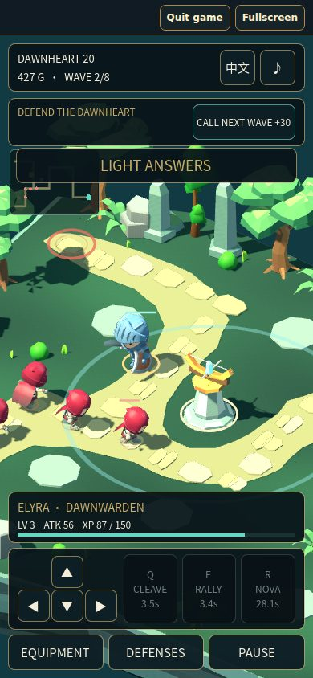

# Dawnkeep completes an eight-wave hero-defense campaign in native Godot and Web

Dawnkeep / 曙光守誓 is an original hero-defense game. On frozen source `957c1d3928d4d7382535a5b50ae2990aa4cf5854`, actual native input won all **8 waves with core health 20, 159 kills and 0 hero deaths**; desktop Web won with **core health 8, 149 kills and 0 deaths**. Both independently reached a natural wave-5 defeat and restarted through actual controls. The public **58-second, 1280 × 720** film comes from real native gameplay. The editable native ZIP is **4,822,730 bytes** and preserves the verified author output.

Artifacts: [Dawnkeep-native-957c1d3.zip](Dawnkeep-native-957c1d3.zip) · [LICENSES.md](LICENSES.md) · [boss.jpg](boss.jpg) · [defeat.jpg](defeat.jpg) · [evidence/art-downloads.json](evidence/art-downloads.json) · [evidence/art-runtime-sources.json](evidence/art-runtime-sources.json) · [evidence/blender-rebuild.json](evidence/blender-rebuild.json) · [evidence/blender-reopen.json](evidence/blender-reopen.json) · [evidence/font-source.json](evidence/font-source.json) · [evidence/headless-acceptance.json](evidence/headless-acceptance.json) · [evidence/image-derivatives.json](evidence/image-derivatives.json) · [evidence/input-acceptance.json](evidence/input-acceptance.json) · [evidence/mcp-public.json](evidence/mcp-public.json) · [evidence/music-sources.json](evidence/music-sources.json) · [evidence/native-manifest.json](evidence/native-manifest.json) · [evidence/native-package.json](evidence/native-package.json) · [evidence/publication-review.json](evidence/publication-review.json) · [evidence/video-edit.json](evidence/video-edit.json) · [evidence/visual-review-historical.json](evidence/visual-review-historical.json) · [gameplay.mp4](gameplay.mp4) · [hero.jpg](hero.jpg) · [portrait.jpg](portrait.jpg) · [victory.jpg](victory.jpg) · [validation.json](validation.json) · [manifest.json](manifest.json)

## What was actually verified

[Exact full acceptance run](https://github.com/dcc-mcp/showcase/actions/runs/39285690349) · [Pinned production source](https://github.com/dcc-mcp/showcase/tree/957c1d3928d4d7382535a5b50ae2990aa4cf5854/scripts/godot_web/dawnkeep)

| Route | Recorded input checks | Victory | Natural defeat | Restart |
|---|---:|---|---|---|
| Native Linux, X11/XTest | 132 | Wave 8; core 20; kills 159; deaths 0 | Wave 5; core 0; kills 51; deaths 4 | After victory and defeat |
| Desktop Chrome | 128 | Wave 8; core 8; kills 149; deaths 0 | Wave 5; core 0; kills 52; deaths 4 | After victory and defeat |
| Portrait Chrome touch emulation | 39 | Not a full-campaign test; two waves, Q/E/R | Not tested | After combat |

These input routes operate the real engine through OS/browser controls. The observer only reads state. Headless fixtures are a separate stage: **78 mechanics, 28,051 layout, 135 integration and 56 shutdown assertions**. They do not replace real input, visual review or listening. The supported Jolt backend passed strict Web quit, fresh engine restart, fullscreen and required-download failure/Retry checks.

The native game initially opens in Chinese. Press **L** or click **EN** to switch to English; the game does not automatically inherit the page language.

## Actual pixels and editorial cuts

The native boss encounter is a real **1280 × 720** capture. All public stills use JPEG quality **82** only, retaining original framing and control/failure read-outs. There is no generated image replacement, recoloring or cleanup.

The defeat evidence has the same status as the victory evidence. A dimmed decorative toast is briefly visible behind each terminal overlay; actual restart clears terminal UI and restores the initial game state.

Portrait capture is **390 × 844**, with a **390 × 800** engine canvas beneath the wrapper controls. Its closer tracking camera and touch buttons were inspected. This is not physical-phone or multitouch testing.

[Play the native gameplay excerpt](gameplay.mp4). The film concatenates source intervals **0–5, 27–35, 70–78, 145–168 and 352–366 seconds** from the **366.4-second** continuous native screen recording. It retains native audio and contains no additional editorial speedup; the public in-game **2x** setting is visible. The **20 fps H.264 / stereo AAC** public encode fully decodes. Exact cuts, source and output hashes are recorded in the video receipt. Review sampled the exact final encode, including its win/loss/restart transitions; subjective listening remains untested.

## Authoring and reproduction

Verification reaches **real typed tool return** for Godot authoring and **in-host execution** for native and Web play. Godot **4.6.3**, adapter **0.9.6**, Core **0.20.42** and Server **0.20.45** produced the scene. **37** typed calls were recorded; the sanitized public subset retains **36** host exchanges and omits skill-loading metadata. Script source bodies are represented by exact hashes, private runtime paths are redacted, and result values remain intact. The editor was restarted and the saved scene reopened.

Original environment and tower meshes used native **Blender 4.3.2 Python**, with historical save/reopen and blank-scene rebuild evidence. That is not a Blender MCP claim. Official free KayKit models/animations, credited CC0 music and the renamed Noto-derived font retain separate provenance and rights.

1. Download the native ZIP and verify SHA-256 `cca032f2296ee25d9b01a3e44a23d1991fd7fc92c072dffda8045965d5ed4b59`.
2. Extract it, install the [official Godot 4.6.3 editor](https://godotengine.org/download/archive/4.6.3-stable/), and import **game/project.godot**. Wait for resource import, then run the project. No DCC-MCP installation or account is needed to play.
3. Move with WASD/arrows, click/tap the ground or use the minimap. Nearby attacks are automatic. Q attacks, E heals/rallies, and R unlocks at level **3**. Buy equipment and supporting towers; then call the next wave. Pause, reset, sound and language controls are in the HUD.
4. Inspect scripts and assets directly. The ZIP contains **79 entries**, including **77 native project files**, bilingual RUNNING instructions and the per-file native manifest. Its MCP-saved start scene preserves the actual editor serialization; the rest matches the pinned source.
5. For the original Blender recipe, asset acquisition ledger and exact-head acceptance harness, use the pinned source above. These are separate from this playable-source ZIP. Earlier source documentation retains historical failed and incomplete runs; the hash-bound full acceptance in this report records the later successful revision without rewriting those earlier outcomes.

## Boundaries

- Not tested: subjective music listening, physical phone/multitouch, physical GPU performance or manually closing the native OS window.
- Actual-input automation verifies the recorded strategies and natural outcomes, not all strategies, game balance or universal browser compatibility.
- The excerpt is edited, not a continuous campaign movie. Objective audio measurements and decoding are narrower than listening.
- The ZIP is an editable Godot project, not a standalone executable. Full-game CI is separate from deployed page, download and playback checks.
- Model identity and reasoning effort remain **Unknown** for each production and review stage.
- Original work remains all rights reserved. Public play and downloads grant no new license. Third-party CC0, SIL OFL and engine notices are preserved; see LICENSES.md.

## 中文报告

冻结版本 `957c1d3928d4d7382535a5b50ae2990aa4cf5854` 的真实原生与桌面 Web 输入均完成八波胜利、第五波自然失败和实际重开。原生胜利为核心 **20**、击杀 **159**、死亡 **0**；Web 为核心 **8**、击杀 **149**、死亡 **0**。竖屏 **390 × 844** 是 Chrome 模拟触控，完成两波、Q/E/R 与重置，不代表实体手机或多点触控验收。

公开 **58 秒**短片剪自连续原生录屏，保持 **1280 × 720、20 fps**；仅时间剪辑与编码，没有额外加速，游戏内 **2x** 可见。截图仅 JPEG **82** 压缩，保留胜利、失败和全部界面。音频来自实际游戏；完整解码与音量测量不替代主观试听。

Godot 场景通过真实 typed MCP 创建、保存、重启编辑器并重开；Blender 原创网格使用原生 Python，不声称 Blender MCP 制作。模型及推理强度没有可独立核验的记录，各阶段保持未知。运行、来源、哈希、许可和脱敏范围见本报告链接的机器可读证据。

下载原生 ZIP，导入 **game/project.godot**，用 Godot **4.6.3** 等待导入完成后运行。初始界面为中文；按 **L** 或点击 **EN** 切换英文，不随网页语言自动变化。WASD/方向键或地面、小地图点击移动；附近敌人自动攻击；Q 为斩击，E 为治疗/振奋，**3** 级解锁 R。升级装备、建设辅助塔并守住曙光之心。

尚未验收主观音乐试听、实体手机、多点触控、物理 GPU 性能和原生系统关闭窗口。原生工程不是独立可执行程序；CI 结果不单独证明部署后的页面行为。原创作品保留所有权利；KayKit 与署名音乐保留 CC0，字体保留 SIL OFL，引擎保留自身通知。公开试玩和下载不新增原创作品许可。
