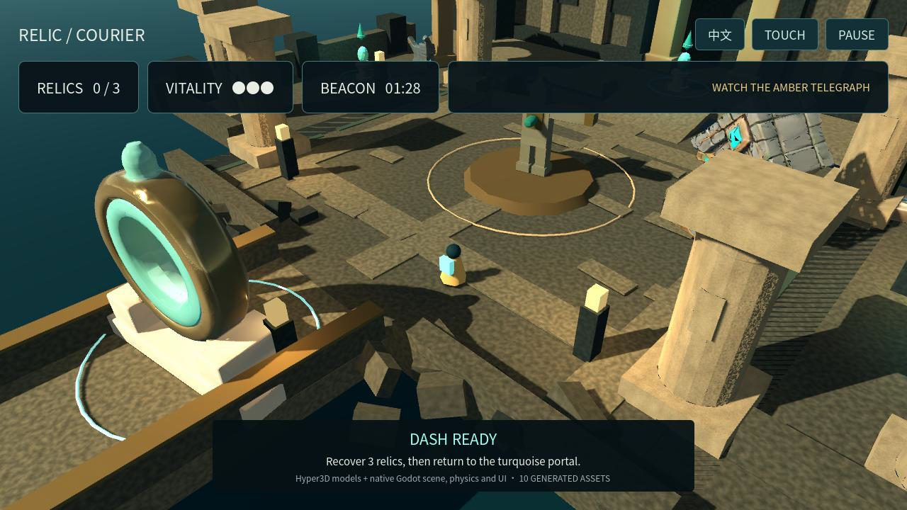
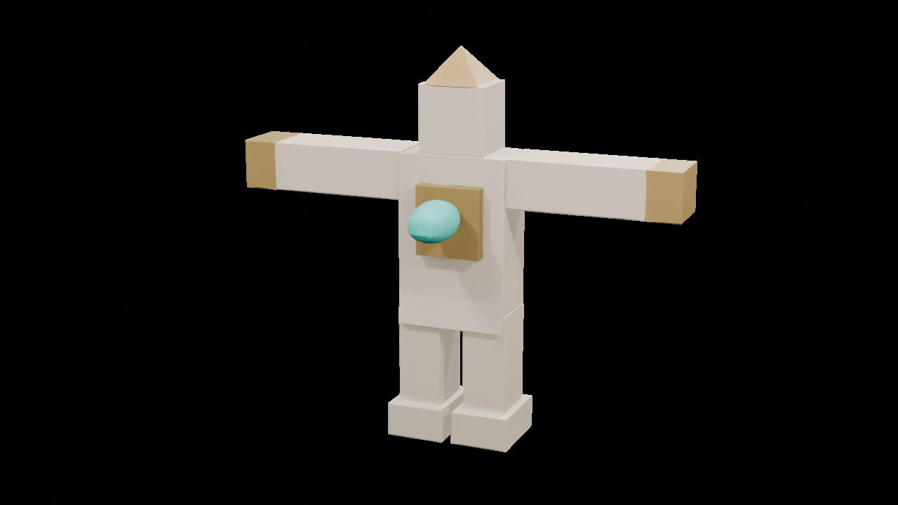
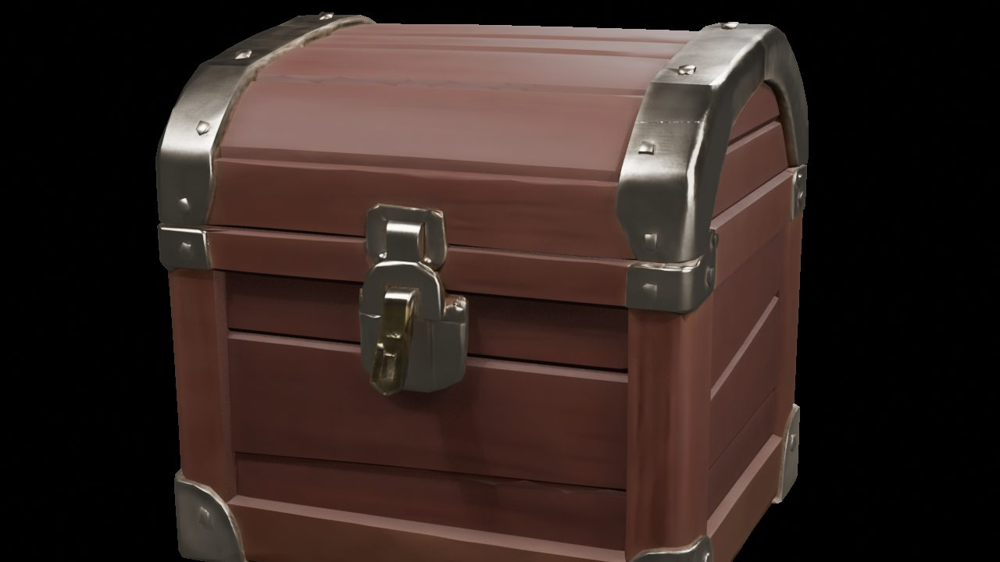
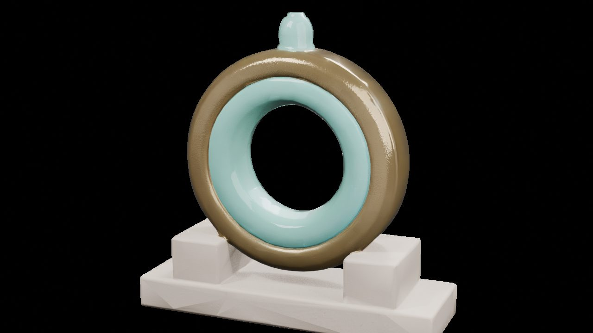
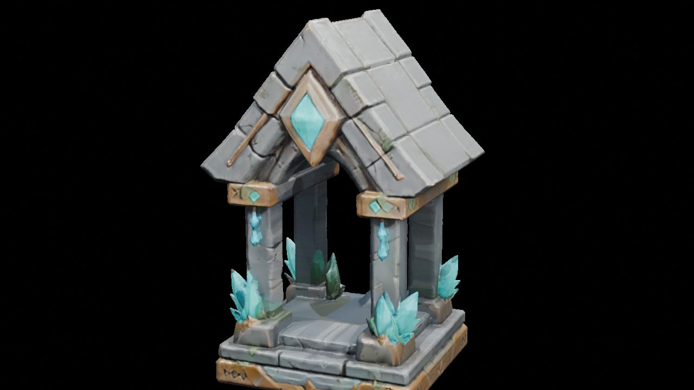
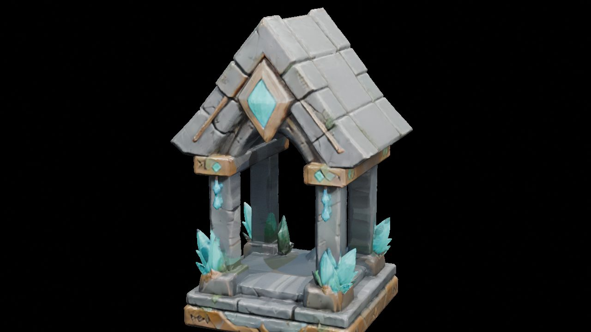
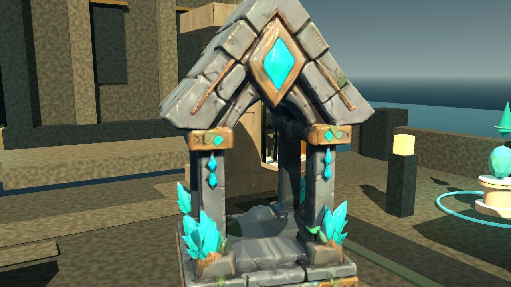
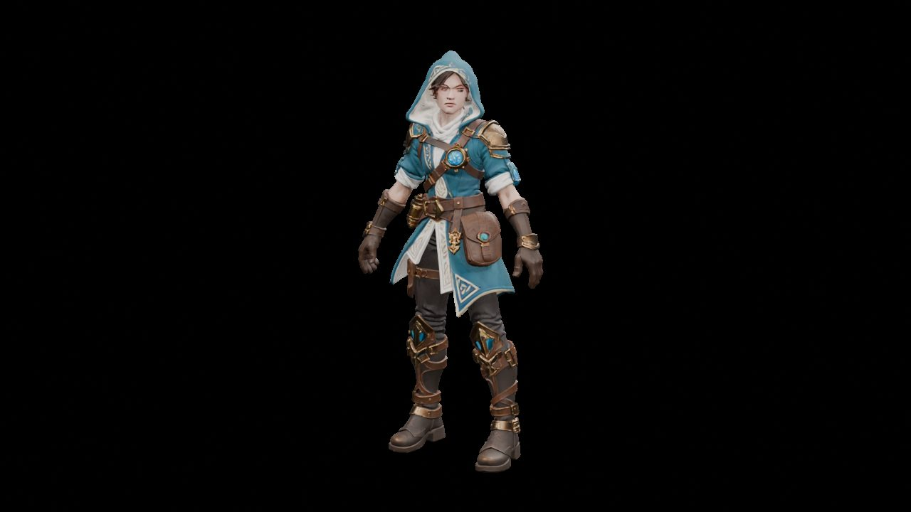
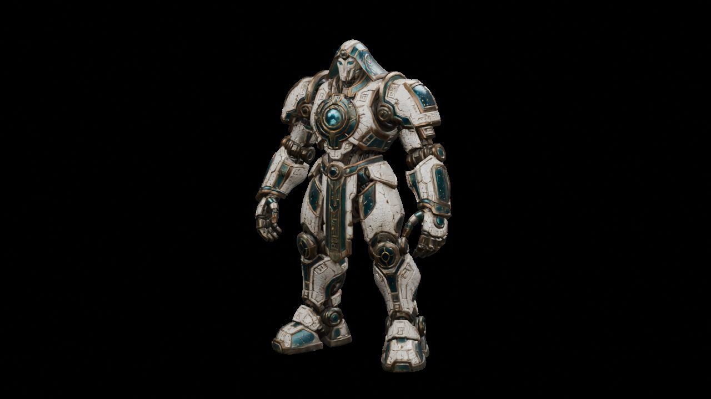

# Native diagnosis separates source design limits from a broken shrine reduction

This addendum records why the previous visual revision needed work. The visible courier was authored primitive geometry, the old generated guardian followed a block reference, and the shrine's 5,000-triangle derivative introduced visible artifacts. A 60,000-triangle shrine repair passed the same near-angle check in Blender and fresh native Godot. Two new detailed characters passed static native import checks; their rigs and revised gameplay remain separate work.

The existing V1 media and source archive remain historical comparison artifacts. They are not final revised-adventure acceptance. The main case report and manifest are intentionally awaiting the final freeze; this addendum has its own [evidence](diagnosis/evidence.json) and [artifact inventory](diagnosis/manifest.json).

## The visible player was authored geometry

The actual native runtime bound a **CylinderMesh (84 triangles)**, **SphereMesh (4,224 triangles)** and **BoxMesh (12 triangles)** as the visible courier. Their resources had no provider mesh path or texture. The capsule was a separate, invisible physics shape, with collision debug drawing disabled. The visible placeholder therefore came from the authored body, not the collider.

The previous guardian did have generated provenance: an ArrayMesh from `res://assets/guardian.glb`, **5,000 triangles**, with albedo, normal and packed metallic/roughness maps still bound. An authored scene-only ash-teal tint/roughness adjustment was applied. Its GLB SHA-256 was `76d60eb1ba2898af6cf25ccf6675e971196c2c585b4ebb68796f5f7bd4153ab1`.

Both old character candidates followed the original native block T-pose reference. R9's textured result had **5,000 triangles**; its untextured raw result had **5,124,470 triangles** and the same block silhouette. A2 had **17 meshes**, **2,488 triangles**, four factor-only materials and no images. Substituting either would have preserved the design problem.

## Chest: detail survived the derivative

| Provider original | Previous V2 derivative |
| --- | --- |
|  |  |

Both contain **5,000 triangles** and one UV map. The three embedded PBR images were reduced from **2,048 × 2,048** to **1,024 × 1,024**. The same-camera native comparison retains the metal straps, padlock and wood panels; native Godot readback preserves the same channel bindings. This is the strongest source-faithful treasure prop in this set. The chest came from the prior Texture route using a local OBJ and a provider-generated reference render from an original task-authored prompt.

## Portal: the source itself is simple

| Provider original | Previous V2 derivative |
| --- | --- |
|  |  |

The original already has a smooth brass/teal ring and pale block pedestal. Its **16,528 triangles** became **4,999**; a **4,096 × 4,096** base-color image and **2,048 × 2,048** normal/metallic-roughness maps became three **1,024 × 1,024** maps. Reduction adds pedestal faceting, but missing design detail is principally a source/reference limitation. The accepted request used Gen-2.5-High, Quad, `quality_override=8000`, Hybrid and high textures; the selected PBR output does not establish native quad topology or exact requested-budget fidelity.

## Shrine: a real reduction regression, then a scoped repair

| Provider original | Rejected previous V2 | Repaired derivative |
| --- | --- | --- |
|  |  |  |

The Sketch/HighPack original delivered **559,968 glTF triangles**, despite a Quad request with `quality_override=1000`. Reducing it to **5,000 triangles** produced clear triangular artifacts across the roof, central gem and base. UV/PBR bindings alone did not prove visual quality.

The repair starts from the immutable original and retains **60,000 triangles**. The three **1,024 × 1,024** provider images have exactly the same decoded pixels as the original. Same-camera Blender comparison resolves the identified artifacts; a fresh native Godot import binds the repaired GLB and reproduces that near-angle improvement.

This passes the identified close-view regression check. It does not establish all-angle, animated-scene or final adventure acceptance. Higher geometry cost is deliberate; a previous compactness target is not treated as a quality pass.

## PBR, UV, scale and geometry are separate checks

All three selected GLBs retain `TEXCOORD_0` and one native UV map. Base color is **sRGB**. The packed metallic/roughness image is **linear**, with **G = roughness** and **B = metallic**; the tangent-space normal image is **linear**. Blender and actual Godot readback retain those bindings. The chest, portal and shrine near samples have no scene-only tint applied. Geometry reduction and texture downsampling remain independent sources of quality loss.

Source coordinates are normalized with no declared physical unit. Per-instance scene heights are authored choices; they do not prove that a provider unit equals a meter. These are individual static derivatives, not a validated distance-based LOD ladder. Full source/previous/repaired hashes follow; originals are identified here without publishing their GLB files.

| Asset / stage | Triangles | Bytes | SHA-256 |
| --- | ---: | ---: | --- |
| Chest / Original | 5,000 | 6260184 | `060fbec0f44be2b69736e502f2d8f8b37d2d1f86648a1ce5f833c361869d261e` |
| Chest / Previous V2 | 5,000 | 2144840 | `db8ed454dfcf8d440c3bff7776a4f930503b11164bbb2693d05c86de6b913ff7` |
| Shrine / Original | 559,968 | 19401668 | `ea17bdcefe4f76b496b6501ed74bd7692032d076f8db4de39d0f92dfee12e210` |
| Shrine / Previous V2 | 5,000 | 2973192 | `85535901cbd027917dc51ff75b88588f5b2fbc81e2dc9a90f8af6d54512692af` |
| Shrine / Repaired | 60,000 | 4550948 | `267fd55b9773b109a7dea93f832d80b68f8191b6cf874210ce6ce3e3a84f27d7` |
| Portal / Original | 16,528 | 15836304 | `85077f322be243ee726d7b85409073ecbff16f23f7062276e7d5e3dcf7bab12c` |
| Portal / Previous V2 | 4,999 | 2592960 | `e4ff28b1e47d9cb7b9ddeb5a4a27061921275512c38bd3d30373eaf96c181da2` |

## New characters: static native evidence, before authored rigs

| New courier | New mechanical guardian |
| --- | --- |
|  |  |

These are actual Blender renders of the newly downloaded 3D outputs, not ImageGen concept pictures or final Godot gameplay. Each original has **30,000 triangles**, one mesh, one material, one UV map and three embedded **2,048 × 2,048** PBR images. Both contain **zero skins and zero animation clips**. Front, quarter and rear native views were reviewed; this compact public set retains the quarter views. Relaxed A-poses have separated arms and legs. Conservative skin weights are still needed around clothing, satchels and armor plates.

The user approved original single-view ImageGen concepts. The courier received a final white-background cleanup preserving its design; the guardian used a single white-background view. `use_original_alpha=false` was submitted. This does not establish multiview consistency. Generator model and reasoning effort are **Unknown**. The [acquisition receipt](diagnosis/hero-acquisition.public.json) records the exact input-image hashes, submitted parameters and immutable output hashes.

| New original | Triangles | Bytes | SHA-256 |
| --- | ---: | ---: | --- |
| Courier | 30,000 | 11,134,316 | `4831d672f8ae37be04f0525ae1dfd8ffe6198039c53d375ab9b8bc05a2ee559c` |
| Guardian | 30,000 | 16,458,320 | `a6b0bd4ffa9dce137026cce0e80cbe536158641145c7a093729c795f996f87cd` |

The proposed focal roles are the generated courier, mechanical guardian and chest, with the repaired shrine as a landmark. This is a visual direction proposal, not acceptance of the revised adventure.

## Cost and evidence boundaries

The extended round contains **23 accepted paid cases** at **15.5 credits**, matching the approved **15.5-credit cap** and all 23 billing rows. The two hero cases cost **0.5 credits each**; the **1-credit** extension delta was verified. The separate prior five-case experiment cost **2.5 credits** and is excluded from this round. See the [sanitized ledger](diagnosis/budget-ledger.public.json). There was no automatic paid retry.

The public previews are **1,280 × 720 JPEG q82**, 4:2:0, without resizing, cropping, retouching or image compositing. Alpha is discarded for JPEG. Native PNGs contained private scene-path metadata; public previews exclude metadata. The evidence records the exact native PNG hash, native decoded-pixel hash, metadata-stripped PNG hash and public JPEG hash separately. Metadata-only PNG cleanup preserved decoded pixels before JPEG encoding. **Lossy JPEG pixels are not claimed identical to the native PNGs.** Visual judgments were made on the original native PNGs, not solely these compressed previews.

All 12 previews and their provenance are listed in [diagnosis/manifest.json](diagnosis/manifest.json); measurements and failure/pass scopes are in [diagnosis/evidence.json](diagnosis/evidence.json). No account identities, provider job IDs, credentials, signed URLs or private machine paths are published. No new rig/deformation pass, final gameplay, Web performance, source archive, video, publication, merge or deployment is claimed here. Technical and visual reviewer model/effort attribution remains **Unknown**.
