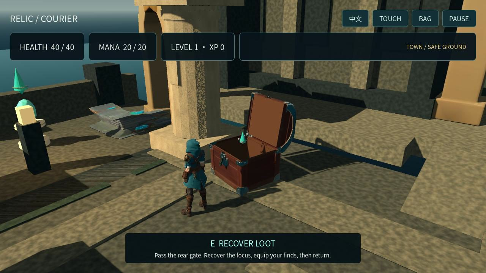
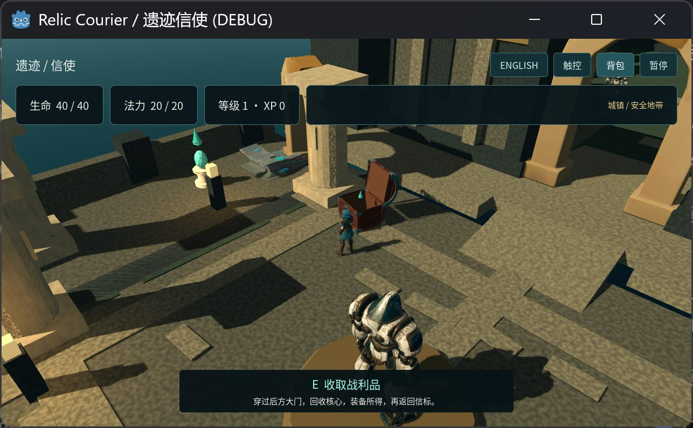
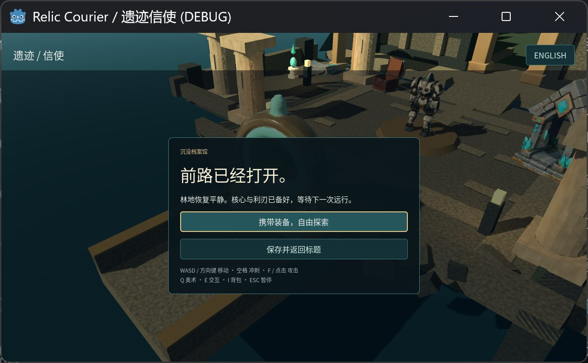
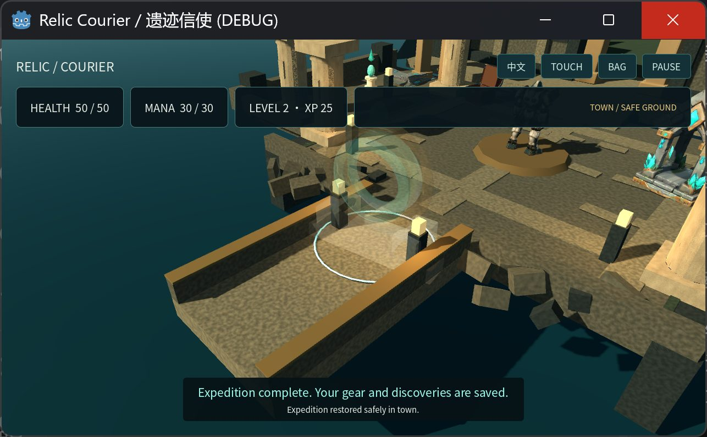

# Generated characters and treasure support a complete native Godot expedition

Relic Courier connects a safe archive court to a warden grove: open a hinged chest, recover and equip loot, fight with melee and Arc, then return. The latest save correction passed **57** staged engine/actual-filesystem checks, a separate **5-check** read and **25-check** scene integration run. Its clean native extraction/import passed, but partial window occlusion blocked all game input; the new PCK has no actual browser run. The earlier `ec13ca4d…` runtime retains its accepted **94.295 m** actual native course/fresh reopen, **15-action** Web smoke on PCK `22f7d1c3…`, and **59.033333 s** film decode/sampled-frame review. Those exact-byte baselines do not certify the later correction. The acquisition round completed **23 paid cases for 15.5 credits**; natural-speed film playback and subjective listening were not run.

[Native source](RelicCourier-native.zip) · [Native package](native-package.public.json) · [Historical package/export measurements](package-export.public.json) · [Historical gameplay tests](gameplay-tests.public.json) · [Historical OS acceptance](os-acceptance.public.json) · [Historical Web acceptance](web-acceptance.public.json) · [Baseline film](showcase.mp4) · [Film measurements](film-validation.public.json) · [Film pixel review](film-pixel-review.public.json) · [Rights](LICENSES.md) · [Instructions included in source ZIP](RelicCourier-native.zip) · [Production notes included in source ZIP](RelicCourier-native.zip) · [Asset diagnosis](ASSET-DIAGNOSIS.md) · [Diagnostic evidence](diagnosis/evidence.json) · [Diagnostic inventory](diagnosis/manifest.json) · [Hero acquisition](diagnosis/hero-acquisition.public.json) · [Billing ledger](diagnosis/budget-ledger.public.json) · [ARPG asset handoff](arpg-assets.public.json) · [Validation](validation.json) · [Inventory](manifest.json)

[Capture derivatives](capture-derivatives.public.json) · [Historical API before heroes](api-before-heroes.public.json) · [Native English](native-en.jpg) · [Native Chinese pause](native-zh.jpg) · [Native equipped bag](native-bag.jpg) · [Web smoke: playing](web-playing.jpg) · [Web smoke: pause](web-pause.jpg) · [Web smoke: Chinese](web-zh.jpg)

[Current save-recovery checks](save-recovery.public.json) · [Current native follow-up](current-native-followup.public.json) · [Current Web export](current-export.public.json)

## The current loop

Start on safe ground in the archive court. The rear passage leads into the warden grove. Use **WASD or arrows** to move, **Space** to dash, **F or left click** for melee, **Q** for Arc, **E** to interact, **I** for the bag and **Escape** to pause. English and Chinese use native Godot controls; optional on-screen controls are available for separate touch testing.

Defeating the scout yields an arc focus. Recover it with E and equip it in the bag to unlock Arc. The sentinel yields a bronze edge; the town chest offers the same item through another legitimate source. Repeated finds clear their own loot without stacking the item or its bonus. Return with both wardens defeated and the focus and blade equipped to complete the expedition. Arc is an available skill, not a forced-use objective.

The chest has an actual hinged `Lid` node, rotating around local X to **−100°** while its base stays fixed. Stepping away cancels opening; pause freezes it; its one-time drop commits only at the end of a valid interaction. The save caller bounds reads, verifies temporary writes, rotates a valid backup, recovers a missing/corrupt primary and retains rejected bytes. It restores safe-town progress without replaying rewards.

The historical `ec13ca4d…` actual-input course opened the chest, recovered and equipped its loot, defeated both wardens with melee and two successful Arc casts, reached level two and returned. A fresh normal launch reported `save_loaded`, restored one copy of each item, both equipment slots, opened chest, defeated enemies and completed quest, and placed the courier safely in town. The [OS receipt](os-acceptance.public.json) binds that runtime's actual window captures and state evidence. It is distinct from the later correction, staged tests and scripted footage.

These historical baseline OS captures retain the original framing and pixels except for declared JPEG compression. Raw PNG originals remain in the retained acceptance evidence.

The OS gameplay-recording probe failed at capture-overlay exclusion, so the
course is supported by actual stills, action/state evidence and logs, not a
continuous OS gameplay video. The film uses a separate scripted native Godot
GPU/audio capture through the real controller and action handlers. Actual OS
chest step-away cancellation was not accepted: the lid finished before the
actor left range. The engine chest-cancel test passed separately; this OS
attempt did not reproduce a logic failure or prove successful cancellation.
Physical-user interruption of the CUA transaction was not tested.

## What Hyper3D supplied, and what was authored

The generated courier and mechanical guardian replace the previous visible primitive courier and block-reference character. Their original meshes each contain **30,000 triangles** and three **2,048 × 2,048** PBR images. They arrived as static, unskinned outputs from approved original single-view concepts. Blender supplied skeletons, skin weights and in-place clips: **five** for the courier and **four** for the guardian. Automatic rigging or animation is not attributed to Hyper3D. Different warden encounters reuse the generated character with distinct statistics and display sizes.

| Authored action | Clip length | Gameplay contact/release |
| --- | ---: | ---: |
| Courier Attack | 0.45 s | 0.18 s |
| Courier Cast | 0.65 s | 0.32 s |
| Guardian Attack | 0.65 s | 0.38 s |

Idle, Walk and Dash remain separate clips. Damage is requested at contact using current range and line of sight; the deterministic core also checks state, cooldown, unlock and mana. Bounded AI uses idle, chase, attack, recovery and dead behavior through actual `CharacterBody3D` motion. Warning rings precede guardian contact. Invisible floor, ramp, actor and prop collision proxies are separate from visible generated geometry.

The interactive chest preserves the provider exterior, UVs and PBR images. Its separated hinged lid, lining and lid underside are authored additions. Native Godot architecture, collision proxies, AI movement, camera, UI, loot rules, save IO and beam/dust effects are also authored. The column's baked stone maps and the architecture's triplanar materials are distinct from provider texture output. [The asset handoff](arpg-assets.public.json) records preservation checks and authored boundaries.

The [diagnosis](ASSET-DIAGNOSIS.md) retains source/derivative comparisons rather than hiding the rejected result. Chest detail survived its derivative. The portal's simple silhouette principally follows its source. The shrine's previous **5,000-triangle** reduction tore the roof, gem and base; a **60,000-triangle** derivative retains the original **1,024-pixel** maps and passes the identified same-camera Blender and native Godot near-view regression. This is a scoped repair, not an all-angle guarantee or a distance-based LOD system.

The diagnostic JPEGs are static native views and historical comparisons. The courier and guardian images precede rigging; none is a final ARPG gameplay frame. Their separate manifest records native PNG, decoded-pixel and public lossy-JPEG hashes. Approved concept images are inputs, not runtime evidence.

## Acquisition coverage and cost

The first **21 cases** used the direct Python runtime. The two approved hero cases used actual MCP `tools/call` submissions and added **1 credit**, bringing this round to **23 cases and 15.5 credits**. All accepted cases completed and downloaded their outputs; the [ledger](diagnosis/budget-ledger.public.json) separates this round from the earlier experiment. No paid submission was retried automatically.

The reusable integration exposes **eight tools across seven HTTP endpoints** for account balance, generation, status and download workflows. Its [API acceptance report](https://github.com/dcc-mcp/dcc-ai-hyper3d/blob/main/docs/live-acceptance-2026-10-24.md) covers the historical API experiment; the [hero receipt](diagnosis/hero-acquisition.public.json) records the later MCP acquisitions. Neither establishes every website feature, every option combination, semantic effects, seed reproducibility or all native host/version paths.

## Reproduce from the source checkout

Open `scripts/godot_web/hyper3d-relic-room/game/project.godot` in **Godot 4.6.3**, allow resource imports to finish, and run `scenes/main.tscn`. Use **GL Compatibility**, built-in **Jolt 3D** and a landscape viewport of **960 × 600 or larger**. The standalone project needs no API credential, DCC adapter, debugger autoload or network service. The typed Godot authoring bridge is a separate configuration gate.

Open `RelicCourier/README.md` inside the [native source ZIP](RelicCourier-native.zip) for focused model, scene and controller tests. Its included `RelicCourier/PRODUCTION.md` [production notes](RelicCourier-native.zip) describe contact timing, material boundaries and persistence. Use a separate QA save path for instrumented checks; do not use tests to overwrite a player's progress.

The current runtime freeze contains **41 files**, aggregate SHA-256 `ba6b22f5eee335c41717dfa8989113e7e40494fe5a60ce177a73c95aa701248f`. Only `scripts/main.gd` differs from the accepted `ec13ca4d…` baseline; the other **40 files** are byte-identical. The native archive was cleanly extracted and freshly imported. It bundles **13 GLBs**; the scene loads **11 asset types**. Only the unused historical closed chest and block-reference guardian are omitted from isolated Web staging. Hero textures and repaired shrine geometry were retained.

The [save-recovery receipt](save-recovery.public.json) covers an actual failed write at an isolated QA temporary path. Failed Save & Title retains live progress and visible EN/ZH feedback; won Explore and lost Retry retain latest gear and consumed rewards instead of reloading older disk state. Cached unpicked chest loot survives same-process Title Continue. Normal successful save/continue also passed. These are staged headless engine/filesystem checks; no player save was used. Keep the process open until a later write succeeds, since unsaved memory cannot survive process closure.

The [latest native follow-up](current-native-followup.public.json) reached the untouched title after clean extraction/import. Its first window observation was partly occluded and not foreground, so it issued **zero game inputs**, used **no IO-fault fixture**, acknowledged cleanup and terminated only its own untouched title. Latest actual Menu/Continue/failure pixels remain **blocked**. The original full native course/reopen is retained as historical evidence, not silently reassigned to this source.

| Measurement | Verified value |
| --- | --- |
| Current source ZIP | 44,273,997 bytes; SHA-256 `8822a8da38a23c2ab4194d82fa49b97c0d99d5b13533b7bc1164a24498b64b79` |
| Current exported PCK | 41,192,572 bytes; SHA-256 `bc6af9db60ea88bb87c6c1adaaace410fb0fcdbb1a13f522b99b17fd73fae5ea` |
| This case's ten manifest-listed Web files | 41,227,974 raw bytes; 40,851,951 gzip-equivalent bytes |
| This case's ceilings | 40 MiB raw and 40 MiB gzip-equivalent |
| Initial instanced generated-triangle upper bound | 258,525; includes created hidden instances, not a per-frame visible/GPU count |

The current source package is identified by [native-package.public.json](native-package.public.json) and the current export by [current-export.public.json](current-export.public.json). The earlier [package/export measurements](package-export.public.json) remain historical. The Web build shares four byte-identical official **Godot 4.6.3** runtime files. Mounted-pack scene/resource loading, data definitions, clips, six sound resources and rights notices passed inspection; that does not establish browser/WASM input acceptance. Case budgets exclude shared runtime; gzip-equivalent size is a build measurement, not measured browser transfer. Historical archives and movies remain retained comparison evidence, not new downloads or acceptance of changed runtime bytes.

## Browser smoke and the current film

The historical PCK `22f7d1c3…` HiDPI browser smoke completed **15 actions**: continue, move across
the arrival bridge and court, pause, switch SFX off/on, and switch Chinese/English.
The wrapper uses a device-pixel backing store capped at twice its CSS size.
The next required capture encountered another native window overlapping the
browser before input, so full combat, loot, save/reopen, quit, fullscreen and
restart were not run. Explicit cleanup was acknowledged. This is a blocked
remaining scope, not evidence that those gameplay paths failed.
The [playing](web-playing.jpg), [pause](web-pause.jpg) and
[Chinese](web-zh.jpg) captures document only that smoke scope.
The current `bc6af9db…` PCK has **not** run through actual browser input.

The [editorial film](showcase.mp4) is **1,771 frames** at **30 fps**, **1280 × 720**,
**20,157,741 bytes**, SHA-256
`134579f9e7995f038764b7a27989e6bd073eb62ec2b8d8b75054ceeba1059634`.
It retains the historical `ec13ca4d…` runtime's complete **1,351-frame / 45.033333 s** scripted native GPU course
without cuts or retiming, fitted into the editorial canvas with captions outside
the footage. Title/source cards and the final-frame hold are editorial additions.
Original engine sound remains in the course; silent cards/ending are intentional.
Full decoding reported no errors, and first/middle/last sampled frames were
reviewed. Natural-speed playback and subjective listening remain **not run**.
The [film measurements](film-validation.public.json) and
[pixel review](film-pixel-review.public.json) keep those gates separate from
actual OS input and the Web smoke.

## Acceptance boundaries

| Gate | Current scope |
| --- | --- |
| API acquisition | Accepted generation/download cases and sanitized billing receipts; separate from playable quality. |
| Pure gameplay model | Deterministic combat, cooldown, range, pause, loot, equipment and strict save-data checks passed in Godot. |
| Current save correction and integration | 57 staged engine/filesystem checks, separate read 5, scene integration 25, interface/font/touch and changed-script parses passed. |
| Continuous physics | Historical ec13 baseline passed controller-driven connected floors, ramps and complete expedition without position writes after normal spawn. |
| Visual assets | Selected source/derivative comparisons, shrine repair, generated actor motion, lid and current combat/body-visibility samples reviewed. |
| Historical native input and fresh save/reopen | Passed on ec13 through actual OS keyboard/mouse and a separate normal process. |
| Latest actual native follow-up | Clean extraction/import passed; partial occlusion blocked before any game input or IO-fault fixture. Menu/Continue/failure pixels unaccepted. |
| Current Web export | Exact new PCK/resources and budgets passed inspection; no actual browser run. |
| Historical Web smoke | PCK22f passed 15 actual continue/movement/pause/SFX/language actions. |
| Full Web course and lifecycle | Blocked before further input by a concurrent window overlap; combat/loot/save-reopen/quit/fullscreen/restart not run. |
| Film decode and sampled pixels | The ec13 baseline's 59.033333 s film decoded without errors; first/middle/last frame review passed. Scripted footage is not current-runtime or OS-input proof. |
| Playback and listening | Natural-speed film playback and subjective audio listening not run. Six licensed effects and native/Web SFX toggles have separate checks. |

Kenney RPG Audio effects retain CC0; the controller adaptation retains MIT; the renamed Noto-derived font retains SIL OFL 1.1. Generated models retain the applicable Hyper3D terms. See [LICENSES.md](LICENSES.md).

Physical mobile touch, gamepads, portrait layout, cross-device performance, all-angle rig deformation, independent blank-scene rebuilding, release and deployment are not established by these checks. This contribution remains a draft. Creator and reviewer model/effort attribution remains **Unknown** where no accepted configuration record was verified.
