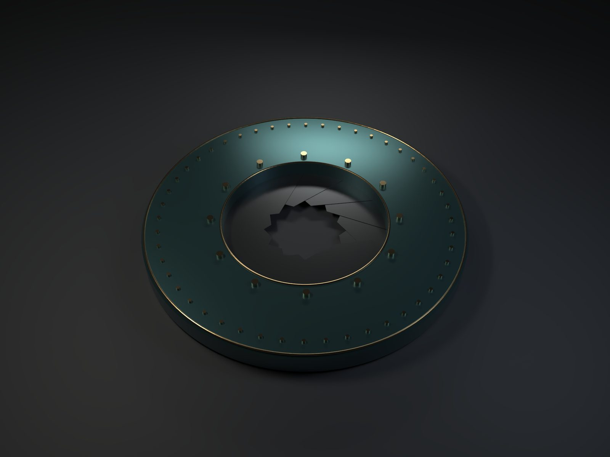
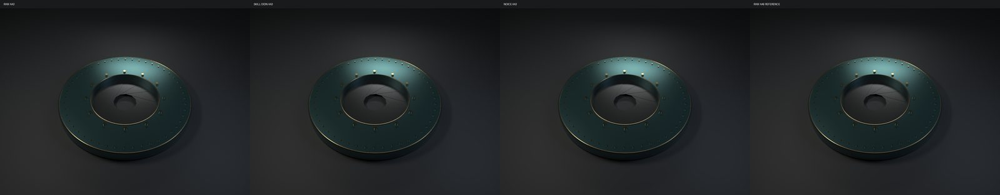
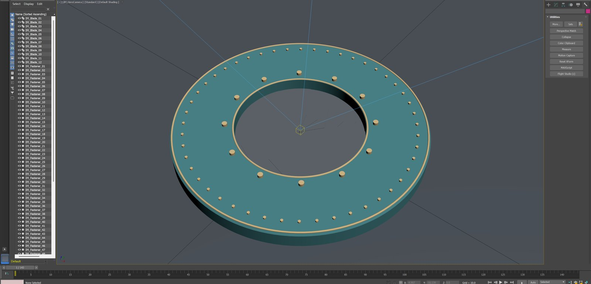
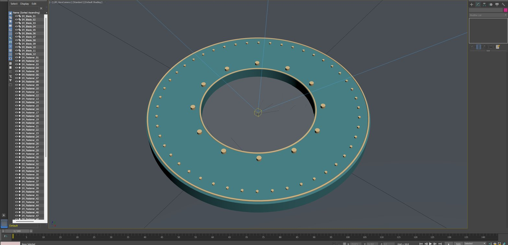

# 3ds Max iris: editable native geometry and guided denoise comparisons

An original **84-object**, **440×440×34mm** mechanical iris contains12blades,12pivot caps and48distinct fasteners. Native Max save/reopen and FBX reimport matched sampled animation matrices. A **1920×1440 AA3** hero and an **8-frame48–55** comparison retain actual render inputs. The canonical media-enhance Core Skill invokes Blender OIDN; Autodesk Noice is a separate native reference. **This is a draft evidence case, not an accepted full-film showcase.**

[24fps comparison](comparison-24fps.mp4) · [6fps slowed review](comparison-slow-review-6fps.mp4) · [960×720 OIDN clip](oidn-24fps.mp4) · [higher-sample comparison](higher-sample-comparison.jpg) · [pin detail](fastener-detail.jpg) · [blade detail](blade-detail.jpg) · [all-frame crops](eight-frame-detail.jpg) · [recipe](recipe.json) · [validation](validation.json) · [manifest](manifest.json) · [rights](RIGHTS.md) · [中文](README.zh-CN.md)

## Native construction and camera correction

The Lathe housing uses128segments and an explicitly verified axis matrix;12extruded spline blades have independent pivots and animation keys. Reopen/FBX comparisons at1/24/72/96/144 had maximum matrix delta0.0. All48fastener native bounding-box centers were checked independently. These native SDK/handler results are separate from MCP transport and real UI acceptance.

The adapter previously returned success for an unsupported65mm target-camera request. The candidate now rejects it and verifies rollback, while a native Physical camera reads back65mm. The original84-object scene and its file hash remain unchanged. Existing renders use the original actual45°FOV; this patch does not silently change the artwork.

## One input, two algorithms

The retained scene-linear Rec709 EXR contains real beauty,albedo,normal,Z and variance channels. The canonical Python Core Skill entry executes doctor/schema/probe/plan/run with explicit binary hashes and CPU2 budgets. This is in-process Skill execution, **not MCP wire acceptance**. Blender5.1.1 supplies Intel OIDN; this repository owns orchestration, not a new denoising algorithm. Noice7.2.4.1 is invoked separately and is not called Skill output or a new Maya test.

The final Blender5 compatibility candidate uses a compositor group, Group Output, denoise/alpha input sockets and an explicit unnamed EXR root. Actual beauty/normal/albedo passthrough pixels matched original channels within1e-6. The final run has no root-layer enum warning; its output also matches the earlier successful candidate within1e-6. All original inputs remain unchanged.

## Consecutive frames and a higher-sample reference

The comparison columns are **RAW / Skill OIDN / Autodesk Noice**. All source pictures are960×720 and use the same explicit Gamma2.2 display conversion. The24fps clip contains8frames and lasts1/3second; the6fps clip is intentionally four-times slower. Three-column delivery is1280×334; the OIDN-only clip is960×720. Video uses explicit limited-range BT709 matrix, BT709 primaries and gamma22 transfer tags. Silence is intentional.

AA6 at frame48 took272.515seconds. It is a higher-sample observation, not ground truth. Frames49–55 share actual seed-2082661815; frame48 is retained from an older sampling pattern, so its boundary cannot isolate algorithm flicker. All8pictures were fully decoded and inspected as chronological crops; actual real-time player viewing remains untested in this scoped run.

Both denoisers reduce grain. Noice looks smoother and OIDN retains more fine texture; pin outlines, iris corners and the thin brass ring remain visible in inspected stills. No universal accuracy ranking follows. The short opening interval does not cover reversal or the full144-frame film.

## Reproduction and boundaries

Use the adapted discovery-intent recipe with the source candidate, verify millimeter units and native cameraFOV, save retained linear EXRs, finish the render worker, then run the canonical Skill with explicit actual pass names. Keep original/raw output and a completed manifest with matching hashes. Native source files and private diagnostic logs are retained separately, pending public sanitization.

Sources: [Max candidate](https://github.com/dcc-mcp/dcc-mcp-3dsmax/tree/e1b724483193dd6476d117cb7ecf15ccaab91422), [media-enhance candidate](https://github.com/dcc-mcp/dcc-media-enhance/tree/f7073694ea2abef5c5b94f36e1442be076c9bb75). Both remain unmerged candidates. Native camera regression and exact-head CI pass; final independent review is incomplete.

Full-film/reversal review, actual natural-speed playback, wireframe and modifier-parameter UI inspection, normal MZP installation, MCP transport and public native-source sanitization remain open. This case is intentionally **not added to collection.json**. No source merge, public deployment or complete engineering validation is claimed.

[UI capture plan](UI-CAPTURE-PLAN.md) · [Video verification](video-verification.json)

## Actual Max UI capture

Two real DCC-CUA1.12.2 captures show the original scene. The second follows a successful background UIA click on the native Modify tab; no object is selected, so this does not inspect a modifier stack. The first exact-window WGC capture succeeded without foreground focus. An earlier foreground activation request was refused and sent no input. These are separate outcomes. Top application toolbars containing a private project path and bottom status strips were cropped; images were resized/JPEG encoded, with no repaint or compositing. Raw captures remain private and hashed. [UI verification](ui-verification.json).
