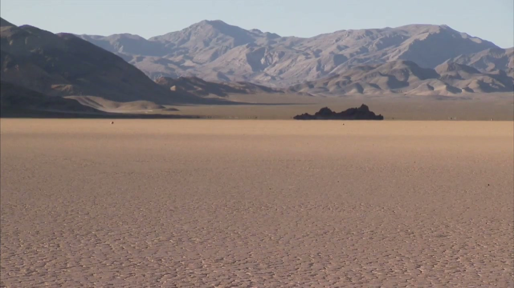

# An eight-second desert plate and generated layers are prepared for Nuke

This **preproduction draft** contains a licensed 1280×720, 30 fps, 240-frame
live-action excerpt, two actual generated raster layers and a cleared CC0 sword.
No Nuke or Blender execution, native project or final composite is claimed.
The transparent ruins have visible colored edge contamination that remains open.

[Recipe](RECIPE.md) · [Prepared assets/builders](../../../scripts/nuke_desert_relay/README.md) · [Source inventory](source-inventory.json) · [Publication mapping](publication-plan.json) · [Evidence stages](production-evidence.json) · [Validation](validation.json) · [Manifest](manifest.json) · [中文](README.zh.md)

## What exists

| Artifact | Actual evidence | Boundary |
| --- | --- | --- |
| NPS Racetrack plate | Source seconds 13–21; all 240 excerpt frames decoded; BT.709 tags retained | Re-encoded H.264 excerpt, not untouched source bytes; no audio in the excerpt |
| Offline motion analysis | Maximum ground-fit translation 0.7394 px; maximum rotation 0.01025° | OpenCV analysis, not a Nuke tracker, 3D camera solve or lens calibration |
| Generated sky | 1672×941 RGB PNG returned by `image_gen.imagegen` | Source candidate; no native color-match acceptance |
| Generated ruins | 1672×941 RGBA PNG with real transparency | Red/yellow fringe pixels require native edge work; final-quality check failed |
| Bronze sword | Kay Lousberg / KayKit CC0; existing GLB hash verified | Not Hyper3D output; import, scale, materials and contact shadows remain untested |
| Native builders | Offline Python and fail-closed prerequisite checks | Not a saved/reopened `.nk` or `.blend`; no render passes exist yet |

Both image tasks initially failed Windows reference-path deserialization, then
returned an actual image after a corrected new-image request. The original
failures and exact reusable prompts remain in the source receipts. The tool
returned image bytes but no backend model identity or remaining quota. Codex
orchestrated the tool; it is not described as the image model. No new Hyper3D
generation, account change, paid request or third-party installation occurred.

## Reproduction and pending native work

Follow [RECIPE.md](RECIPE.md) only after the resource coordinator assigns fresh
task-owned hosts and confirms the Nuke entitlement. The prepared builders do not
launch applications. Native work must discover current official MCP tools,
match perspective/light, inspect masks and lens needs, correct alpha edges,
compose in a verified linear pipeline, save/reopen and rebuild from a blank
scene. Render the final shot, synchronized before/after and breakdown, then
package actual native projects, passes, notices and sanitized call evidence.

The present source package contains reusable **preparation**, not those pending
deliverables. A static 3D hold is the proposed minimal route and would be labeled
explicitly. The case is an offline composite; it does not claim real-time or
interactive rendering. Silence is intentional, while final audiovisual review
has not run.

## Publication boundary

The stable slug is `nuke-desert-relay`. It is absent from `collection.json`;
neither this candidate nor its source media is selected for the website build.
The planned English/Chinese routes and the official-homepage mapping are recorded
without creating live links or changing the official site. Native/output,
source-reopen, visual, playback and language acceptance are required before
selection. A Draft PR is not publication approval.

NPS rights were checked for this exact credited plate, separately for finished
display and source redistribution. KayKit retains its CC0 notice. Generated
assets retain their actual provenance and applicable service terms; site-code
MIT does not relicense every asset. Historical Hyper3D props with unresolved
redistribution scope are excluded. See the source [LICENSES.md](../../../scripts/nuke_desert_relay/LICENSES.md).
