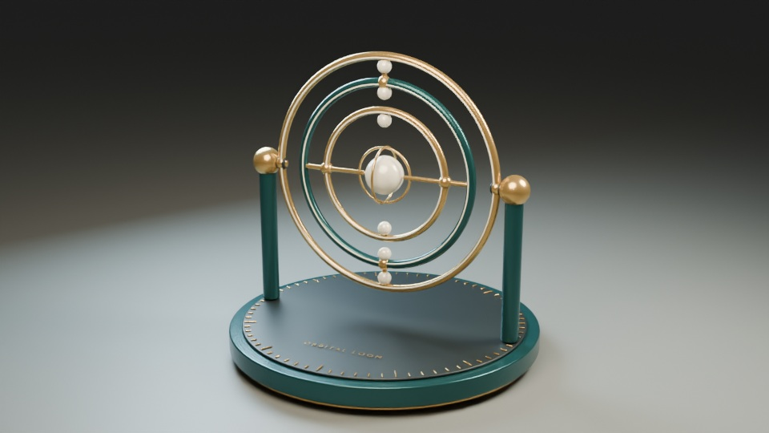
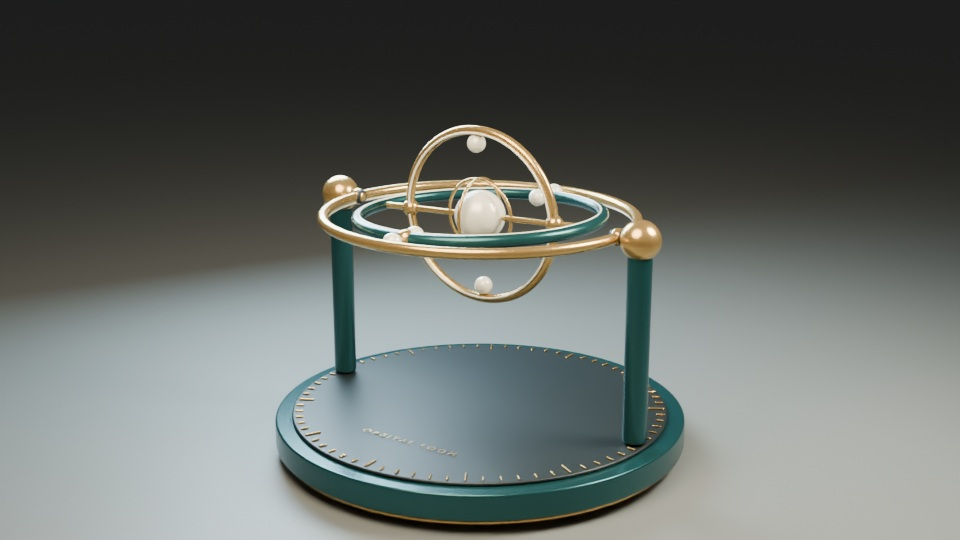
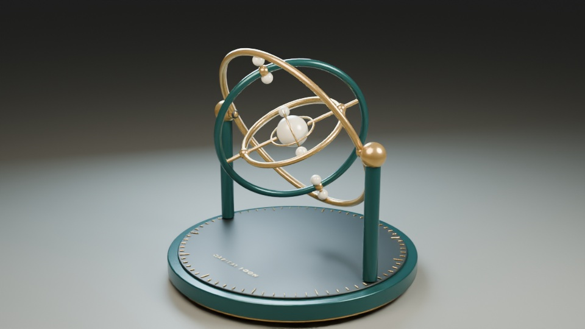
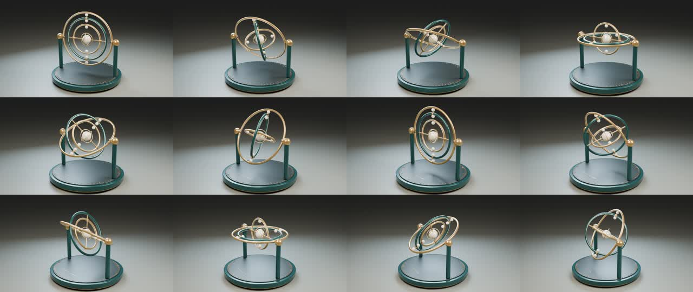

# Orbital Loom: three driven gimbals in a 15-second Blender film

This historical headless Blender run produced an original kinetic sculpture with 122 native objects and three live expression drivers. Its intentionally silent 960 × 540-pixel film contains 360 consecutive rendered frames at 24 fps, lasting 15 seconds. The recorded GLB reimport contains 115 objects and identifies Gimbal_0_driver, Gimbal_1_driver and Gimbal_2_driver as its animated objects. GUI operation and browser playback were not established by that production run.

[Hero](hero.jpg) · [Quarter-turn](quarter-turn.jpg) · [Oblique](oblique.jpg) · [Film contact sheet](film-contact-sheet.jpg) · [Film](orbital-loom.mp4) · [Native scene](orbital-loom.blend) · [Animated GLB](orbital-loom-animated.glb) · [Source package](orbital-loom-source.zip) · [Build script](build_scene.py) · [Export script](export_scene.py) · [Scene checks](validate_scene.py) · [Framing checks](check_framing.py) · [Driver probe](driver-probe.json) · [MCP evidence](mcp-summary.json) · [References](references.md) · [Toolchain findings](toolchain-findings.md) · [Licenses](LICENSES.md) · [Report](README.md) · [Validation](validation.json) · [Manifest](manifest.json)

## Delivered artifacts and measurements

| Artifact | Recorded measurement |
| --- | --- |
| Three stills | 960 × 540 pixels each |
| Contact sheet | 1280 × 540 pixels |
| H.264 film | 960 × 540 pixels; 360 consecutive frames; 24 fps; 15 seconds; intentionally silent |

Sources: validation.json and manifest.json.

The native scene contains 122 objects and three live drivers. Its recorded reopen preserved the frame range, drivers and Track To camera constraint without external image dependencies. The GLB reimport contained 115 objects and the three named animated driver objects. Its recorded pose-change check is aggregate: it does not establish each driver's independent or simultaneous playback, or motion equivalence to the native scene.

## Verified tool failure

The typed driver tool in the tested release cannot target the requested Z channel using its advertised component-path style. A vector fallback silently adds zero-valued drivers to other channels. The isolated regression probe and readback are published in `driver-probe.json`; production uses the declared scripting path with explicit axis indices.

## Iteration and framing

The first preview had a tight lower crop and incorrect shaft orientation caused by a missing transform update before parenting. Those were corrected in the scene. The camera was moved back, its target lowered, and the bearing columns moved outward. The final animated hoop envelope clears both the plinth and the columns; actual BVH overlap checks supplement the analytical envelope.

A full-timeline projection of the evaluated surface vertices also verified that the sculpture stays within the camera canvas. A first conservative bounding-box test flagged empty corners around the circular plinth; testing the actual mesh surface resolved that false positive. The measured minimum visible-geometry margin is recorded in the framing evidence rather than inferred from a few selected stills.

## Reproduce

Use the tested Blender 4.5.14 LTS host (newer host versions were not validated for these reproduction scripts), with official dcc-mcp-blender 0.2.16 and dcc-mcp-core 0.20.42. Open `orbital-loom.blend` and play its timeline. The native project keeps editable meshes, three live expression drivers, a Track To camera constraint, PBR materials and studio lights. No external textures or asset downloads are needed.

For exact reconstruction, place `build_scene.py` in a writable project directory and execute it through the official adapter's `blender_scripting__execute_script_file` tool. This is the supported scripting escape hatch, not a claim of typed-only modeling. Load `blender-scene`, `blender-animation`, and `blender-render`; open the scene with `blender_scene__open_scene`; set the output to 960×540, 24 fps, Cycles CPU, 16 samples and denoising. For each frame from 1 through 360, call `blender_animation__set_current_frame` and `blender_render__render_scene`, writing zero-padded PNGs. Encode those frames at 24 fps using H.264/yuv420p with faststart. The final native file uses a relative render directory.

The embedded adapter endpoint was loopback-only, with gateway_port=0. The safe local setup and observed gateway option mismatch are documented in `toolchain-findings.md`. Gateway-mediated CLI calls were not accepted as evidence for this run.

## Boundaries

- `validation.json` contains measured scene, clearance, export, native reopen and video checks.
- `mcp-summary.json` is a reduced list of actual successful calls. It is not a full private trace.
- `orbital-loom-animated.glb` bakes the three drivers to rotation keys. It excludes the studio, camera and native text. It was imported again into Blender and its three animated objects were found. This does not establish cross-renderer material fidelity.
- `orbital-loom.blend` preserves the live drivers and the complete studio. A metadata-sanitized compressed copy was reopened and inspected.
- Mechanical clearances are visualization checks. Intentional shaft/bearing connections are not treated as collisions. This is not a fabrication-ready engineering certification.
- The work was created and rendered headlessly. GUI operation, screen recording of the UI, and end-user acceptance are not claimed.

The exact model and reasoning effort for the historical production could not be independently verified and remain unknown. This is separate from asset licensing: original creative assets and reproduction scripts retain their explicit rights-reserved notices.

This maintenance revision adds the report layout, exact-name export guard and bilingual site presentation. It does not rerender, rebuild or retrospectively verify the historical production. The source ZIP contains the revised export script and a package-specific README that links to the review page instead of media absent from the package. The loose website report links every delivered artifact above.

## References and licensing

See `references.md` for current public inspiration and the official extension/skill check. Reference artwork was not copied, downloaded, or traced. The sculpture, native scene and rendered images are original. No new license is granted for the original artwork, native assets, rendered media or reproduction scripts; their rights are reserved. The repository’s existing site-code MIT license remains separate. Blender's built-in font was used for the native plinth label. No third-party imagery, music or fonts were imported.
