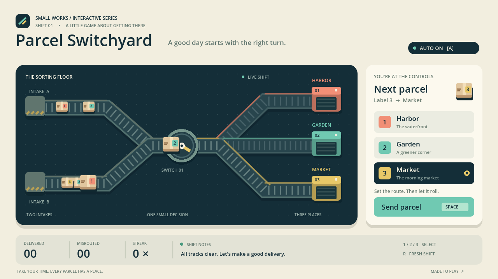
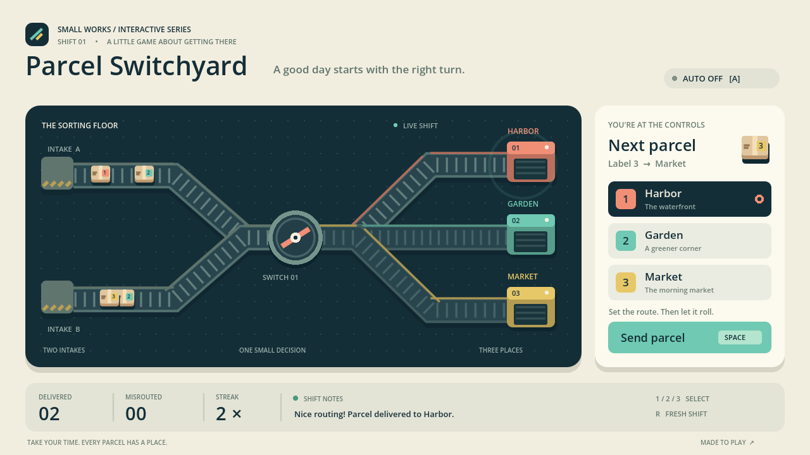

# Parcel Switchyard: typed MCP builds a sorter that survives native replay



An original Godot game with two incoming lanes, three destinations and a six-parcel capacity. Eleven successful typed authoring calls create and revise the native project. Nine deterministic checks and six real keyboard/mouse checks pass. The native film is 1280 × 720, 30 fps and 8 seconds; the exported PCK reopens and passes the same logic checks.

[Source ZIP](Parcel-Switchyard-Source.zip) · [PCK](parcel.pck) · [Hero](hero.png) · [Film](demo.mp4) · [Small window](small-window.png) · [Interaction](interaction.png) · [Project](native/project.godot) · [Scene](native/main.tscn) · [Script](native/parcel_game.gd) · [UID](native/parcel_game.gd.uid) · [Preset](native/export_presets.cfg) · [MCP evidence](evidence/mcp-calls.json) · [Initial script](evidence/initial-script.gd.txt) · [Logic](evidence/logic-tests.json) · [Archive replay](evidence/archive-tests.json) · [Input](evidence/interaction-result.json) · [CI binding](evidence/ci-verification.json) · [Render](evidence/native-render.txt) · [Video metadata](evidence/video-info.json) · [Rights](LICENSES.md) · [Validation](validation.json) · [Manifest](manifest.json)

## What the evidence establishes

| Stage | Result | Evidence boundary |
| --- | --- | --- |
| Typed gateway authoring | Pass | Script creation/revision, scene creation, script attachment, save, project settings; actual request/response records |
| Native deterministic logic | Pass | Three correct destinations, wrong routing, six-parcel limit, route keys, automatic-dispatch toggles, repeated reset |
| Local native rendering | Fail | Cloud sandbox cannot establish Xorg Unix sockets; the official preview tool correctly refuses headless dummy rendering |
| CI native pixels | Pass | Fixed official Godot under Xvfb, real OpenGL/Mesa pixels; direct Godot execution, not a claimed MCP render return |
| Real-time keyboard/mouse | Pass | Two successful deliveries, repeated reset, mouse automatic-dispatch toggle and route selection |
| Portable native/PCK reopen | Pass | Editor import, original project execution, PCK export, and PCK execution |

The unretouched hero, interaction image and small-window image are native viewport captures. The film is Godot Movie Maker output encoded to H.264 with FFmpeg, without audio. The first visual pass exposed a status/Harbor label overlap; a subsequent real MCP revision separated them before final capture. Source-commit and hash records bind the screenshots to the included script and scene. Original source payloads and subsequent tool responses remain traceable.



The small-window capture is 960 × 540. It establishes that the layout fits, with no clipping; the small secondary text is intended for desktop viewing. This does not establish mobile or touch usability.


## Reproduce and play

Extract the source ZIP and open project.godot with Godot 4.6.3. Let the editor import the project, then run the main scene. No external art assets or plugins are needed to play.

- Keys 1, 2, 3 or destination cards select a route
- Space or Send parcel dispatches the next parcel
- A or the AUTO control toggles dispatch at the selected route
- R starts a fresh shift
- Match the parcel's label with its destination. The route is latched when dispatching; changing the switch does not reroute parcels already in flight

For deterministic verification:

```sh
godot --headless --editor --path . --import
godot --headless --path . -- --test
godot --headless --path . --export-pack 'Linux package' parcel.pck
godot --headless --main-pack parcel.pck -- --test
```

Run `godot --path . -- --demo` for the scripted visual demonstration. Demo mode automatically selects the correct route; ordinary AUTO only sends along the current selection.

To reproduce authoring, install the official Godot adapter into a separate copy. Verify the typed project identity, discover/load/describe the script and scene tools, create the included source, attach it to a Node2D scene, save, and set the main scene and viewport settings. Blank bootstrap project creation, portable packaging and export-preset setup are filesystem preparation, not MCP calls. The source ZIP omits adapter code, receipts and user cache.

## Boundaries and rights

The deepest creation verification is a real tool return through the gateway. Native rendering is separately established by the CI runner; the local headless limitation remains a recorded failure. A warning that the CI display cannot change V-Sync is retained in the render record. The initial portable copy lacked the script UID sidecar and resolved via the valid text path; the sidecar was restored before final CI, which has no missing-UID warning.

No Web export, standalone executable, touch controls or mobile gameplay is claimed. The PCK requires a compatible Godot executable. Artwork is procedural GDScript, not individually modeled scene nodes. No private project assets, third-party artwork, software binary or font binary are bundled. Publication does not apply the site-code MIT license to this case. See LICENSES.md.
