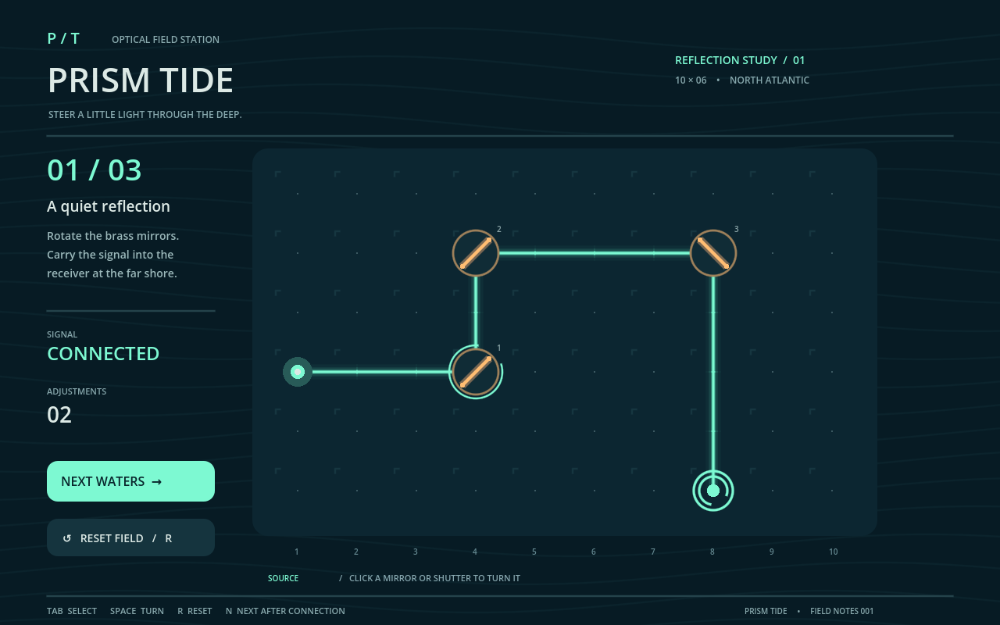

# Prism Tide: three mirror puzzles, authored through real MCP and solved by actual input

A quiet optical instrument for a dark sea. Rotate brass mirrors, lift the shutters, and guide a mint-green signal back to its receiver. Three original levels grow from a simple double turn into a six-reflection route.

The saved native project passes 17 deterministic assertions and 9 separate OS keyboard/mouse checks across three levels. Ten successful MCP calls are preserved. Native capture is 1280 × 800, 450 frames at 30 fps (15 seconds). The small capture is 864 × 540 after aspect-preserving viewport fitting.

[Native ZIP](Prism-Tide-Source.zip) · [PCK](prism-tide.pck) · [Film](demo.mp4) · [Actual input](interaction.png) · [Small viewport](small-window.png) · [MCP calls](evidence/mcp-calls.json) · [Source binding](evidence/ci-verification.json) · [Input measurements](evidence/interaction-result.json) · [Validation](validation.json) · [Manifest](manifest.json) · [Licenses](LICENSES.md)

## Play and reproduce

Download Prism-Tide-Source.zip, extract it, and import project.godot using Godot 4.6.3. No addon is needed to play. Click a mirror or striped shutter to change it. Tab selects the next device; Space or Enter operates it. R resets the current field. Once CONNECTED appears, use N or NEXT WATERS to advance. The final stage returns to the first.

Run deterministic tests: godot --headless --path . -- --test. A compatible Godot executable can run the separate prism-tide.pck with --main-pack. This is a resource pack, not a standalone executable. No web or mobile build is claimed.

## Actual production boundary

The design and GDScript were prepared as source, then real dcc-mcp-godot 0.9.6 / Core and CLI 0.20.42 Gateway calls created the script, created a native Node2D scene, attached the script, saved the scene, and set the main scene, viewport, stretch and renderer. A subsequent actual MCP edit corrected REFRACTION to REFLECTION after independent visual review. Ten actual successful calls are in evidence/mcp-calls.json. Godot 4.6.3 reopened the saved files and passed 17 assertions. The portable copy removes local adapter installation and editor metadata; its source script is byte-identical.

Rendering is a separate direct native Godot CI stage using Ubuntu Xvfb and Compatibility OpenGL, not an MCP rendering response. The movie is Godot Movie Maker output encoded with FFmpeg to H.264. The movie's scripted state changes are a demonstration, not evidence of human or OS input. A separate xdotool run verifies real keyboard and mouse events for all three solutions, incorrect rotation, blocked shutter, selection and repeated resets.

## Quality and limits

Designed for a 1280 × 800 desktop viewport. Small-window fit does not establish phone readability or touch accessibility. Mirrors and shutters are editable script data; the illustration is procedural drawing rather than individual scene mesh assets. The beam is a deterministic orthogonal grid model, not a physical ray tracer. There is no audio. Exact model and reasoning attribution remains Unknown.

See validation.json for measured checks, manifest.json for hashes, LICENSES.md for license boundaries, and evidence for sanitized production and native testing records.
