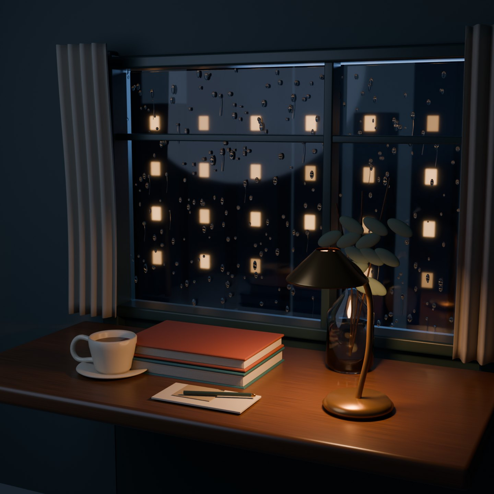
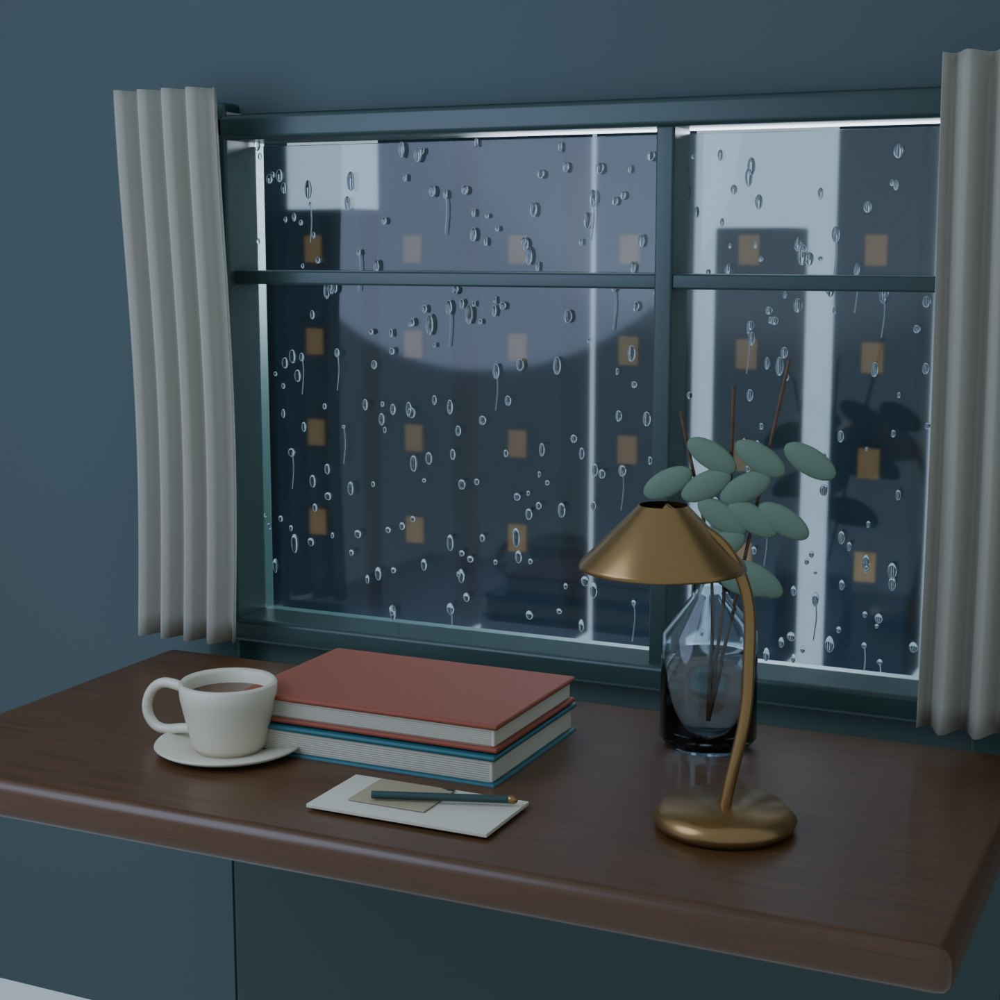
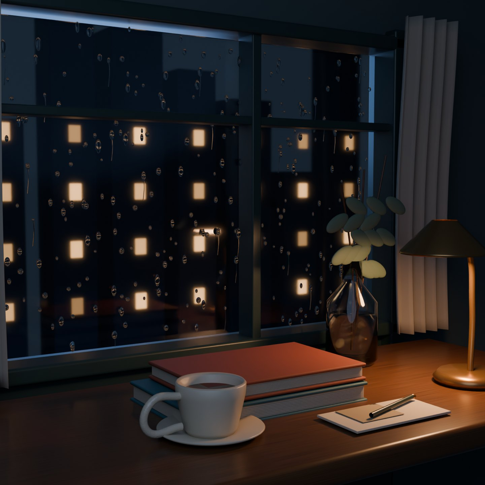
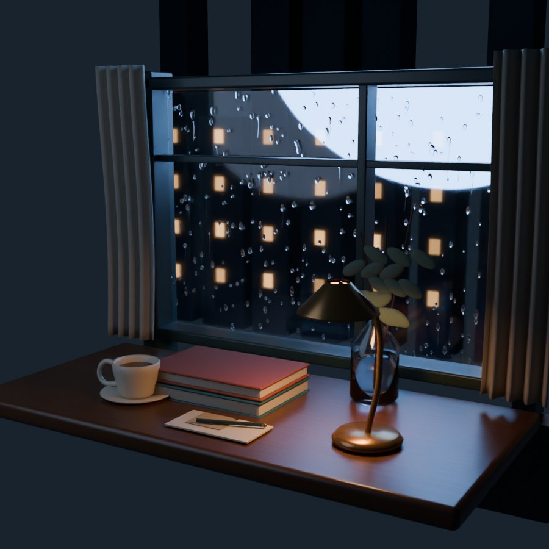

# Rainroom — two hours at the same window

[Native Blender scene](rainroom.blend) · [Morning](morning.jpg) · [Detail](detail.jpg) · [Validation](validation.json) · [Manifest](manifest.json) · [Licenses](LICENSES.md)

An editable, original rainy-window still life: smoked walnut, glazed stoneware, folded linen curtains, stacked cloth-bound books, a clear botanical bottle and a brass reading lamp. Two saved lighting states turn the same room from rain night into cool morning. Stylized water is geometry: 330 individual beads and 26 editable curve rivulets on real transmissive glass.

## Actual production

This scene was authored in Blender 4.5.14 LTS through the official dcc-mcp-blender 0.2.16 adapter and Core/Gateway/CLI 0.20.42. Authoring used the documented scripting skill after inspecting the typed inventory; image packing, saving, scene opening and isolated CPU render submission/status used typed tools. This is not typed-only modeling. No generated image is used as a render or texture.

[Pre-authoring plugin suitability review](plugin-review.md) records what was checked before geometry creation, the official sources, a failed direct extension-page fetch and why a sky add-on was not installed. The native asset-library capability was evaluated; no downloaded asset library is claimed. All geometry, materials and the tiny postcard texture are original. The postcard's 128 × 128 bitmap is actually packed through the material-library tool.

The first CPU image revealed a sky softbox visible through the window and an exposed set above the sash. The review pass disabled the softbox's camera/transmission visibility, added plaster returns and tightened the main camera. A second independent preview review found a black corner caused by coplanar overlapping wall slabs. fix_wall.py rebuilt non-overlapping returns and filled an under-sill gap; its actual preview confirmed the correction before all final images were rerendered. These are source-scene revisions, not image retouching. Water beads, silhouette readability, noise, rim edges, book contact and the two lighting states are inspected in real renders before publication.

## Reproduce and edit

Use Blender 4.5 or newer. Open rainroom.blend and select frame 1 for warm-lamp rain night or frame 2 for morning. The two saved cameras are 01_Window still life and 02_Rain and tea. All materials and objects remain editable. The file includes a packed original postcard image and no linked libraries.

For reconstruction, connect a dedicated empty Blender instance to its official gateway. Search/load the blender-scene, blender-scripting, blender-material-library and blender-render skills and inspect current schemas. Execute build_rainroom.py followed by refine_rainroom.py, finalize_lighting.py and fix_wall.py through blender_scripting__execute_script_file. Pack Rainroom postcard original ink with blender_material_library__pack_image; save with blender_scene__save_scene. Set CPU Cycles and the documented final resolution/samples through typed render settings. Submit frames 1–2 with blender_render__start_render_job and poll blender_render__get_render_job until terminal completion. Use the second camera for the detail image. Run inspect_rainroom.py to read actual counts and mood energies. Before sharing, run sanitize_native.py and verify its scan results.

## Evidence boundaries

Public MCP evidence is a minimal, sanitized selection of successful actual results, not a complete raw trace. Internal routing, job identities and working directories are omitted. Headless CPU rendering and scene reopen are verified; GUI interaction and other DCC hosts are not. The native model is an artistic interior vignette, not architectural documentation or a calibrated fluid simulation. The two mood states are keyed lighting, not a weather simulation. Exact backend model and reasoning effort are not attributed without a checked configuration receipt. Author visual review is not user sign-off.

## Final images

The two main images are 1440 × 1440, 128-sample CPU Cycles; the second camera uses 96 samples. Denoising is enabled. Display JPEGs are quality-86 derivatives of actual PNGs; original render hashes are in image-provenance.json. Native delivery is 491 objects, 454 meshes, 32 curves, two cameras and 64 materials. The transient unsaved Viewer Node scratch buffer disappears on reopen; authored image/material/object state is unchanged. The compressed delivery itself was independently decompressed and scanned, not only its uncompressed predecessor.

