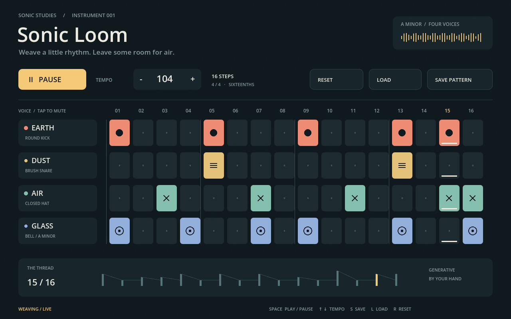
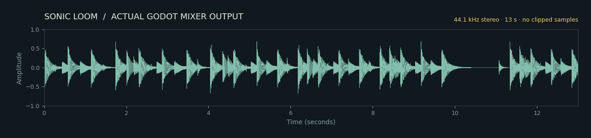

# Sonic Loom: a playable Godot sequencer with a real recorded audio track

Four original synthesized voices and a 16-step grid make a 64-cell instrument. The real Godot 4.6.3 runtime produced this 1280 × 800 frame and a 13-second movie with actual mixed sound. Its 44,100 Hz stereo PCM has RMS 0.119222, peak 0.759277, and 0 clipped samples. **Subjective listening was not available and is not claimed.**

[Movie with audio](demo.mp4) · [Listen MP3](demo.mp3) · [Lossless WAV](demo.wav) · [Native source ZIP](Sonic-Loom-Source.zip) · [Waveform](waveform.png) · [Small window](small-window.png) · [MCP evidence](mcp-evidence.json) · [Interaction](interaction.json) · [Logic checks](logic-tests.json) · [Audio measurements](audio-analysis.json) · [Reproduce](REPRODUCE.txt) · [Licenses](LICENSES.md) · [Validation](validation.json) · [Manifest](manifest.json)

## A small instrument, with room for air

Earth, Dust, Air and Glass combine a pitched kick, noise snare, closed hat and A-minor bell. The default tempo is 104 BPM. Click the grid to edit, the voice label to mute, or the amber control to play and pause. The active step is underlined. Local Save/Load preserves the edited pattern, tempo and mute state; Reset returns the original pattern without overwriting the saved pattern.

The interface is original source-drawn Godot artwork. The top-right motion is decorative and the lower thread expresses pattern density; neither is presented as a measured spectrum.

## Sound that actually came from the host

The MP4, MP3 and WAV derive from the same real Godot Movie Maker audio stream. Audio has not been replaced by a synthetic soundtrack in post-production. Only format conversion was applied. The WAV is the left/right PCM of the host's mixer, and the plotted waveform shows its left channel. All sound synthesis occurs in the GDScript audio source at runtime. There are no third-party recordings or samples.

## Interaction caught a real bug

The initial rapid keyboard/mouse test failed: consulting the latest mouse position during a queued click could activate the following control. The revised script uses each event's own coordinates. The final actual mouse/keyboard check covers a step edit, tempo button, play/pause, mute, repeated reset, and saved-pattern reload. Full evidence retains the failure and correction in validation.json.

The video demonstrates scripted live edits, a tempo change, pause and resume. It is separate from the real xdotool input test. Native state tests also check repeated editing, tempo limits and nonzero PCM in every voice.

## Reproduce

Unzip Sonic-Loom-Source.zip, open project.godot in Godot and run. No external samples or MCP add-on are needed to play. Space toggles playback, arrow keys adjust tempo, S saves, L loads and R resets. Detailed commands are in REPRODUCE.txt.

For authoring evidence, the script was created and revised using typed MCP create_script/edit_script, compiled with validate_script, attached to an actual Node2D scene, and saved through scene tools. Project settings and the audio bus were read or written through the gateway. The CI runtime is direct Godot, clearly separate from MCP authoring.

## Boundaries

- Numerical PCM and clipping checks do not replace a listening review. Listening remains unverified.
- Desktop input and local state are tested; mobile, Web export and hardware audio latency are not.
- Capture used a windowed Godot instance on Xvfb, not headless rendering. No retouching was applied.
- The native ZIP contains the editable source, scene and project settings, not software binaries or credentials.
- Pausing stops the sequencer; already triggered sounds retain their short natural tails.

- The capture logs include an unsupported V-Sync warning and an ObjectDB-at-exit warning; the movie and PCM completed, but a warning-free shutdown is not claimed.
