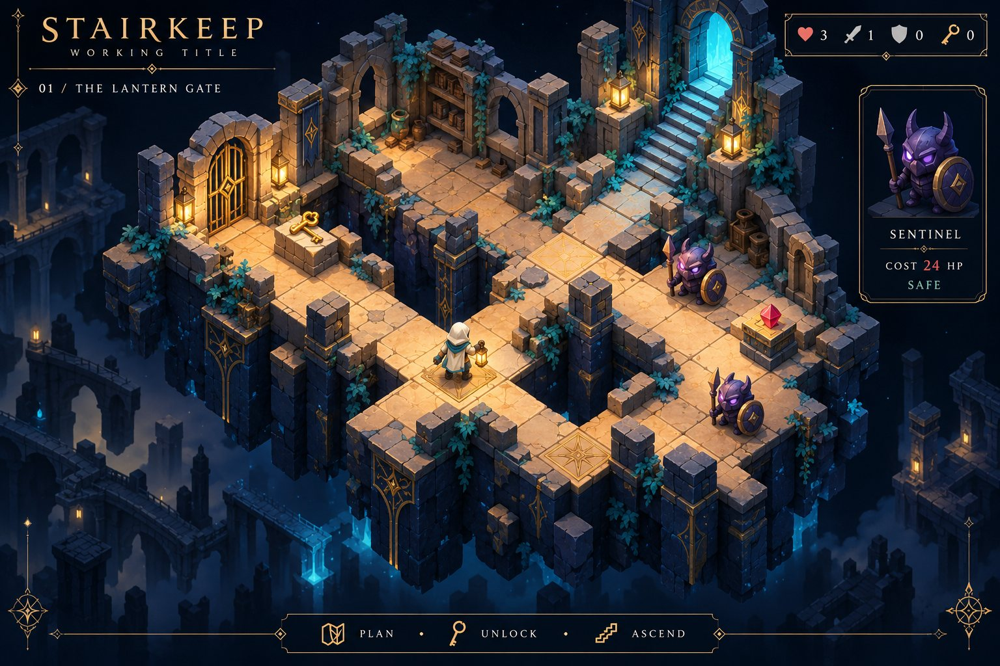

# Three floors share one deterministic combat rule

**Draft candidate — 阶塔 / Stairkeep is a working title and can be renamed.**
The native Godot slice has 3 floors and 34 fixed objects. Its 42 rule checks and
34 projection round-trips passed. The actual Compatibility/GDScript Web export
uses the verified official single-thread runtime. Native pixels, real input and
HTTP browser acceptance remain blocked. The image above is concept art only.

[Native project](../../../scripts/godot_web/stairkeep/game/project.godot) ·
[Recipe and controls](../../../scripts/godot_web/stairkeep/README.md) ·
[Rules](rules-checks.json) · [Layout](layout-checks.json) ·
[Simulation](simulation-10000.json) · [Export](export-provenance.json) ·
[Validation](validation.json) · [Manifest](manifest.json) ·
[Review status](review-status.json) · [Attribution](model-attribution.json) ·
[Concept prompt](concept-prompt.txt) · [Repository checks](repository-checks.json) ·
[Technical review](technical-review.json)

## What ran

The existing Godot 4.7.2 editor imported the licensed native source, ran the
headless scene and exported a real WebAssembly build. Tests cover a key consumed
once, repeated/opened gates, bidirectional stairs, cleared floor state,
preview equal to HP spent, armor/HP impossibility, finite shop stock and strict
save/load/reset with invalid-save rejection. Four full routes replay every
resource ledger event and finish with 49, 78, 20 and 85 HP.

The scene test measured settled native Control rectangles at 1280 × 800 and
round-tripped all object cells through the reused official TileSet projection.
This is a geometry check after Container sorting, not a rendered visual review
or an input test. The native HUD uses one six-symbol stroke system and Theme.

## Resource choices have consequences

The real GDScript rules ran 10,000 seeded simulations across five policies,
yielding 7,970 different decision sequences and 69,968 combat comparisons with
zero preview/resource invariant errors. There were 9,980 wins and 20 exhausted
resource states, all in the randomized policy. The report retains a complete
counterexample: fighting before buying attack spends health inefficiently, then
limited healing stock runs out before the warden. No currency or merchant stock
was silently changed to turn this into a perfect score. Save/reload/restart is
available; explicit losing-route explanation and balance review remain needed.
The sample is not a proof over every state or a substitute for the planned
21-floor solver/seed acceptance gate.

## Reuse and visual direction

The official MIT isometric demo is pinned to commit
`6ad6167e0577fe3622c18546138f456b107ce93c` (Godot 4.7 tag). Its real TileSet
projection and goblin SpriteFrames are used. Ten unchanged Kenney CC0 PNGs form
the sandstone environment and wanderer. New native systems supply the grid,
floor persistence, keys/gates, forge, resource decisions, combat and saves.
Retained notices, exact source hashes and modifications are in the
[project source](../../../scripts/godot_web/stairkeep/README.md#rights-and-reuse).

The AI-generated concept establishes ink-blue masonry, warm sandstone, cyan
stairs and brass HUD accents. It is not accepted evidence of final game quality.
The current gameplay UI is English; full localization, portrait/mobile and sound
are outside this slice's accepted scope. The game is deliberately silent.

## Reproduce and review

Use [the native recipe](../../../scripts/godot_web/stairkeep/README.md), the
[Web export recipe](../../../scripts/godot_web/stairkeep/WEB-EXPORT.md), and the
[pending browser checklist](../../../scripts/godot_web/stairkeep/BROWSER-ACCEPTANCE.md).
The delivered review ZIP contains an editable native project, exported browser
game, all applicable licenses and this evidence. Serve its web folder over HTTP;
do not open index.html using file://. Source and runtime hashes are recorded.

The existing showcase games and shared runtime remain untouched. This draft is
not selected in collection.json or the play manifest, and is not deployed.
The [21-floor design](../../../scripts/godot_web/stairkeep/CAMPAIGN-21-DESIGN.md)
is a follow-on specification; those floors, death variants and play duration are
not implemented or accepted in this package.
