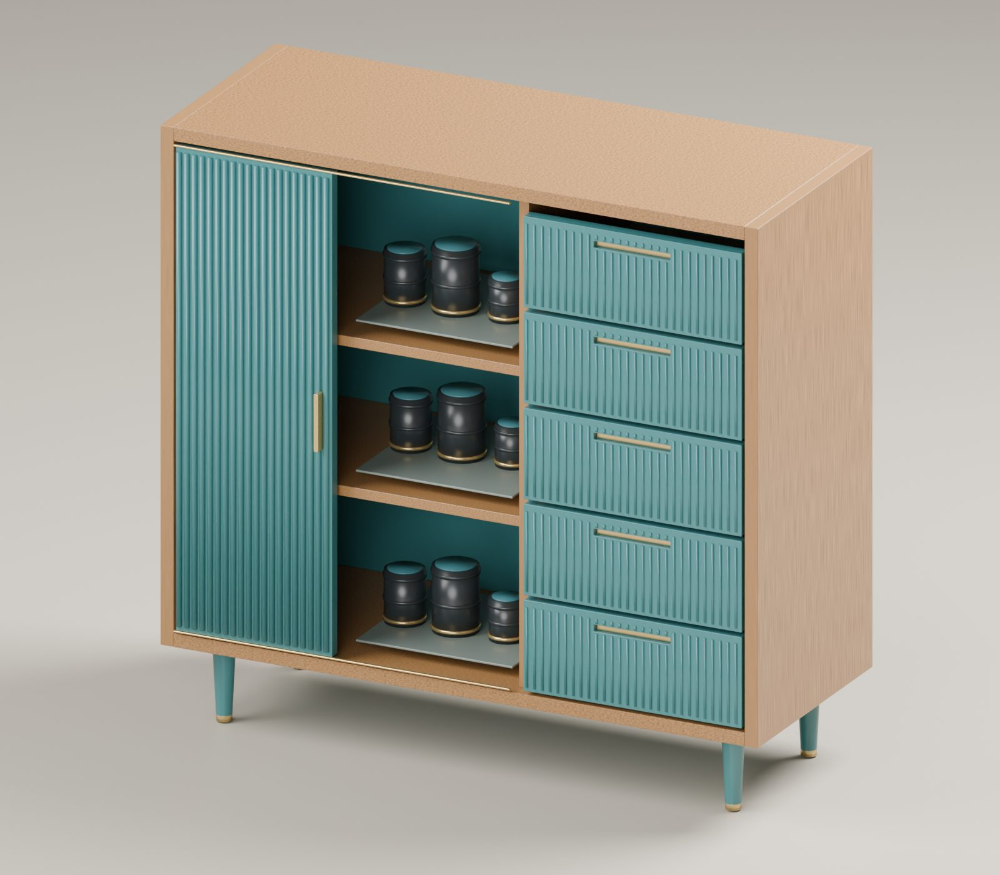
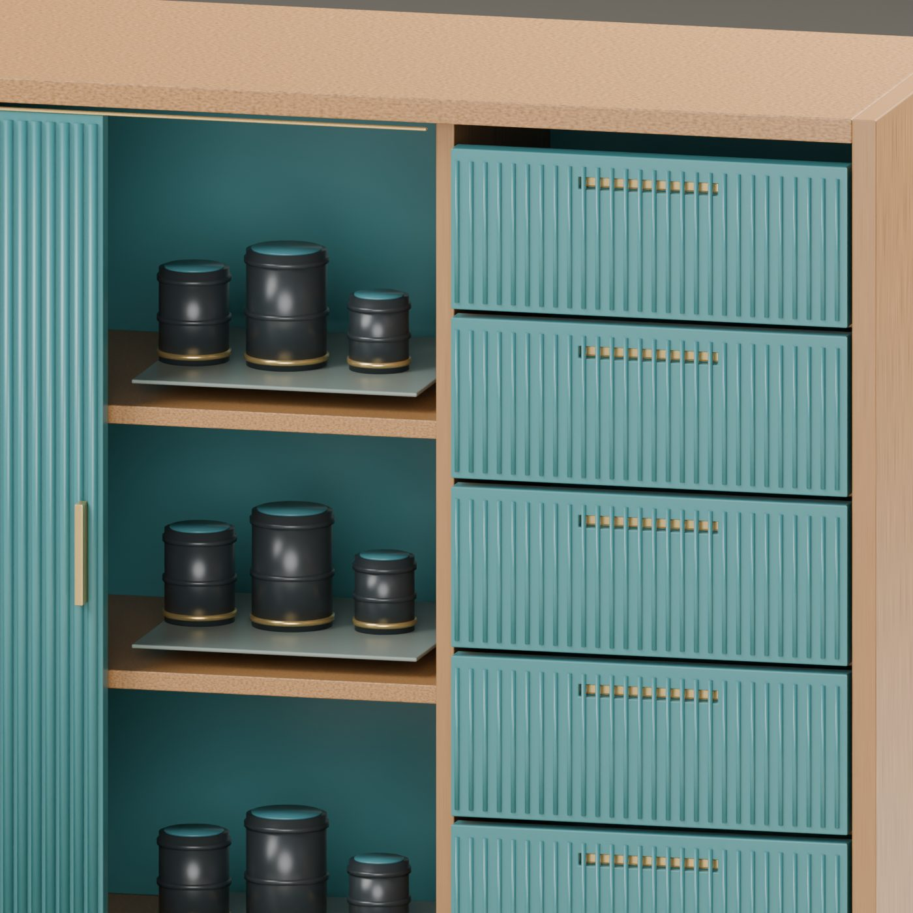
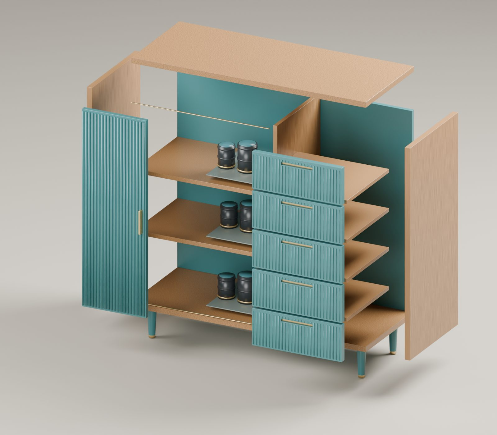

# Tidal: editable cabinet dimensions and 294 solids survive STEP exchange

An original camera-library cabinet with light ash-toned framing, a fluted teal shutter, brass tracks, five reed-front drawer studies and neutral lens storage proxies. The FreeCAD native document reopens with 255 objects, 17 live expressions and an 11-constraint fully constrained tray profile. Its 294 exported solids retain identical millimetre bounds through STEP reimport; measured relative volume error is below 1e-9.

[Native CAD](tidal.FCStd) · [Exploded CAD](tidal-exploded.FCStd) · [STEP](tidal.step) · [Hero](hero.jpg) · [First-pass detail](preview-detail.jpg) · [Detail](detail.jpg) · [Exploded](exploded.jpg) · [Build recipe](build_tidal.py) · [Roundtrip recipe](roundtrip.py) · [Render recipe](render_tidal.py) · [Mesh readback](measure_render.py) · [Measured mesh data](cad_meshes.json) · [Part selection](visible.json) · [MCP summary](mcp-summary.json) · [Licenses](LICENSES.md) · [Validation](validation.json) · [Manifest](manifest.json)

## Design and real images

Close-up review revealed that the first reed pattern crossed the recessed grips. The final CAD cuts those reeds around each grip, exposing the continuous brass liner; the model and STEP measurements were rerun after this geometry change.

The material study uses a restrained cabinet silhouette with fine vertical reeds, inset grip recesses, contrasting brass details and tapered feet. The open bay reveals how camera equipment occupies the storage volume. Lens shapes are generic layout proxies, not branded product models.

The exploded native copy separates cheeks, crown, shutter and drawer fronts. It is a presentation study, not a mechanically constrained assembly or a validated sliding mechanism.

All images come from Blender Cycles CPU using the real FreeCAD tessellated geometry, with auxiliary micro-bevel modifiers and procedural materials. These are direct CLI renders, not FreeCAD viewport captures and not Blender MCP calls. JPEG quality-82 derivatives are the only image conversion; source PNG hashes and dimensions are recorded in validation.json. No image generation, retouching or replacement geometry is used.

## Native and exchange verification

| Quantity | Native export selection | STEP reimport |
|---|---:|---:|
| Solids | 294 | 294 |
| Minimum XYZ (mm) | 0, -24, 0 | 0, -24, 0 |
| Maximum XYZ (mm) | 1080, 420, 1040 | 1080, 420, 1040 |

The live Width expression test changes the right cheek from x=1056 mm to x=1116 mm and restores it to x=1056 mm. The tray sketch has 11 constraints and FreeCAD reports it fully constrained. Native validation reports no invalid or empty-shape objects. These digital measurements do not establish fabrication or structural safety.

## MCP workflow and reproduction

The official adapter skills and supported runtime matrix were inspected first. The initial GUI-assisted attempt exited unsuccessfully and was replaced by a clean headless build. Its file is not the delivered native artifact. The explicit MCP transport option also failed during routing; successful calls used the official gateway default REST route. These are not represented as successful GUI or MCP-transport checks.

Production uses FreeCAD 1.1.4, its Python 3.11.14 runtime, dcc-mcp-freecad 0.8.0 and Core/Gateway/CLI 0.20.42. Built-in Part, Spreadsheet and Sketcher support the chosen design without external workbenches. The host installation was isolated from an incompatible system Python; this is not recorded as an adapter defect.

Start the official FreeCAD service with an allowed project folder. Load freecad-session and inspect tool schemas. Call freecad_session__run_script with the path to build_tidal.py; the official documented escape hatch handles native expressions, repeated geometry and the constrained Sketcher/Pad feature. Call freecad_session__validate_document and inspect_document with path pointing to tidal.FCStd. Then run roundtrip.py through the same official tool for native reopen, reversible dimension test, exploded copy and STEP export/reimport measurements. Selected successful gateway receipts are retained in mcp-summary.json; internal paths, routing IDs and jobs are omitted.

Open tidal.FCStd in FreeCAD to edit the Dimensions spreadsheet, main Part primitives or TrayProfile constraints. Detailed decorative parts are static Part features. The master is verified headlessly; its GUI presentation and material persistence were not tested. A native document is supplied, not a screenshot substitute.

For the auxiliary material presentation, run render_tidal.py with Blender in background mode beside cad_meshes.json. The renderer converts millimetres to metres and does not remodel the cabinet. It generates hero, detail and exploded images. The separate exploded CAD remains a static presentation copy.

## Boundaries

This is a digital industrial-design concept. It is not a fabrication drawing, load-bearing claim, certified furniture design, humidity-control validation, manufacturing tolerances, fastener plan or fully constrained mechanical assembly. Drawer fronts and support shelves are modeled; drawer boxes, runners and fasteners are not. Volume means summed solid BREP volume, not union volume or material mass. Only the structural envelope is spreadsheet-driven; interior and decorative dimensions require review after changes. STEP preserves the measured BREP geometry, not FreeCAD expressions, sketch history or materials. FreeCAD viewport use remains untested. CAD orchestration used official MCP; auxiliary rendering used direct Blender CLI. All verification scope and image provenance are explicit in validation.json.
