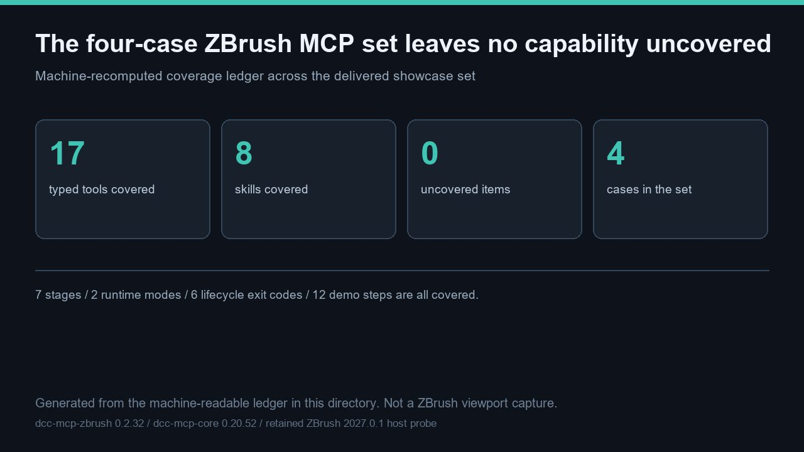

# Four ZBrush MCP cases cover all 17 typed tools, 8 skills, 7 stages, 2 runtimes and 6 lifecycle exit codes with 0 uncovered items



> This hero is a **generated diagram** of the machine-readable ledger in this directory, not a ZBrush viewport capture. It is 1280 × 720 pixels. No ZBrush process was launched and no new host media was captured for this entry.

This entry is the **machine-checkable zero-gap proof** for the delivered ZBrush MCP showcase set of **4** cases. The ledger in [capability_coverage.json](capability_coverage.json) declares the full expected inventory — **17** typed tools, **8** skills, **7** progressive stages, **2** runtime modes, **6** lifecycle exit codes, **12** ordered demo steps, **6** read-only and **11** destructive tools — and maps every item to at least one case. [audit_capability_coverage.py](audit_capability_coverage.py) recomputes coverage rather than trusting the declaration: **12** checks `pass`, **0** uncovered categories and **0** uncovered items in [capability_coverage_result.json](capability_coverage_result.json). Across the whole set, **29** checks pass in the three dedicated verifiers. Coverage means a capability is inventoried and bound to a reproducible check; it does **not** mean a live ZBrush tool returned a value (**0** such returns are claimed).

Artifacts: [README.md](README.md) · [README.zh.md](README.zh.md) · [hero-capability-coverage.jpg](hero-capability-coverage.jpg) · [capability_coverage.json](capability_coverage.json) · [audit_capability_coverage.py](audit_capability_coverage.py) · [capability_coverage_result.json](capability_coverage_result.json) · [validation.json](validation.json) · [manifest.json](manifest.json)

## The four cases and what each contributes

| Case | Role | What it adds |
| --- | --- | --- |
| `zbrush-mcp-capability-tour` | baseline inventory | The full **17**-tool / **8**-skill contract tour, the **12**-step demo chain, both runtimes and the lifecycle table. |
| `zbrush-mcp-sdk-surface-audit` | real-host SDK binding | Binds every adapter SDK call to the **149**-name real ZBrush 2027.0.1 callable surface; proves **0** missing callables. |
| `zbrush-mcp-capability-coverage` | coverage ledger | This recomputed zero-gap proof over the whole set. |
| `zbrush-mcp-recovery-and-lifecycle` | recovery and lifecycle | Post-submit unknown-outcome classification, blocked dialogs, **6** exit codes and **2** runtime modes. |

One baseline case plus three depth cases is deliberate: the baseline guarantees nothing is silently omitted, and the depth cases verify the parts a plain inventory cannot — real-host SDK backing, measured absence of UI-only capabilities, and the ZBrush-specific recovery semantics.

## Recomputed coverage

| Category | Expected | Covered by at least one case | Uncovered |
| --- | --- | --- | --- |
| Typed tools | `17` | `17` | `0` |
| Skills | `8` | `8` | `0` |
| Progressive stages | `7` | `7` | `0` |
| Runtime modes | `2` | `2` | `0` |
| Lifecycle exit codes | `6` | `6` | `0` |
| Demo steps | `12` | `12` | `0` |
| Read-only tools | `6` | `6` | `0` |
| Destructive tools | `11` | `11` | `0` |

The verifier also checks that the **6** read-only and **11** destructive tools are disjoint and together partition the **17** typed tools, that **4** distinct case slugs are declared, and that the ledger's own `declared_uncovered` list is empty. A gap in any category makes the verifier exit non-zero, so "no missing capability" is a reproducible result rather than a sentence.

## Reproduction

```bash
# From the dcc-mcp/showcase checkout; standard library only:
python docs/showcase/zbrush-mcp-capability-coverage/audit_capability_coverage.py
python scripts/validate_entry.py docs/showcase/zbrush-mcp-capability-coverage
```

The verifier rewrites [capability_coverage_result.json](capability_coverage_result.json) deterministically (no timestamps), so re-running it produces byte-identical output. To validate the whole set at once, run the official entry check with each of the **4** slugs. The clean-wheel suite on the same source revision was re-run in this turn: **596** passed, **2** skipped, **0** failed; `tools/lint_skills.py` exited **0**. A `PASS` from the official checker means the mandatory trio and artifact hashes are present and traceable, **not** that a live host produced the numbers.

## Boundaries — what this entry does not prove

This is a **contract-verified coverage ledger**, deliberately not a live-host demonstration. The following are recorded as `not_run` in [validation.json](validation.json), each with a concrete `observed` reason:

- **Live 2027 host typed-tool returns.** No ZBrush process, no `zbrush` MCP instance and no open sidecar port; the 2027 host has no adapter/plugin deployment receipt. Real `tools/call` values for the **17** typed tools were not produced.
- **New host media.** No viewport was launched; the hero is a generated diagram, not a capture.
- **Gallery pages, publication and review.** All **4** cases are unlisted/review decisions in one Draft PR; no card, locale page, merge, deployment or independent review is claimed.
- **Real-host capability execution.** Structural coverage binds each capability to a reproducible check, not to an executed ZBrush operation.

No private task ID, prompt, account, credential, internal path or unredacted log is included. The next step toward a gallery card is an owner-authorized deployment receipt followed by a real-host acceptance run with tool returns, then review, merge and a post-deploy read-back — each a separate authorization gate.
