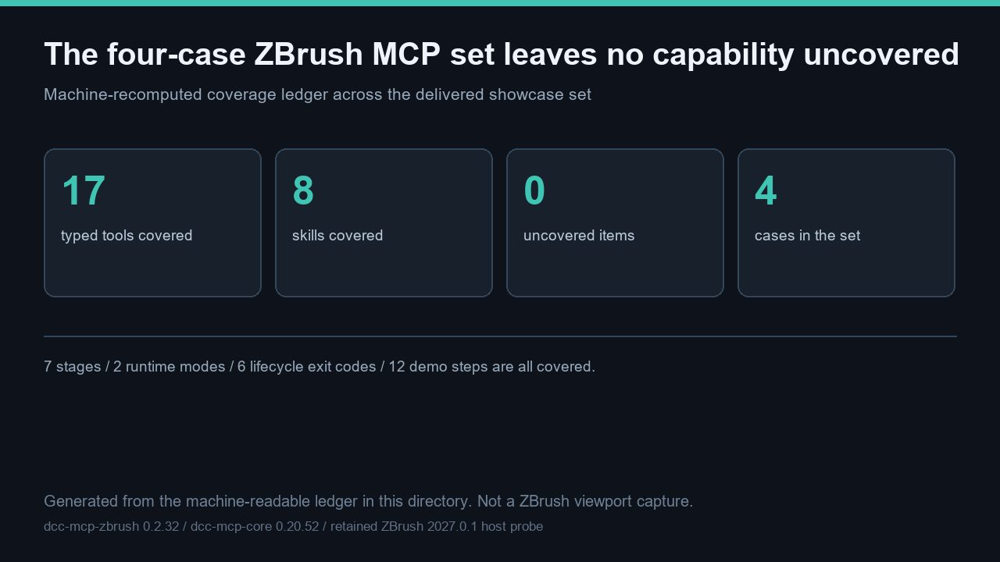

# 4 个 ZBrush MCP 案例覆盖全部 17 个类型化工具、8 个技能、7 个阶段、2 种运行时与 6 个生命周期退出码，未覆盖项 0



> 主图是根据本目录机器可读台账**生成的示意图**，不是 ZBrush 视口截图，尺寸 1280 × 720 像素。本轮未启动 ZBrush 进程，也未采集任何新的宿主媒体。

本条目是已交付的 **4** 个 ZBrush MCP 案例集合的**机器可校验零缺失证明**。[capability_coverage.json](capability_coverage.json) 声明完整期望清单 —— **17** 个类型化工具、**8** 个技能、**7** 个渐进加载阶段、**2** 种运行时模式、**6** 个生命周期退出码、**12** 步有序演示链、**6** 个只读工具与 **11** 个破坏性工具 —— 并把每一项映射到至少一个案例。[audit_capability_coverage.py](audit_capability_coverage.py) 重算覆盖而非轻信声明：[capability_coverage_result.json](capability_coverage_result.json) 中 **12** 项 `pass`、未覆盖分类 **0**、未覆盖条目 **0**。整个集合的三个专用校验器共 **29** 项检查通过。「覆盖」指该能力已在册并绑定到可复现检查，**不等于**真机工具返回了值（此类返回声称 **0** 项）。

文件：[README.md](README.md) · [README.zh.md](README.zh.md) · [hero-capability-coverage.jpg](hero-capability-coverage.jpg) · [capability_coverage.json](capability_coverage.json) · [audit_capability_coverage.py](audit_capability_coverage.py) · [capability_coverage_result.json](capability_coverage_result.json) · [validation.json](validation.json) · [manifest.json](manifest.json)

## 四个案例及各自贡献

| 案例 | 角色 | 补充了什么 |
| --- | --- | --- |
| `zbrush-mcp-capability-tour` | 基线清单 | 完整 **17** 工具 / **8** 技能契约巡演、**12** 步演示链、两种运行时与生命周期表。 |
| `zbrush-mcp-sdk-surface-audit` | 真机 SDK 绑定 | 把每个 adapter SDK 调用绑定到真实 ZBrush 2027.0.1 的 **149** 项可调用面，证明缺失 **0** 项。 |
| `zbrush-mcp-capability-coverage` | 覆盖台账 | 本条针对整个集合重算的零缺失证明。 |
| `zbrush-mcp-recovery-and-lifecycle` | 恢复与生命周期 | 提交后未知结局分类、阻塞对话框、**6** 个退出码与 **2** 种运行时模式。 |

「一个基线 + 三个纵深」是刻意设计：基线保证没有能力被静默遗漏，纵深案例校验纯清单无法覆盖的部分 —— 真机 SDK 支撑、UI 专属能力的实测缺失，以及 ZBrush 特有的恢复语义。

## 重算出的覆盖情况

| 分类 | 期望 | 至少一个案例覆盖 | 未覆盖 |
| --- | --- | --- | --- |
| 类型化工具 | `17` | `17` | `0` |
| 技能 | `8` | `8` | `0` |
| 渐进加载阶段 | `7` | `7` | `0` |
| 运行时模式 | `2` | `2` | `0` |
| 生命周期退出码 | `6` | `6` | `0` |
| 演示步骤 | `12` | `12` | `0` |
| 只读工具 | `6` | `6` | `0` |
| 破坏性工具 | `11` | `11` | `0` |

校验器还会检查 **6** 个只读与 **11** 个破坏性工具互不相交、合起来恰好划分 **17** 个类型化工具，检查声明了 **4** 个不同案例 slug，并检查台账自身的 `declared_uncovered` 为空。任一分类出现缺口都会让校验器非零退出，因此「能力无缺失」是可复现的结果，而不是一句断言。

## 复现

```bash
# 在 dcc-mcp/showcase 检出下，仅需标准库：
python docs/showcase/zbrush-mcp-capability-coverage/audit_capability_coverage.py
python scripts/validate_entry.py docs/showcase/zbrush-mcp-capability-coverage
```

校验器以确定性方式（无时间戳）重写 [capability_coverage_result.json](capability_coverage_result.json)，重跑会得到逐字节一致的输出。若要一次校验整个集合，对 **4** 个 slug 分别运行官方条目检查。同一源码修订上本轮重跑干净 wheel 测试套件：**596** 通过、**2** 跳过、**0** 失败；`tools/lint_skills.py` 退出码 **0**。官方检查的 `PASS` 只表示三个强制文件与制品哈希齐备且可追溯，**不代表**这些数字由真机产生。

## 边界 —— 本条目不证明什么

这是一次**契约校验级覆盖台账**，刻意不是真机演示。以下各项在 [validation.json](validation.json) 中记为 `not_run`，各附带具体 `observed` 原因：

- **2027 真机类型化工具返回。** 本轮没有 ZBrush 进程、没有 `zbrush` MCP 实例、也没有开放的 sidecar 端口；2027 宿主没有 adapter/插件部署回执。**17** 个类型化工具的真实 `tools/call` 值并未产生。
- **新的宿主媒体。** 未启动视口；主图是生成的示意图，不是截图。
- **画廊页面、发布与审核。** **4** 个案例在同一个 Draft PR 中登记为 unlisted/review；不声称已有卡片、语言页、合并、部署或独立审核。
- **真机能力执行。** 结构化覆盖把每项能力绑定到可复现检查，而非已执行的 ZBrush 操作。

不含任何私有任务号、提示词、账户、凭据、内部路径或未脱敏日志。通向画廊卡片的下一步是先取得属主授权的部署回执，再做一次含真实工具返回的真机验收，其后是审核、合并与部署后回读——每一道都是独立授权门禁。
