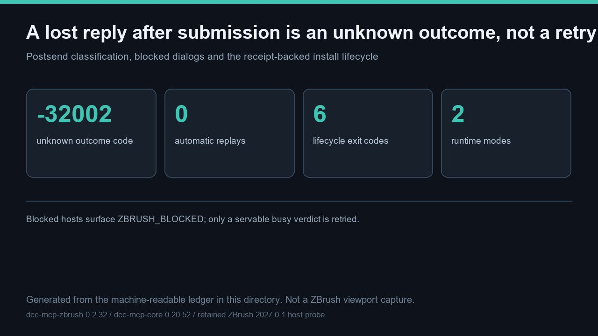

# A lost reply after submission is an unknown, non-retryable outcome: 4 verdict states, 3 bridge codes, 6 exit codes and 2 runtime modes are contract-verified with 0 real tool returns claimed



> This hero is a **generated diagram** of the machine-readable matrix in this directory, not a ZBrush viewport capture. It is 1280 × 720 pixels. No ZBrush process was launched and no new host media was captured for this entry.

This entry showcases the ZBrush-specific behaviour a plain tool inventory cannot prove: what happens when the host stops answering. Once a real method is on the wire, a lost or malformed reply is classified as `-32002` with `execution_state=unknown` and `retryable=False` — **0** automatic replays. Only a refused-but-servable `-32001` busy verdict is retried; a `blocked` host surfaces `ZBRUSH_BLOCKED` and is never retried or auto-answered. The matrix in [recovery_lifecycle_matrix.json](recovery_lifecycle_matrix.json) records **4** probe verdict states, **3** client-visible bridge codes, **6** lifecycle exit codes, **2** runtime modes and **6** source invariants. [verify_recovery_lifecycle.py](verify_recovery_lifecycle.py) rechecks those invariants against the adapter source and reports **9** checks `pass` in [recovery_lifecycle_result.json](recovery_lifecycle_result.json). Real `tools/call` returns remain **0** and are explicitly not claimed.

Artifacts: [README.md](README.md) · [README.zh.md](README.zh.md) · [hero-recovery-lifecycle.jpg](hero-recovery-lifecycle.jpg) · [recovery_lifecycle_matrix.json](recovery_lifecycle_matrix.json) · [verify_recovery_lifecycle.py](verify_recovery_lifecycle.py) · [recovery_lifecycle_result.json](recovery_lifecycle_result.json) · [validation.json](validation.json) · [manifest.json](manifest.json)

## The postsend decision table

This is the failure mode that matters for a side-effecting DCC call: replaying a tool that may already have changed the scene is unsafe. The adapter distinguishes failures before the connection is established from failures after the request was submitted.

| Situation | Classification | Retry |
| --- | --- | --- |
| OSError before any byte reached the host | bare transport error, `unreachable` diagnosis preserved | no |
| Timeout / OSError after a submitted call | `-32002`, `execution_state=unknown`, `retryable=False` | **no** |
| EOF, truncated, invalid UTF-8 or non-object reply | `-32002`, `execution_state=unknown` | **no** |
| `-32001` busy with `data.retryable=true` | `ZBRUSH_BUSY` | yes, bounded backoff |
| `blocked` probe verdict | `ZBRUSH_BLOCKED`, report to a human | **no** |

The **3** bridge codes are `-32001` (`ZBRUSH_BUSY`), `-32002` (`ZBRUSH_TIMEOUT_STILL_RUNNING`) and `-32004` (`ZBRUSH_REQUEST_EXPIRED`). A blocked verdict is deliberately not a retryable busy verdict: the host is inside a native call or showing a modal note, and the two dialog tools (`get_active_dialog`, `click_dialog_button`) exist to read and dismiss it rather than to guess.

## Runtime modes and install lifecycle

The **2** runtime modes — **embedded** (MCP server inside ZBrush's Python VM) and **sidecar** (external Python over TCP to `mcp_socket_bridge.py`) — expose the same typed tools. Install/verify is governed by a receipt-backed SOP with **6** distinct exit codes so a failed preflight cannot be mistaken for success:

| Code | Meaning |
| --- | --- |
| `EXIT_OK` = `0` | verified success |
| `EXIT_PREFLIGHT` = `10` | preflight rejection |
| `EXIT_ACQUIRE` = `20` | payload acquisition failure |
| `EXIT_INSTALL` = `30` | install failure |
| `EXIT_VERIFY` = `40` | verification failure / rollback |
| `EXIT_REQUIRES_RESTART` = `50` | restart required |

Verification binds the exact executable, PID, start identity, endpoint, version and loaded-module origins, and rejects a `PYTHONPATH`-shadowed adapter. Retained real-host identity evidence confirms ZBrush **2027.0.1** returns `zbrush_info(0)` = `2027.0009765625` and `zbrush_info(1)` = `2.0`; the fixed `read_sdk_version` yields `("2027.001", 2)` and therefore no `EXIT_VERIFY` rollback. That historical run is **not** re-executed here. The **3** UI-only capabilities (Selection Sets, Bake Current, UV Apply/Cancel) have **0** registered typed tools and are not claimed.

## Reproduction

The recorded result was produced with a `dcc-mcp-zbrush` checkout at revision `6028d02c8896` so that the **6** recorded source literals are rechecked against the real adapter source:

```bash
# From the dcc-mcp/showcase checkout, with an adapter checkout available:
python docs/showcase/zbrush-mcp-recovery-and-lifecycle/verify_recovery_lifecycle.py \
  --source-root <dcc-mcp-zbrush-checkout>
python scripts/validate_entry.py docs/showcase/zbrush-mcp-recovery-and-lifecycle
```

Plain `python docs/showcase/zbrush-mcp-recovery-and-lifecycle/verify_recovery_lifecycle.py` also works with the standard library alone; without `--source-root` the `source_invariant_recheck` check is honestly `not_run`, which is why the result differs from the committed one. With it, all **9** checks pass, and re-running with the **same flags** rewrites [recovery_lifecycle_result.json](recovery_lifecycle_result.json) deterministically (no timestamps), producing byte-identical output. The clean-wheel suite on the same revision was re-run in this turn: **596** passed, **2** skipped, **0** failed; `tools/lint_skills.py` exited **0**. A `PASS` from the official checker means the mandatory trio and artifact hashes are present and traceable, **not** that a live host reproduced the failure modes.

## Boundaries — what this entry does not prove

This is a **contract-verified recovery and lifecycle matrix**, deliberately not a live-host fault-injection demonstration. The following are recorded as `not_run` in [validation.json](validation.json), each with a concrete `observed` reason:

- **Live 2027 host typed-tool returns and fault injection.** No ZBrush process, no `zbrush` MCP instance and no open sidecar port; the 2027 host has no adapter/plugin deployment receipt. No connection loss, blocked dialog or rollback was induced on a live host.
- **New host media.** No viewport was launched; the hero is a generated diagram, not a capture.
- **Gallery pages, publication and review.** All **4** cases are unlisted/review decisions in one Draft PR; no card, locale page, merge, deployment or independent review is claimed.
- **Re-execution of retained identity evidence.** The 2027.0.1 identity result is historical in-host evidence kept separate from this run.

No private task ID, prompt, account, credential, internal path or unredacted log is included. The next step toward a gallery card is an owner-authorized deployment receipt followed by a real-host acceptance run with controlled fault injection and tool returns, then review, merge and a post-deploy read-back — each a separate authorization gate.
