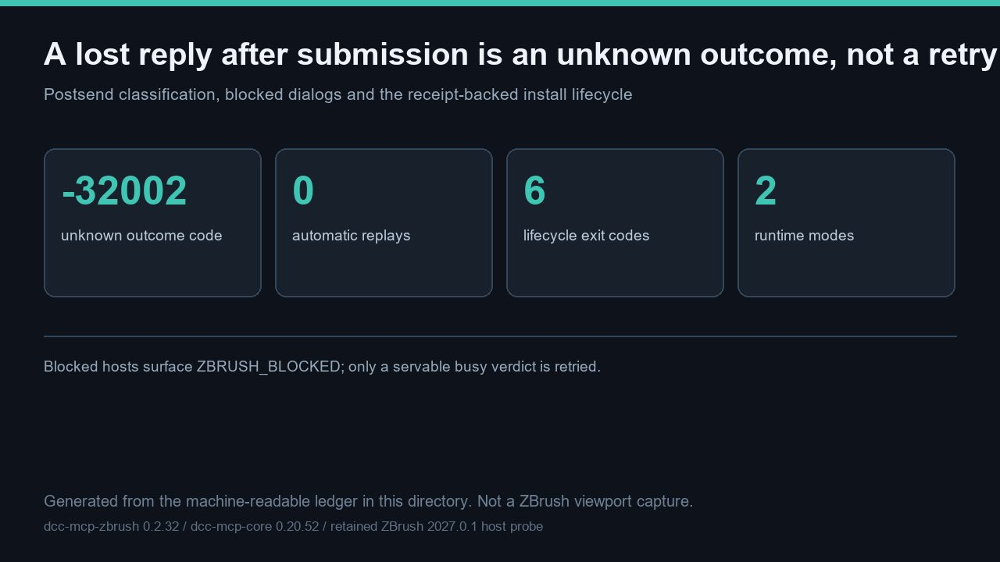

# 提交后丢失应答被判为未知、不可重试的结局：4 种裁决状态、3 个桥接码、6 个退出码与 2 种运行时均通过契约校验，真实工具返回声称 0 项



> 主图是根据本目录机器可读矩阵**生成的示意图**，不是 ZBrush 视口截图，尺寸 1280 × 720 像素。本轮未启动 ZBrush 进程，也未采集任何新的宿主媒体。

本条目展示的是普通工具清单无法证明的 ZBrush 特有行为：宿主停止应答时会发生什么。一旦真实方法已经发出，丢失或畸形的应答会被归类为 `-32002`、`execution_state=unknown`、`retryable=False` —— 自动重放 **0** 次。只有被拒绝但仍可服务的 `-32001` busy 裁决会重试；`blocked` 宿主会返回 `ZBRUSH_BLOCKED`，既不重试也不自动应答。[recovery_lifecycle_matrix.json](recovery_lifecycle_matrix.json) 记录 **4** 种探针裁决状态、**3** 个客户端可见桥接码、**6** 个生命周期退出码、**2** 种运行时模式与 **6** 条源码不变量。[verify_recovery_lifecycle.py](verify_recovery_lifecycle.py) 会对照 adapter 源码复核这些不变量，在 [recovery_lifecycle_result.json](recovery_lifecycle_result.json) 中记录 **9** 项 `pass`。真实 `tools/call` 返回仍为 **0** 项，明确不予声称。

文件：[README.md](README.md) · [README.zh.md](README.zh.md) · [hero-recovery-lifecycle.jpg](hero-recovery-lifecycle.jpg) · [recovery_lifecycle_matrix.json](recovery_lifecycle_matrix.json) · [verify_recovery_lifecycle.py](verify_recovery_lifecycle.py) · [recovery_lifecycle_result.json](recovery_lifecycle_result.json) · [validation.json](validation.json) · [manifest.json](manifest.json)

## 提交后判定表

这是对有副作用的 DCC 调用最关键的失效模式：重放一个可能已经改动场景的工具并不安全。adapter 区分「连接建立前失败」与「请求已提交后失败」。

| 情形 | 分类 | 重试 |
| --- | --- | --- |
| 任何字节到达宿主前出现 OSError | 裸传输错误，保留 `unreachable` 诊断 | 否 |
| 已提交调用后超时 / OSError | `-32002`、`execution_state=unknown`、`retryable=False` | **否** |
| EOF、截断、非法 UTF-8 或非对象应答 | `-32002`、`execution_state=unknown` | **否** |
| `-32001` busy 且 `data.retryable=true` | `ZBRUSH_BUSY` | 是，有界退避 |
| `blocked` 探针裁决 | `ZBRUSH_BLOCKED`，报告给人工 | **否** |

**3** 个桥接码分别是 `-32001`（`ZBRUSH_BUSY`）、`-32002`（`ZBRUSH_TIMEOUT_STILL_RUNNING`）与 `-32004`（`ZBRUSH_REQUEST_EXPIRED`）。阻塞裁决刻意不属于可重试的 busy：宿主正处于原生调用中或正显示模态提示，而 `get_active_dialog`、`click_dialog_button` 两个对话框工具正是用来读取并关闭它，而不是靠猜测。

## 运行时模式与安装生命周期

**2** 种运行时模式 —— **embedded**（MCP server 运行在 ZBrush 自带 Python VM 内）与 **sidecar**（外部 Python 经 TCP 连接 `mcp_socket_bridge.py`）—— 暴露相同的类型化工具。安装/校验由带回执的 SOP 管控，使用 **6** 个不同退出码，使失败的预检不会被误当作安装成功：

| 退出码 | 含义 |
| --- | --- |
| `EXIT_OK` = `0` | 校验通过 |
| `EXIT_PREFLIGHT` = `10` | 预检拒绝 |
| `EXIT_ACQUIRE` = `20` | 载荷获取失败 |
| `EXIT_INSTALL` = `30` | 安装失败 |
| `EXIT_VERIFY` = `40` | 校验失败 / 回滚 |
| `EXIT_REQUIRES_RESTART` = `50` | 需要重启 |

校验会绑定确切的可执行文件、PID、启动标识、端点、版本与已加载模块来源，并拒绝被 `PYTHONPATH` 遮蔽的 adapter。保留的真机身份证据确认 ZBrush **2027.0.1** 返回 `zbrush_info(0)` = `2027.0009765625`、`zbrush_info(1)` = `2.0`；修复后的 `read_sdk_version` 得到 `("2027.001", 2)`，因此不触发 `EXIT_VERIFY` 回滚。该历史运行**未**在本轮重跑。**3** 项仅 UI 能力（Selection Sets、Bake Current、UV Apply/Cancel）注册的类型化工具数为 **0**，不予声称。

## 复现

记录的结果使用了 `dcc-mcp-zbrush` 在修订 `6028d02c8896` 的检出，以便把 **6** 条源码字面量对照真实 adapter 源码复核：

```bash
# 在 dcc-mcp/showcase 检出下，并备有一份 adapter 检出：
python docs/showcase/zbrush-mcp-recovery-and-lifecycle/verify_recovery_lifecycle.py \
  --source-root <dcc-mcp-zbrush-checkout>
python scripts/validate_entry.py docs/showcase/zbrush-mcp-recovery-and-lifecycle
```

直接运行 `python docs/showcase/zbrush-mcp-recovery-and-lifecycle/verify_recovery_lifecycle.py` 也只需标准库；不传 `--source-root` 时，`source_invariant_recheck` 会如实记为 `not_run`，因此结果与提交的版本不同。传入后 **9** 项全部通过，且以**相同参数**重跑会以确定性方式（无时间戳）重写 [recovery_lifecycle_result.json](recovery_lifecycle_result.json)，得到逐字节一致的输出。同一修订上本轮重跑干净 wheel 测试套件：**596** 通过、**2** 跳过、**0** 失败；`tools/lint_skills.py` 退出码 **0**。官方检查的 `PASS` 只表示三个强制文件与制品哈希齐备且可追溯，**不代表**真机复现了这些失效模式。

## 边界 —— 本条目不证明什么

这是一次**契约校验级恢复与生命周期矩阵**，刻意不是真机故障注入演示。以下各项在 [validation.json](validation.json) 中记为 `not_run`，各附带具体 `observed` 原因：

- **2027 真机类型化工具返回与故障注入。** 本轮没有 ZBrush 进程、没有 `zbrush` MCP 实例、也没有开放的 sidecar 端口；2027 宿主没有 adapter/插件部署回执。未在真机上诱发连接丢失、阻塞对话框或回滚。
- **新的宿主媒体。** 未启动视口；主图是生成的示意图，不是截图。
- **画廊页面、发布与审核。** **4** 个案例在同一个 Draft PR 中登记为 unlisted/review；不声称已有卡片、语言页、合并、部署或独立审核。
- **重跑保留的身份证据。** 2027.0.1 身份结果是历史真机证据，与本轮分开记录。

不含任何私有任务号、提示词、账户、凭据、内部路径或未脱敏日志。通向画廊卡片的下一步是先取得属主授权的部署回执，再做一次含受控故障注入与真实工具返回的真机验收，其后是审核、合并与部署后回读——每一道都是独立授权门禁。
