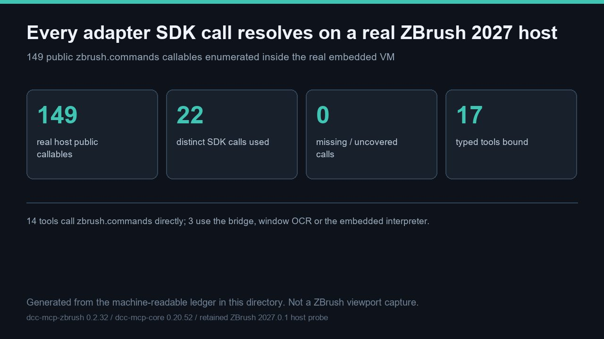

# A real ZBrush 2027.0.1 host exposes 149 public SDK callables, and all 22 adapter SDK calls resolve with 0 missing



> This hero is a **generated diagram** of the machine-readable ledger in this directory, not a ZBrush viewport capture. It is 1280 × 720 pixels. The real-host values behind it come from a **retained** 2027.0.1 embedded-VM probe; no ZBrush process was launched and no new host media was captured for this entry.

This entry binds the published ZBrush MCP surface to **real host evidence**. A retained probe inside a genuine ZBrush **2027.0.1** embedded VM (CPython **3.11.9**) enumerated **149** public `zbrush.commands` callables. Static analysis of the adapter package at **0.2.32** finds **22** distinct `zbrush.commands` calls, **17** of them inside the **17** typed tools' declared source files; **0** are missing from the real host surface. **14** tools call the SDK directly and **3** (`get_active_dialog`, `click_dialog_button`, `execute_python`) instead use the socket bridge, window OCR or the embedded interpreter. All **8** skills and **7** progressive stages stay inventoried. Real `tools/call` returns for the **17** typed tools are **not claimed**: **0** ZBrush MCP instances were live and **0** sidecar ports were open in this run.

Artifacts: [README.md](README.md) · [README.zh.md](README.zh.md) · [hero-sdk-surface.jpg](hero-sdk-surface.jpg) · [live_2027_sdk_callables.json](live_2027_sdk_callables.json) · [sdk_tool_backing.json](sdk_tool_backing.json) · [audit_sdk_surface.py](audit_sdk_surface.py) · [sdk_surface_audit_result.json](sdk_surface_audit_result.json) · [validation.json](validation.json) · [manifest.json](manifest.json)

## What the real host actually measured

The retained probe ran inside the real ZBrush 2027.0.1 executable through both native autoload entry points; the two probe files were byte-identical apart from their mode tag, which is why the desensitized public record binds them by SHA-256 rather than by any private path.

| Measured value | Real host result |
| --- | --- |
| `zbrush_info(0)` | `2027.0009765625` (version float) |
| `zbrush_info(1)` | `2.0` (Full edition) |
| Fixed `read_sdk_version` | `("2027.001", 2)` — version and edition stay separate |
| `format_sdk_version` | `2027.001` — float precision preserved, no integer truncation |
| Signed `ProductVersion` | `2027, 0, 1, 1` |
| Identity consistency | consistent, so no `EXIT_VERIFY` rollback |
| Old `int().int()` formula | would roll back on this host |
| Tamper shapes rejected | `4` of `4` |

The identity values are **retained in-host evidence**, not a new run. They are included here because they explain why the adapter at 0.2.32 binds to exactly this host build. Nothing in this table is an MCP typed-tool return.

## Zero-gap tool-to-SDK binding

[sdk_tool_backing.json](sdk_tool_backing.json) lists all **17** typed tools with their skill, progressive stage, repository-relative source file, backing kind and the exact `zbrush.commands` names each source calls. [audit_sdk_surface.py](audit_sdk_surface.py) recomputes the union, intersects it with the **149**-name real-host inventory and fails on any missing callable. The recorded result is [sdk_surface_audit_result.json](sdk_surface_audit_result.json): **8** checks `pass`, **0** missing callables.

| Backing kind | Tools | Behaviour |
| --- | --- | --- |
| `zbrush_commands` | `14` | Calls the real SDK surface directly; every call resolves. |
| `socket_bridge_and_window_ocr` | `get_active_dialog`, `click_dialog_button` | Probes the bridge and reads/dismisses a modal ZBrush note without a direct SDK call. |
| `embedded_interpreter` | `execute_python` | Runs a caller snippet inside ZBrush's own Python VM. |

The three UI-only capabilities — Selection Sets, Bake Current and UV Apply/Cancel — have **0** registered typed tools and **0** dedicated entries in the **149**-name callable surface. GUI visibility is not SDK support, so no call is attempted or claimed. This is a deliberate, measured absence, not an untested guess.

## Reproduction

The recorded result was produced with a `dcc-mcp-zbrush` checkout at revision `6028d02c8896` so that every tool's SDK calls are re-derived from source rather than trusted from the published ledger:

```bash
# From the dcc-mcp/showcase checkout, with an adapter checkout available:
python docs/showcase/zbrush-mcp-sdk-surface-audit/audit_sdk_surface.py \
  --skills-root <dcc-mcp-zbrush-checkout>/src/dcc_mcp_zbrush/skills
python scripts/validate_entry.py docs/showcase/zbrush-mcp-sdk-surface-audit
```

Plain `python docs/showcase/zbrush-mcp-sdk-surface-audit/audit_sdk_surface.py` also works with the standard library alone and re-checks the bundled ledgers; in that mode `contract_recompute_from_skills_root` is honestly `not_run`, which is why the result differs from the committed one. Re-running with the **same flags** rewrites [sdk_surface_audit_result.json](sdk_surface_audit_result.json) deterministically (no timestamps), producing byte-identical output. The verifier re-parses each `tools.yaml`, re-reads each declared source file and compares the recomputed SDK call lists with the ledger. The clean-wheel suite was re-run on the same source revision: **596** passed, **2** skipped, **0** failed; `tools/lint_skills.py` exited **0**. Run the official entry check from the showcase root as shown above — `PASS` means the three mandatory files and every artifact hash are present and traceable, **not** that a live host produced the numbers.

## Boundaries — what this entry does not prove

This is a **contract-verified audit anchored to retained real-host SDK inventory**, deliberately not a live-host demonstration. The following are recorded as `not_run` in [validation.json](validation.json), each with a concrete `observed` reason:

- **Live 2027 host typed-tool returns.** No ZBrush process, no `zbrush` MCP instance and no open sidecar port; the 2027 host has no adapter/plugin deployment receipt. Real `tools/call` values for the **17** typed tools were not produced.
- **New host media.** No viewport was launched; the hero is a generated diagram, not a capture.
- **Gallery pages, publication and review.** All **4** cases in the set are unlisted/review decisions in one Draft PR; no card, locale page, merge, deployment or independent review is claimed.
- **Re-execution of the retained probe.** The **149**-callable inventory comes from **2** historical probe runs and is kept separate from this run.

No private task ID, prompt, account, credential, internal path or unredacted log is included. The next step toward a gallery card is an owner-authorized deployment receipt followed by a real-host acceptance run with tool returns, then review, merge and a post-deploy read-back — each a separate authorization gate.
