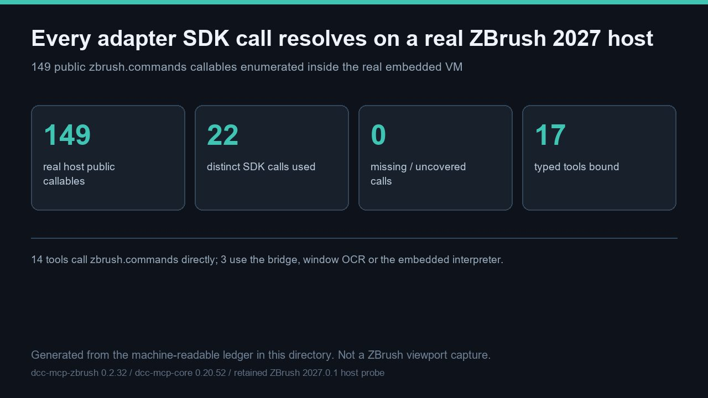

# 真实 ZBrush 2027.0.1 宿主公开 149 个 SDK 可调用项，adapter 的 22 个 SDK 调用全部命中、缺失 0 项



> 主图是根据本目录机器可读台账**生成的示意图**，不是 ZBrush 视口截图，尺寸 1280 × 720 像素。图中真机数值来自**保留的** 2027.0.1 内嵌 VM 探针；本轮未启动 ZBrush 进程，也未采集任何新的宿主媒体。

本条目把已发布的 ZBrush MCP 能力面绑定到**真机证据**。在真实 ZBrush **2027.0.1** 内嵌 VM（CPython **3.11.9**）中保留的探针枚举出 **149** 个公开 `zbrush.commands` 可调用项。对 **0.2.32** adapter 包的静态分析得到 **22** 个不同的 `zbrush.commands` 调用，其中 **17** 个位于 **17** 个类型化工具声明的源文件内；相对真机能力面缺失 **0** 项。**14** 个工具直接调用 SDK，另外 **3** 个（`get_active_dialog`、`click_dialog_button`、`execute_python`）分别走 socket 桥、窗口 OCR 或内嵌解释器。**8** 个技能与 **7** 个渐进加载阶段仍全部在册。**17** 个类型化工具的真实 `tools/call` 返回**不予声称**：本轮在线 ZBrush MCP 实例为 **0**，开放 sidecar 端口为 **0**。

文件：[README.md](README.md) · [README.zh.md](README.zh.md) · [hero-sdk-surface.jpg](hero-sdk-surface.jpg) · [live_2027_sdk_callables.json](live_2027_sdk_callables.json) · [sdk_tool_backing.json](sdk_tool_backing.json) · [audit_sdk_surface.py](audit_sdk_surface.py) · [sdk_surface_audit_result.json](sdk_surface_audit_result.json) · [validation.json](validation.json) · [manifest.json](manifest.json)

## 真机实际测到了什么

保留探针在真实 ZBrush 2027.0.1 可执行文件内经两个原生 autoload 入口各运行一次；两份探针除模式标记外逐字节一致，因此公开记录用 SHA-256 绑定它们，而不写入任何私有路径。

| 测量项 | 真机结果 |
| --- | --- |
| `zbrush_info(0)` | `2027.0009765625`（版本浮点数） |
| `zbrush_info(1)` | `2.0`（Full 版本枚举） |
| 修复后的 `read_sdk_version` | `("2027.001", 2)` —— 版本与版本枚举分离 |
| `format_sdk_version` | `2027.001` —— 保留浮点精度，不做整数截断 |
| 签名 `ProductVersion` | `2027, 0, 1, 1` |
| 身份一致性 | 一致，因此不触发 `EXIT_VERIFY` 回滚 |
| 旧 `int().int()` 公式 | 在该宿主上会回滚 |
| 篡改形状拒绝 | `4` / `4` |

这些身份值是**保留的真机证据**，不是本轮新跑的结果。收录它们是为了说明 0.2.32 adapter 为何绑定到这一确切宿主构建。表中没有任何一项是 MCP 类型化工具返回。

## 零缺失的工具—SDK 绑定

[sdk_tool_backing.json](sdk_tool_backing.json) 列出全部 **17** 个类型化工具的技能、渐进阶段、仓库相对源文件、绑定方式以及各源文件调用的 `zbrush.commands` 名称。[audit_sdk_surface.py](audit_sdk_surface.py) 重新计算并集，与 **149** 项真机清单求交，一旦有缺失即失败。记录结果为 [sdk_surface_audit_result.json](sdk_surface_audit_result.json)：**8** 项 `pass`，缺失 **0** 项。

| 绑定方式 | 工具数 | 行为 |
| --- | --- | --- |
| `zbrush_commands` | **14** | 直接调用真机 SDK 能力面，全部命中。 |
| `socket_bridge_and_window_ocr` | `get_active_dialog`、`click_dialog_button` | 探测桥接并读取/关闭模态提示，不直接调用 SDK。 |
| `embedded_interpreter` | `execute_python` | 在 ZBrush 自带 Python VM 内执行调用方片段。 |

三项仅 UI 能力 —— Selection Sets、Bake Current、UV Apply/Cancel —— 注册的类型化工具数为 **0**，在 **149** 项可调用面中也没有专属入口。GUI 可见不等于 SDK 支持，因此未尝试调用、也不声称支持。这是**实测的缺失**，不是未测的猜测。

## 复现

记录的结果使用了 `dcc-mcp-zbrush` 在修订 `6028d02c8896` 的检出，以便每个工具的 SDK 调用都从源码重新推导，而不是直接信任已发布的台账：

```bash
# 在 dcc-mcp/showcase 检出下，并备有一份 adapter 检出：
python docs/showcase/zbrush-mcp-sdk-surface-audit/audit_sdk_surface.py \
  --skills-root <dcc-mcp-zbrush-checkout>/src/dcc_mcp_zbrush/skills
python scripts/validate_entry.py docs/showcase/zbrush-mcp-sdk-surface-audit
```

直接运行 `python docs/showcase/zbrush-mcp-sdk-surface-audit/audit_sdk_surface.py` 也只需标准库，可复核本目录台账；在该模式下 `contract_recompute_from_skills_root` 会如实记为 `not_run`，因此结果与提交的版本不同。以**相同参数**重跑会以确定性方式（无时间戳）重写 [sdk_surface_audit_result.json](sdk_surface_audit_result.json)，得到逐字节一致的输出。校验器会重新解析每个 `tools.yaml`、重读每个声明的源文件，并把重算出的 SDK 调用列表与台账比对。同一源码修订上重跑干净 wheel 测试套件：**596** 通过、**2** 跳过、**0** 失败；`tools/lint_skills.py` 退出码 **0**。官方条目检查按上面的命令在 showcase 根目录运行——`PASS` 只表示三个强制文件与每个制品哈希齐备且可追溯，**不代表**这些数字由真机产生。

## 边界 —— 本条目不证明什么

这是一次**以保留真机 SDK 清单为锚点的契约校验审计**，刻意不是真机演示。以下各项在 [validation.json](validation.json) 中记为 `not_run`，各附带具体 `observed` 原因：

- **2027 真机类型化工具返回。** 本轮没有 ZBrush 进程、没有 `zbrush` MCP 实例、也没有开放的 sidecar 端口；2027 宿主没有 adapter/插件部署回执。**17** 个类型化工具的真实 `tools/call` 值并未产生。
- **新的宿主媒体。** 未启动视口；主图是生成的示意图，不是截图。
- **画廊页面、发布与审核。** 本集合共 **4** 个案例，在同一个 Draft PR 中登记为 unlisted/review；不声称已有卡片、语言页、合并、部署或独立审核。
- **重跑保留探针。** **149** 项清单来自 **2** 次历史探针运行，与本轮分开记录。

不含任何私有任务号、提示词、账户、凭据、内部路径或未脱敏日志。通向画廊卡片的下一步是先取得属主授权的部署回执，再做一次含真实工具返回的真机验收，其后是审核、合并与部署后回读——每一道都是独立授权门禁。
