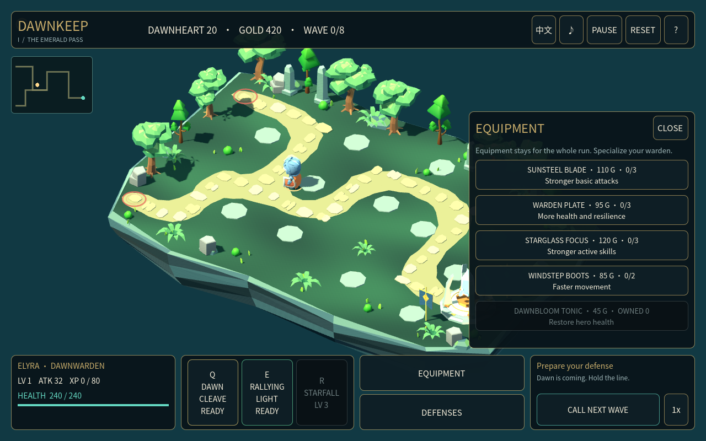
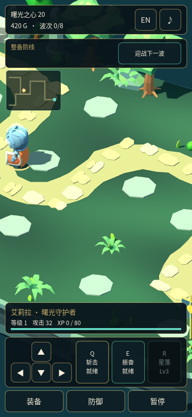
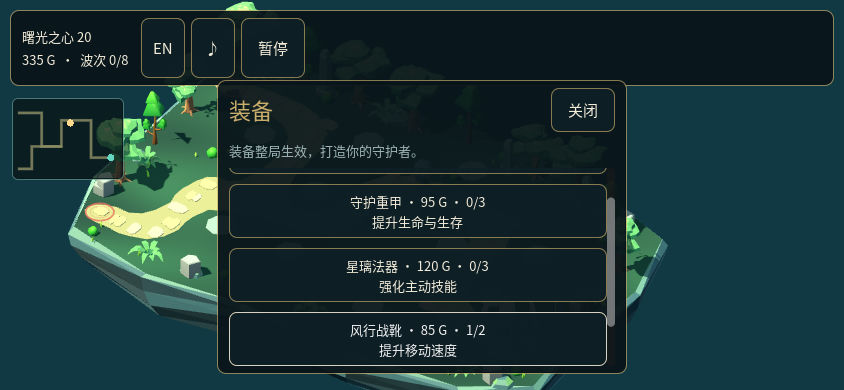

# Dawnkeep native UI acceptance, 2026-10-19

Runtime candidate: **`81c109db079d3815c547943c7924d24349d6d386`**.
This record summarizes completed checks of that candidate. Later documentation
changes do not rebind the runtime evidence. It is an unpublished Draft candidate,
not release, Showcase-gallery or deployed-browser acceptance.

## Verified stages and their scopes

| Stage | Result | Evidence and boundary |
| --- | --- | --- |
| Real DCC-MCP author/save/reopen | Passed | Actual Godot `4.6.3.stable.official.7d41c59c4` headless editor; adapter 0.9.6, Core 0.20.42, server 0.20.45. Typed calls, schema capture, editor import/readback, saved scene and editor restart/reopen are recorded. This is not a rendered-editor review. |
| Mechanics | Passed | 73 assertions; simulation/collision fixtures, not OS-input acceptance. |
| Settled native UI | Passed | 27,660 assertions across eight viewport sizes, EN/ZH and ten screen modes, including clipped scrolling, font widths, health/respawn text and focus. Maximum observed layout settling: three process frames; this is not a universal timing guarantee. |
| Main-scene integration | Passed | 133 assertions, 157 synthetic GUI input events and pointer holds up to 18 process frames. Same-frame press/release is not the sole pointer regression. |
| Native rendered views | Passed within reviewed scope | All 16 final PNGs individually reviewed: no blocking UI clipping, overlapping action rows, missing glyphs or inaccessible primary/Close buttons found. These are synthetic states rendered by Godot, not input-driven terminal gameplay. |
| Actual native input | Passed within the checks below | Real desktop keyboard/mouse driving the native game, correlated with passive state observations. No direct signal emission is presented as pointer input. |
| Official Web export | Passed | Official hash-pinned 4.6.3 single-thread release template; export input manifest matches the saved native manifest. Export completion does not establish browser playability. |
| Exported browser gameplay | Blocked | Ordinary Chromium 154.0.8037.57 reports missing WebGL2. Security/GPU flags unchanged; game rendering, controls and audio could not be accepted. |

The authoring and headless input manifests match the committed runtime files.
All 76 saved-native manifest files also match the tested native-input and
native-visual copies and the Web-export input manifest. The editor-resaved
`start.tscn` has its own native hash; it is not represented as byte-identical to
the repository's source serialization. The native input copy additionally
contains window-size bootstraps and a generated UID; these load the unchanged
scene without changing gameplay. Visual fixtures intentionally set synthetic
screen states and are evaluated separately from live input.

### Actual input: desktop and compact landscape

At **1280×800**, the native event ledger and 476 state samples establish:

- Start enters gameplay. A 300 ms held Equipment click opens the shop; held
  Boots and Blade clicks each purchase exactly once, charging 85 and 110 gold
  respectively (420 → 335 → 225). Close and Space then enter wave one.
- Ground movement, Q and E work during early combat. The run reaches nine
  kills, level two, core health 20 and zero deaths. R remains level-locked.
- Held Mute/Unmute changes the mute/playback state; this is not a listening
  result. Escape/Space pauses and resumes with the appropriate focused action.
- Backspace opens restart confirmation; Tab/Space chooses Cancel and preserves
  the run, purchases and combat state. This tests cancellation, not confirmed
  restart. Live EN → ZH switching changes the HUD without resetting gameplay.

At **844×390**, actual desktop pointer/keyboard input drives the compact Chinese
UI. Wheel scrolling reveals the clipped shop controls. A 300 ms held Boots
purchase changes 420 → 335 gold and rank 0 → 1. A 1,200 ms held right D-pad
press moves the hero across samples 199–202; after release, samples 203–206
show no movement and an unchanged position. Reopening the shop and tabbing to
Boots auto-scrolls its visible height from six to 54 pixels; Enter buys rank two
(335 → 250 gold) and focus moves to Close when Boots becomes disabled. These
are mouse-driven touch-layout controls, not physical touch or multitouch tests.
The six-check compact report also records that Escape closes the shop and the
next Escape opens Pause; the event ledger's claim of releasing restored focus
was inaccurate. This run remains at wave zero and does not prove compact combat.

The 16-view still review covers eight English desktop states at 1280×800;
Chinese intro/gameplay/equipment at 390×844; English intro/equipment at 320×568;
and English intro/gameplay/equipment at 844×390. Compact landscape deliberately
scrolls the shop; the initial view partly obscures the shrine behind the HUD.
The 40×40 D-pad controls remain compact. No contrast-ratio or accessibility-
conformance certification is made.

## Remaining boundaries

- A real full campaign on older commit **`523953fb`** reached eight-wave victory,
  natural unattended defeat and clean restarts. It predates this UI refactor.
  The final candidate's active-victory/AFK-defeat simulations remain automated;
  the new real-input run is UI and early-combat evidence, not a repeated full
  campaign or exhaustive tower/ultimate/terminal-screen input test.
- Native shutdown logs report leaked ObjectDB instances and
  `ERROR: 2 resources still in use at exit`. Successful interaction does not
  establish a clean shutdown. Unsupported V-Sync and a low-disk recording warning
  were also retained; the desktop MovieWriter capture did complete.
- Subjective music listening, physical-phone/multitouch use and exported Web
  gameplay remain unverified or blocked as stated above. Audio flags, decoded
  bytes and objective PCM checks cannot substitute for listening.
- The completed native capture contains 3,344 frames at 24 fps, 1280×800,
  139.333333 seconds, with PCM stereo audio. Container metadata/completion are
  narrower evidence than whole-film motion and listening review.

## DCC-MCP reuse and the workflow improvement

Existing scene/node tools already author native Controls and their properties;
Theme tools create/set/list resources. Inspection found that `get_theme_info`
lists names without resolved values, the anchor preset does not also reset
offsets, analysis counts do not audit layout, and runtime UI discovery does not
establish settled/clipped geometry. `click_button_by_text` emits `pressed`
directly and cannot validate pointer hit routing.

The canonical [native UI workflow](../../../../skills/dcc-showcase-production/references/godot-native-ui.md)
now supplies Container/Control/Theme, focus, responsive-layout and evidence
guidance, including effective visibility, comparable global bounds, sort-frame
settling and press → intervening frames → release checks. The actual held-click
regression exposed premature focus release cancelling a button press attempt;
the candidate includes frame-separated regression coverage and a real-pointer
recheck. This enhancement is production guidance plus project tests, not a newly
registered DCC-MCP audit API or a duplicated runtime.

## Review images

The first two are native-rendered synthetic layout states; the third is a
native screenshot after actual keyboard focus auto-scrolled the shop. These
images contain game pixels only, and all use runtime source `81c109d`.

## Evidence fingerprints

Names below identify retained run evidence, not public download links. Raw
environment paths and session details are intentionally omitted. These hashes
identify the reviewed bytes; they do not make unavailable evidence public or
turn a scoped result into release approval.

| Evidence key | SHA-256 |
| --- | --- |
| `author-81c109d/authoring.json` | `fb84c4364da2efac30f409965c98e74d6997ffe85ebd5cdd5a19e850c17d030b` |
| `author-81c109d/native-manifest.json` | `fb6e026d469c880ffac485e3b646079129b0f3fbee4c559f13340934c56aeb09` |
| `headless-pointer-final/headless.json` | `77a895c10deecb2adeeaa1db84d26a419917c2f64ef5cbd073a4095909d661c4` |
| `web-81c109d/export.json` | `0af2782cb1ba347234e54b3f6d7a7faa59d4775c17c1b957a68e56650ab2ad09` |
| `visual-review-81c109d.md` | `45ba223b76386d9e4ecfe028473175bd00ff31bd3752c80166ed2d5cd7a7cc47` |
| `visual-81c109d/1280x800-en-equipment.png` | `72693fd401128f5011bf5c8ac762ae19f082a5f5b106fda70145e3a7041452d0` |
| `visual-81c109d/390x844-zh-equipment.png` | `2f9eda8d334d6b2fc2ad7fa11ed407696da0d2543498e18f3d3eb31f0cdc77ff` |
| `native-input-result-81c109d.json` | `91a2607feab9ab28f43769faf86abe9b801161a403596128a4f56f894212c99c` |
| `native-compact-result-81c109d.json` | `955171b3194ccb0f989977a102b66e8d74690dd110de4cca0db3fe08f3468169` |
| `native-compact-events-81c109d.json` | `f8bb08b19d2bcf49b37229c62b9b4e2d93bc681767f6470b76126b627952438e` |
| `native-compact-81c109d.log` | `84a2ec0471187a526f915ae1c09c4859c152983504cd2cd6859ed544ded1cac4` |
| `web-browser-81c109d.json` | `8d864d2b37271fadff2ed3e5b1f4dc0401f24ef33b44745a99b0209dff9a53f7` |
| Exported `index.pck` (5,312,240 bytes) | `1471098077112a0f6641effbcc57abe2abb2a0538a5123d274bbb92566dd6439` |
| Exported `index.wasm` (37,700,666 bytes) | `26b61ce95247012ab3dca3ff51e96d1cdbff44ee91a8c20a83e150afca83f1b6` |
| Saved native `start.tscn` | `e333bef3e09c15ff422b33f61579d608b12a9e6a42ea2bd05ea11a4579492656` |
| Native source archive (4,821,818 bytes) | `21a00b6dc53e0d08247fd6e6d24e2f7b4945e3b5f33a9aa22405539ec07257e4` |
| Edited native UI video (59 seconds, 4,911,822 bytes; distinct from full capture) | `e79ef263428af327a0bfc37189a93c2e113b612573fd208547c805a00bdeb715` |

Reproduction tools and stage separation are documented in
[the CI contract](../ci/CONTRACT.md) and [CI instructions](../ci/README.md).
