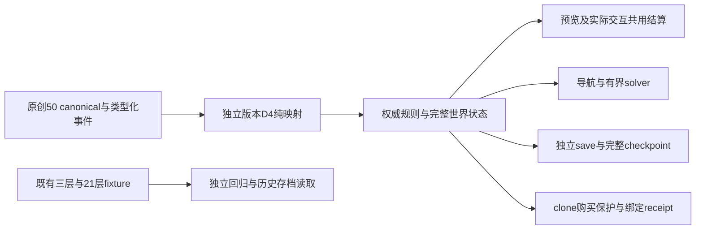

# 50层目标迁移：架构与范围提案

状态：**proposed / unimplemented**，2026-10-25。本文记录新的50层目标、可复用模块和未来验证门槛，不创建50层数据、新工程或可玩包，不修改当前21层、原三层、难度或存档。本文没有新增Godot原生运行、GUI、浏览器或时长验收。名称「阶塔」仍为可改的临时名。

当前21层工程保留为确定性规则、镜像、购买保护与恢复的回归fixture；原三层交付保持自己的内容身份和证据。现有Draft PR54及其owner/branch延续，本文不授权发布、合并或部署。正在进行的21层恢复验证继续独立完成，其结果不能外推为50层已完成。

## 参考版本与原创边界

以下是父端研究交接，不是本文独立重测或用户最终确认。正式规则表须先标明目标产品、发行商、渠道和具体版本，再引用逐项证据。

| 输入 | 当前用途与可信边界 | 待核 |
|---|---|---|
| [TapTap app 48859](https://www.taptap.cn/app/48859)，暂按ITWonder／北京启达《魔塔50层：勇者的试炼》 | 父端2026-10-25实际读取的官方身份页标识ITWonder／北京启达、版本2.0.3（2026-09-23）。这是网页身份元数据；用户渠道确认尚未回收。 | 不是二进制规则验证，不能据此锁定价格、次数、敌人数值或设备安装版本。 |
| [小米渠道 62342513](https://game.xiaomi.com/game/62342513) | 父端识别为同发行商的另一渠道。 | 不把此渠道价格、次数、敌人数值混入TapTap版。 |
| [TapTap社区攻略 15206399269144501](https://www.taptap.cn/moment/15206399269144501) | 父端已实际读取的玩家攻略；可产生待验证的规则假设。 | 社区经验不是厂商规范，须以指定版本实际行为复核。 |
| [TapTap社区分组 242684](https://www.taptap.cn/app/48859/topic?group_label_id=242684) | 父研究交接的社区线索：隐藏钥匙路线、商店、对称传送、破墙／炸敌、装备回收与回访。本审查者未独立打开该分组。 | 是否存在、作用范围、消费、次数、方向条件、Boss条件均未正式核准。 |

普通战斗暂沿用现有规则作为原创设计基线：玩家先手，单击伤害为攻击减防御；`ATK <= 敌DEF`不可胜；反击次数为 `ceil(敌HP / (ATK - 敌DEF)) - 1`；扣血后必须仍大于0。特殊先攻、领域、夹击等只记为待核机制，不能凭普通公式代算后宣称一致。将来每种特殊规则都必须由同一权威计算返回预览与实际扣除结果。

采用确定性资源解谜、有限库存与固定怪位的规则思想；剧情文字、地图、视觉、声音和关卡布局原创。救援入塔、失力、同伴线索、回访与身份疑问仅为高层创作题材，不复用原版地图或对白。没有把21层经验商店／仙子三权杖叙事混入50层；也不假设每十层末固定有Boss。21–30层「后期回访」是待核输入，不是已证实的逐层流程。

拟议的原创节奏如下。楼层带不是已实现内容，也不是对参考作品事实的描述；回访、支路和章节解锁允许跨越这些区间。

| 楼层带 | 原创设计提案 | 设计要验证的取舍 |
|---|---|---|
| 1–10 | 资源、钥匙与图鉴教学；逐步显露战斗成本。 | 少量分支也能读懂「现在打／稍后打」的差别。 |
| 11–20 | 稀缺钥匙与多入口支路。 | 门的机会成本、固定怪位和库存可被规划。 |
| 21–30 | 谜题与剧情线索，预留后期回访结构。 | 回访改变可达性，不能只靠重复走路延长时长。 |
| 31–40 | 陷阱、捷径、位移与方向条件。 | 新机制仍可预览、复现和求解。 |
| 41–50 | 装备回收与终局资源结算。 | 原创终局条件、回收时点与剩余资源构成多条可赢路线。 |

数小时游玩目标只能在完整可玩内容后用真实玩家会话测定，记录首见／熟悉路线、阅读／思考／行走时间、回档次数与样本分布；不能把模拟耗时或50个楼层编号当成达到该目标。

## 模块复用及改动边界

| 模块 | 复用方式提案 | 不能直接沿用的假设 |
|---|---|---|
| 权威战斗 | 保留现有单一combat入口；预览、执行、寻路policy和solver消费同一结果。新机制通过明确类型和同一结算入口增加。 | 不复制第二套伤害公式；未验证特殊机制不能默认按普通敌人处理。 |
| 网格与导航 | 保留稳定对象ID、合法移动／交互API、完整frontier证明和不可变地形索引缓存；按内容版本准备索引。 | 局部视野无动作必须有完整全局检查；预算耗尽是unknown，不能称无解。50层跨区事件、传送与墙变化须使缓存正确失效。 |
| 购买保护facade | 保留clone预览、exact-binding、一次性确认、known_losing默认阻止及unknown风险提示；未来以新内容／规则指纹创建receipt。 | post-unsat只证明拟购后状态，不能单凭它说购买造成原局失败。旧21 token不能用于50层，预算不允许无上限查询。 |
| 资源与商店 | 沿用有限资源／固定库存／清除ID／购买次数的权威状态模型。 | 21层价格、强化量、库存、钥匙分配与可赢预算不是50层默认值。恢复不能单项退款或补货。 |
| 存档和完整checkpoint | 复用先校验、整体提交、失败不破坏当前状态的方式；完整保存资源、世界、库存、事件和历史。 | 当前每三层首入捕获的1/4/7/10/13/16/19入口是21层内容策略；不自动推广为50层checkpoint安排。 |
| 内容构建与见证路线 | 构建时输出显式固定canonical布局、怪位、数值、事件ID、资源上界及多风格路线。 | 不把50空层当内容，不在运行时随机布怪，不用循环四条21层路线冒称50层探索。 |
| 展示层 | Godot Compatibility／GDScript／单线程Web作为候选延续；概念视觉、HUD与icon先评审再制作。 | 21逻辑测试不是50 GUI、点击命中、遮挡、动画、导出或HTTP实际浏览器通过。 |

现有实现硬编码的边界已只读核对：`campaign_variant.gd`的`FLOOR_COUNT=21`、`DRAW_COUNT=43`与`stairkeep-variant/xorshift32-hv-v1`；`campaign_rules.gd`的`stairkeep-campaign-21/v1`、schema2与当前rules版本。未来必须把内容规模、变体spec和checkpoint策略分离，不能只把常量21改成50。

## D4：整层空间同构提案

本节是未来契约，不表示当前HV变体已升级。D4提供最多8种空间等价布局；**整体同构不增加策略路线，也不能把资源耗尽状态变成可赢状态**。不能据此宣称PoE采用同一算法。

逻辑网格使用x向右、y向下，原尺寸为W×H，坐标范围为`0 <= x < W`、`0 <= y < H`。提案编号 `code=k+4m` 表示 `R^k ∘ Mx^m`：先左右镜像Mx，再顺时针旋转k次。方向是整数向量，不对方向字符串做零散替换。

| code | 点(x,y)映射 | 方向(dx,dy)映射 | 结果尺寸 |
|---:|---|---|---|
| 0 | `(x,y)` | `(dx,dy)` | W×H |
| 1 | `(H-1-y,x)` | `(-dy,dx)` | H×W |
| 2 | `(W-1-x,H-1-y)` | `(-dx,-dy)` | W×H |
| 3 | `(y,W-1-x)` | `(dy,-dx)` | H×W |
| 4 | `(W-1-x,y)` | `(-dx,dy)` | W×H |
| 5 | `(H-1-y,W-1-x)` | `(-dy,-dx)` | H×W |
| 6 | `(x,H-1-y)` | `(dx,-dy)` | W×H |
| 7 | `(y,x)` | `(dy,dx)` | H×W |

矩形的90/270度映射必须交换宽高；逆变换和复合使用当前尺寸，不能把长方形旋转后裁进旧范围。现有HV在数学上分别对应本表0、4、6、2，但**旧存档依旧按旧HV spec读取**，不重新编码旧`floor_mirrors`，更不能把旧值误解释为本表旋转编号。

### 空间字段registry与全量映射

构建器须为每类空间字段定义转换规则，未知字段／不透明坐标脚本使验证失败；禁止只转换`objects.pos`。不带空间含义的资源、身份和剧情语义保持不变。

| 数据／状态 | 必须同步处理 |
|---|---|
| 地板、墙、门框、collision、遮挡、朝向tile和多格footprint | 重建结果网格和边mask；每个占格映射一次，朝向／边normal使用同一线性映射。 |
| 敌、钥匙、门、道具、商店、NPC、恢复点、隐藏物 | 全部位置、占格、朝向和触发区域；稳定ID、门颜色、数量、战斗属性、库存、价格、奖励及消耗不变。 |
| 楼梯、传送与跨层引用 | 起点按所属层变换；`target.pos`按目标层变换。目标层ID／对象ID不变，几何朝向同目标层变换；双端引用仍精确互指。楼层的「上／下」语义不因平面旋转互换。 |
| 出生、当前玩家位置、checkpoint／复活候选 | 所属层的位置和朝向一起映射；候选排序与选择spec显式版本化；只选被内容作者批准且实际安全可达的首层空格。 |
| NPC事件、进入方向、单向通道、领域、夹击、机关、隐藏路 | 触发格集合、方向向量、offset、射线／邻接、前后／左右关系、传送落点和引用都纳入registry。镜像改变手性时相应转换转向条件。 |
| 破墙、炸敌等世界变更（若目标规则确认后采用） | 动态墙状态、被移除ID、可作用区域／方向与相对offset跟随同一映射。不能保留旧坐标再写入变体。 |
| 已触发事件、剧情状态、任务日志与完整恢复树 | 空间引用逐项映射，语义flag／计数／ID不变。面向玩家的方位提示由变换后的数据生成或另审原创文案，避免文字与规则相反。 |

若某机制要求绝对世界方向、光源方向或不能镜像的文字／图案，必须明确其语义：要么把该条件一并映射，要么限制该内容可用的变换子群，要么重新设计并验证。不能留下硬编码「东侧」条件又声称完整D4同构。碰撞、规则、导航、选择命中和视觉都消费同一变体；先变换逻辑坐标再进行等距投影，不是旋转一张画面。sprite朝向、遮挡顺序、click hit area和HUD可读性仍需后续真实视觉／输入测试。

期望性质是对每个合法状态S和动作a都有 `T(step(S,a)) = step(T(S), A(a))`，并保持资源与商店状态向量不变。该结论只有在**全部事件及空间条件都受同一映射约束**时成立；它不能替代新事件的引擎执行测试。若有已实跑的canonical赢路，可运输其动作得到数学见证；运输证明和在变体上实际回放必须分别记录。

### 同局固定、去重及死亡序列

拟议接口为 `select_variant(canonical, campaign_seed, prior_layout_receipt, variant_spec) -> candidate + selection_receipt`。同一局同一层的变换固定；进入、离开、读档、预览、policy决策或装饰动画不重新抽布局。布局流与policy RNG、视觉RNG分离。

每层先枚举允许的有限变换，按实际空间内容去重。用于去重的规范序列化必须包含尺寸、网格、稳定对象ID、类型、属性、位置、方向、所有registry事件及跨层目标几何，不包含seed、变换code、receipt或生成时间。相同hash仅作为候选索引，实际规范字节也相等才认为同类。去掉对象ID来合并看似相同的实体需要额外的身份置换与事件图证明，不能擅做。跨层目标必须在完整变体解析后校验，不能拿源层变换代替目标层变换。

新布局应排除上一局相同code及实际等价布局；选取顺序、hash规范、PRNG／确定性排序、拒绝过程和draw记账必须归属于一个新的正式spec。本文不擅定50层消耗是43、51或101 draw；现有21层43draw契约保持原样。正式实现前需冻结测试向量，并把实际消费、候选顺序、前局排除上下文与结果hash写入receipt和save。由于排除前局会引入上下文，**单独seed不足以解释结果**，必须保存或能重建该上下文。

完全对称层可能只有一个实际空间等价类。此时不能承诺「每层都变样」；须报告`no_alternative_due_to_symmetry`，或在严格要求变化的内容验收阶段拒绝此布局。若只要求整局不同，则比较完整已解析布局hash。不得为满足变化而单独打散门、怪或钥匙，也不得无限重抽。

只有在玩家选择并确认「新布局」且当前loss ID有效、未消费时，才执行一次事务：从旧sequence派生下一候选 → 全量验证 → 原子提交新sequence／attempt／布局及消费该loss ID。一次已接受死亡转换最多推进一次sequence；候选拒绝、hash去重和内部重试不重复推进全局sequence。取消、重复确认、旧ID、崩溃前未提交或校验失败均保留旧局；提交成功后的重试返回同一已提交结果。需要同时保存已消费loss ID与提交身份，避免存读档跨边界重复推进。

## 恢复策略尚需选择

D4是空间同构，不能靠旋转替玩家补救已花掉的预算。下面两方案必须由产品设计明确选择；本文不替用户决定，也不修改现有21层行为。

| 方案 | 玩家结果 | 实现与证明影响 |
|---|---|---|
| A：新布局整局重开 | 从完整初始状态开始；已取得收益和消耗全部撤回，进度重来。 | 状态边界清楚，可从初始见证运输可赢性；需接受整局进度损失。死亡确认只一次推进sequence。 |
| B：新布局恢复完整checkpoint | 保留某个真实checkpoint之前的进度，之后的收益与消耗一起回退。 | 必须对整个恢复世界、旧／新变换间坐标、事件引用和checkpoint树进行一致重基；不能只搬玩家。该checkpoint可能已继承无解资源，不保证局部复活能救。需实际赢路或完整证明。 |

同seed完整回档、从头重开、已证实有赢路的checkpoint选择仍可作为不改难度的恢复操作。若未来要给予保底钥匙、退款、补血或补库存，那是另一个会改变难度的规则决策，须有明确新版本、资源预算和验收；不能藏在恢复或seed逻辑内。

玩家提示需要区分三个事实：「拟购后已证明无赢路，默认未购买」「预算不足以判断，仍可确认风险」「某个完整回档入口已有实际获胜后缀」。不能把post-unsat写成该购买必然导致loss，也不能在金币不足时提示立即购买某强化。现有21层backend提示草案和证据见[RECOVERY-DESIGN.md](RECOVERY-DESIGN.md)；该文案尚未接入21或50层GUI。

## 内容／存档身份与兼容提案

新50内容需要独立`content_id`、规则指纹、事件schema和变体spec。`stairkeep-campaign-50/v1`可作待定标识示例，正式值尚未注册。建议独立save namespace及下一schema版本（暂称v3），不可原地扩写21层schema2。

拟保存字段至少包括：canonical内容／事件schema／规则／variant spec及hash，campaign seed，sequence、attempt、loss提交及消费ID，前局排除上下文、完整selection/draw receipt，各层code与原／结果尺寸，resolved spawn与恢复点，完整玩家／世界／门／事件／库存／日志，完整checkpoint树和状态hash。加载时先重建并验证布局、跨层目标、方向条件与世界状态，再整体提交。已有run内的slot、checkpoint和receipt都绑定其内容身份；不能跨版本抽取金币、库存或proof拼装。

原三层仍以原`SAVE_VERSION=1`、实际数据JSON的SHA256 content identity和原slot读取；21层仍以`stairkeep-campaign-21/v1`、schema2和`xorshift32-hv-v1`读取。保留旧读写器与原字节，不静默迁移为50层，不为旧receipt改身份，不以新50规则解释旧HV数据。未来若提供显式迁移，须另列转换规则、损失信息、可逆备份与拒绝条件，不能默认成功。

## 架构决策记录（均为提案）

| ADR | 决策／未决项 | 取舍 |
|---|---|---|
| 50-01 | 优先复用权威规则与模块接口，以独立内容／事件适配器扩展。 | 减少公式分叉；先暴露当前21层硬编码，避免把规模扩展误写为改常量。 |
| 50-02 | D4只做全量空间同构；拒绝单独随机打散对象。 | 保留资源路线证明，最多增加空间呈现变化，不承诺策略多样性。 |
| 50-03 | 新内容／存档／variant身份独立，保留3／21历史。 | 增加版本分派成本，换取旧证据与存档可复现。 |
| 50-04 | 整局重开或checkpoint重基尚未选择。 | A证明简单但进度损失大；B保留进度但状态与可赢性更复杂。 |
| 50-05 | 新selector、draw规范及对称无替代处置需冻结后实现。 | 不能以未定算法建立跨版本seed兼容承诺。 |

## 已执行的独立几何性质检查

根端使用现有Python 3.12.10实际运行了独立[几何helper](tools/d4_grid.py)的[性质测试](tests/test_d4_grid.py)：16个named tests通过，0 failure／error，1,300.581ms；根端记录exit0、stderr0。本文件作者只读核报告及其同字节归档，没有启动Godot或重复运行这些测试。

[实际报告](evidence/d4-geometry/properties.json) SHA256为`97b02b991e4a8be9542f6911a184f354767ac6af2c2f8cd7496e5f2009507bd6`。它绑定helper `7b0c23aae35497dbe9988bb850513b1cf8b7a9a7600b68f4dba33ecc8d75070a`、test `9c21d81ae8ca1479e7daf9d4ae61be2e33ecd61c9f48ca0a85b64047772079c9`与冻结21层fixture `b11c41ed50566f0fcfc7c50f59641c987d29b249435ff08487ab17fd580550d1`。

已测范围是Python坐标／方向bijection与inverse、composition、距离及邻接，不同尺寸楼层与双端楼梯、完整ID引用roundtrip、静态资源／原route ledger不变、合成NPC／事件／隐藏／恢复字段、未知字段拒绝，以及保守重复排除。相同怪属性的opaque ID、名称或type alias不构成新遭遇布局；该重复投影不是事件语义或save-state等价证明。完全对称内容可能没有变化候选。

报告明确`engine_integration_tested=false`、`fifty_floor_content_generated=false`、`fifty_floor_balance_tested=false`、`save_or_respawn_policy_changed=false`。因此这次纯几何检查没有实现GDScript D4、布局RNG／死亡selector、50层内容／特殊战斗／平衡或新的save／复活策略；现有HV43规则与历史存档保持不变。

## 未来验证矩阵

以下全部是**planned / not-run for the 50-layer integration**。上节已执行的独立Python检查只覆盖所声明的纯几何范围，不证明当前GDScript已集成D4或50层可玩。该helper的空间重复投影与正式语义／存档hash必须区分：忽略opaque ID拼写等只可保守减少候选，不能授权替换事件身份、重用save或声称新的玩家可见布局。

| 范围 | 计划验证与必须保留的证据 |
|---|---|
| 版本与来源 | 用户确认目标产品／渠道；逐机制官方／玩家／实际证据分级；素材、模板、插件、字体、声音许可证与固定版本清单。 |
| D4基础 | 8变换坐标／方向；正方形及非正方形；inverse、closure、边界、L1/L2距离、邻接图；变换后长宽正确。 |
| 全字段 | 带NPC、隐藏触发、单向条件、相对turn、绝对方向声明、多格墙的合成fixture；不认识的坐标字段必须拒绝。 |
| 跨层 | source／target层使用不同变换，双向楼梯／传送／落点／方向仍匹配；所有ID唯一、target有效。 |
| 资源与身份 | 怪数、门／钥匙颜色、全部属性、奖励、库存、消费、剧情flag守恒；固定canonical预算与多风格赢路。 |
| D4去重 | 实际对称类、hash与字节一致；排除上一等价布局；完全对称无替代有明确结果；有限终止、不打散对象。 |
| 序列与恢复 | 同局回访不重抽；独立RNG；loss重复／取消／stale不推进；一次提交只一次推进；崩溃前后提交恢复与完整checkpoint重基。 |
| 存档 | 新schema roundtrip、tamper拒绝、错误不覆盖；旧3／21按旧身份读取，不能误迁移；token/proof精确绑定新规则。 |
| 结算 | 普通及每种已确认特殊规则的preview=actual，零伤／不可胜／致死边界；商店库存与钥匙只扣一次。 |
| 求解 | 使用真实权威combat和事件转移；dominance只比较相同可达／事件／清除／库存约束，不能仅按HP或金币合并；有限上界与预算。每个接受seed有绑定内容的可赢见证或明确unknown拒绝，随机10k policy仅为补充。 |
| 大规模执行 | 有界worker、case边界停止、partial报告和receipt完整；实际完成数与measurement_completed分开，历史失败不被新恢复覆盖。 |
| 实际可玩 | 原创概念／HUD/icon评审；Godot原生与Web导出；HTTP实际浏览器的方向／鼠标／存读档／遮挡；50层完整内容与真实玩家时长另行验收。 |

实施顺序提案：先确认参考版本及原创机制表 → 冻结类型化空间registry、D4 selector和恢复选择 → 只用小型合成fixture验证几何／事件／save → 做有完整预算的原创章节并真实回放 → 扩展到50层与完整玩家验收。当前不生成占位50层或用21层证明替代该流程。
